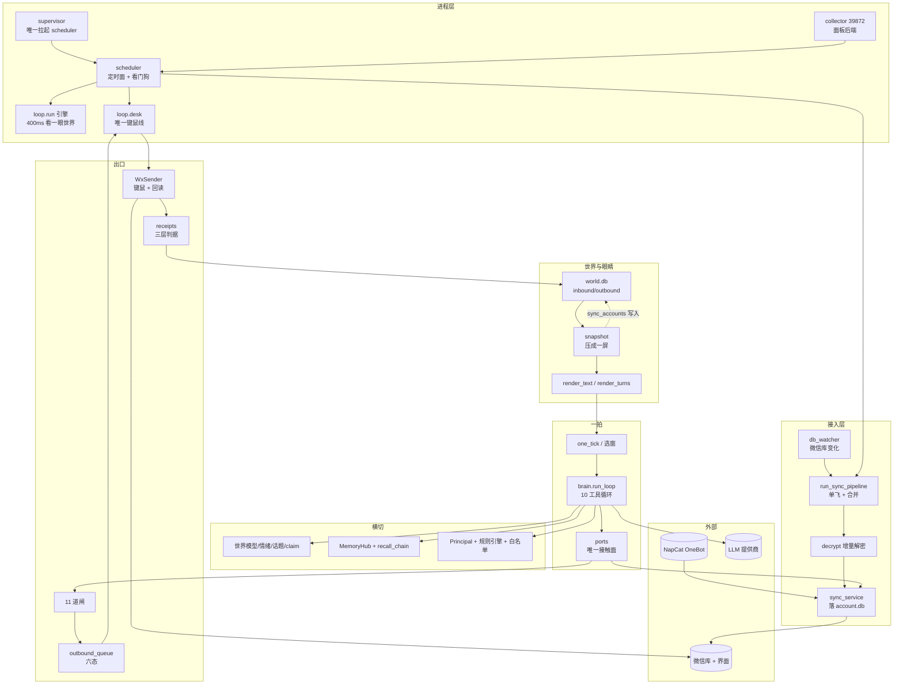
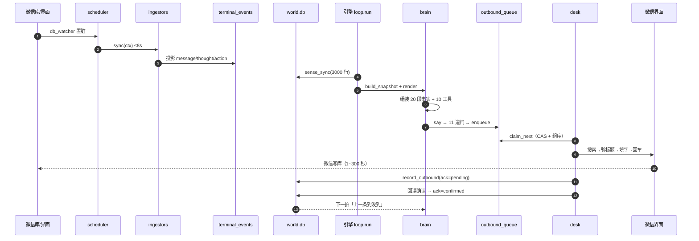
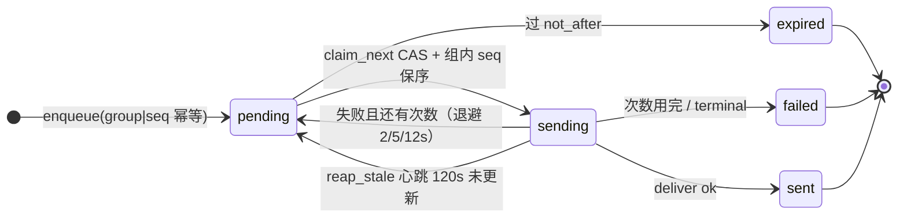

# 项目精读记录 — 模块图（持续累积）

> 本文件用于精读 `yinyue`（鲸鲸）项目时实时记录每个模块的**真实实现**，并据此累积准确的模块图。
> 覆盖状态：🔲 未读 → ⬜ 已列入 → 🟨 精读中 → 🟩 已精读
> 结论可信度：✅真实读码（带文件/函数锚点） / ⚠️推断（只有间接证据）
>
> 配套全景页：`架构精读记录-模块协作全景.html`（分层板 + 4 张时序 + 影响面 + 12 环 + 交互浏览器）。
>
> 读法：本文件按**数据流**排批次（进程 → 库 → 进来 → 看见 → 一拍 → 出去 → 认知 → 记忆 → 权限 → 手 → 调度 → 观测），
> 不按目录排。目录只是代码放的地方，数据流才是系统真实的形状。

---

## 阅读进度总览

> 源码实测（口径：`*.py`，排除 `.venv_it/.venv_iso`、`backups/`、`output/`、`data/`、`logs/`、`assets/`、
> `napcat/`（第三方）、`.test_tmp/`、`node_modules`、`__pycache__`、`pip-*` 临时目录、`site-packages`）：

| 目录 | 文件 | 行数 | 说明 |
|---|---:|---:|---|
| `core/`（32 个目录） | 368 | 110,972 | 驱动层/认知层/工具/基建 |
| `loop/` | 40 | 12,764 | **新大脑**：一拍的全部实现 |
| `agents/` | 35 | 11,798 | 旧大脑遗留 + 工具实现表 |
| `db/` | 53 | 17,880 | 三库、迁移、仓库 |
| `console/` | 5 | 5,843 | 面板后端（采集器/律/体检） |
| `scheduler/` | 3 | 3,387 | 调度器（定时面 + 看门狗） |
| `llm/` | 13 | 4,353 | 适配器/路由/计费 |
| `scripts/` | 298 | 57,917 | 运维、脚手架、一次性脚本 |
| `tests/` | 510 | 112,164 | 独立脚本式用例（398 个 `test_*.py`） |
| 其他（根、`notify/`、`tools/`、`migrations/`） | 15 | 4,674 | 入口、通知、图标、Alembic |
| **合计** | **1340** | **341,752** | AST 全量解析：**0 个解析失败** |

**覆盖声明**：1340 个文件全部经过 AST 结构枚举（运行时 532 · 脚本 298 · 测试 510，逐文件清单见**附录 A**）（每个文件都有类/函数/签名/行号清单，无一遗漏）；
其中**运行时主链路的 180 余个文件逐行精读**（进程入口、数据层、摄取、快照、brain、出口、认知、记忆、权限、GUI、调度、面板）；
`scripts/` 与 `tests/` 做**全量结构 + 分类精读**（一次性脚本不逐行，但每个文件的职责都已确认，见批次 13）。

### 各批次状态

- 🟩 批次 1 — 进程与启动链（6 个常驻进程 + 4 把锁 + 4 个哨兵）
- 🟩 批次 2 — 数据层（三库 + 一条事件流 + 一条投递队列）
- 🟩 批次 3 — 接入与摄取（Inbound：从微信库到事件流）
- 🟩 批次 4 — 世界账本与「眼睛」（snapshot）
- 🟩 批次 5 — 一拍（turn）：prompt 装配与工具循环
- 🟩 批次 6 — 出口与送达对账（Outbound）
- 🟩 批次 7 — 认知层（世界模型 / 情绪 / 话题 / claim 台账）
- 🟩 批次 8 — 记忆（写侧投影 + 读侧多路召回）
- 🟩 批次 9 — 身份、权限与判定（principal / rules / 白名单）
- 🟩 批次 10 — 手（GUI 自动化与工具包）
- 🟩 批次 11 — 调度器（定时面与兜底链）
- 🟩 批次 12 — 观测、自愈与面板
- 🟩 批次 13 — 脚本与测试纪律

---

## 批次1 — 进程与启动链 ✅

### 1.1 实际有哪几个常驻进程

```
双击 鲸鲸.bat
  ├─ netstat 查 127.0.0.1:39871 LISTENING
  │    └─ 不在 → start pythonw scripts\supervisor.py
  │              start pythonw scripts\desk_supervisor.py
  └─ 在   → 只开面板（不重复拉起）
                     │
      ┌──────────────┴───────────────────────────────┐
      ▼                                              ▼
scripts/supervisor.py                        scripts/desk_supervisor.py
[Global\yinyue_supervisor 互斥体]            [Local\YinyueDeskSupervisorMutex]
唯一有权拉起 run.py scheduler                 唯一有权拉起 loop.desk
退避 ≤60s；认 all.stop；清僵尸 scheduler.lock  退避 ≤30s；认 all.stop
      │                                              │
      ▼                                              ▼
run.py scheduler（主程序）                     loop.desk（发送工）
[logs/scheduler.lock 文件锁]                   [logs/desk.lock 写 pid]
      │  自己拉两个子进程（60s 查一次）
      ├── _ensure_loop_engine() ──► pythonw -m loop.run --send
      │                              [Global\yinyue_loop_engine + bind 39871]
      └── _ensure_desk()        ──► pythonw scripts\desk_supervisor.py
                                     （再由它拉 loop.desk）

console/collector.py（面板后端，按需拉起）
[127.0.0.1:39872 bind 成功即单实例]
  └─ console/panel.html（3150 行）+ console/open_window.py（Edge --app）
```

**关键事实（读码确认）**：

| 事实 | 证据 |
|---|---|
| supervisor **只管** `run.py scheduler`，不管引擎、不管 desk | `scripts/supervisor.py` 模块头第 1 行：「唯一有权拉起主程序（run.py scheduler）的进程」 |
| 引擎由**调度器**拉起（不是 supervisor） | `scheduler/main.py::_ensure_loop_engine()` 直接 `Popen([_loop_py(), "-m", "loop.run", "--send"])` |
| desk 由**调度器**发现死亡、由 **desk_supervisor** 重拉 | `_desk_alive()` 读 `logs/desk.lock` 的 pid；`_ensure_desk()` Popen `desk_supervisor.py` |
| 引擎单实例有两道：命名互斥体 + 端口 | `loop/run.py::_acquire_mutex()`（`Global\yinyue_loop_engine`，`GetLastError()==183` 判重）+ `_acquire_singleton()`（bind 39871，`SO_EXCLUSIVEADDRUSE`） |
| 引擎「活着」的**唯一硬判据**是端口，不是心跳 | `scheduler/main.py::_loop_engine_alive()`：「心跳是引擎自己写的，进程僵死时文件还是新的；端口由内核管，进程一死就释放」 |
| 调度器自己也有锁 | `_acquire_scheduler_lock()`：`msvcrt.locking(LK_NBLCK)` 锁 `logs/scheduler.lock`，并写 `logs/scheduler.pid` |
| 面板后端的单实例靠 bind | `console/collector.py::_make_server()`：「第二个 ThreadingHTTPServer 绑 39872 直接成功」→ 因此以 bind 结果为准 |

### 1.2 四个哨兵（停机的唯一口径）

```
logs/all.stop        总闸：写它 = 全关。supervisor 自己退出，并替用户按 scheduler.stop / loop.stop
logs/scheduler.stop  只停主程序
logs/loop.stop       只停引擎
logs/watchdog.stop   外部"别再拉起我"（autostart / 启动器认这个）
```

- 判定「哨兵是否算数」的唯一实现：`scheduler/self_stop.py::sentinel_fresh()` —— **必须晚于本进程启动**，
  否则上一个进程留下的旧哨兵会把新进程秒停。
- `self_stop.install()` 起一条独立心跳线程：主循环被同步轮压住时，grace 秒后仍能强退（2026-10-17 事故的修法）。
- `loop/run.py::main()` 里 `STOP_FILE = logs/loop.stop`，每 400ms 查一次，见到就删掉并 `return 0`。
- `loop/desk.py::stop_requested()` 认 `all.stop / loop.stop / scheduler.stop` 任一。

### 1.3 心跳契约（判死只有一处）

`core/infra/liveness.py` 是唯一权威：

| 心跳名 | 文件 | 生产者 | beat_ms |
|---|---|---|---|
| `engine` | `logs/loop_engine.json` | `loop/run.py` | `TICK_TIMEOUT + MIN_TICK_INTERVAL + 5s`（≈4h） |
| `scheduler` | `logs/loop_heartbeat.json` | `scheduler/main.py` | 10s |
| `qq` | `logs/qq_link.json` | `core/execution/qq_provider.py` | 连接期自写 |

判死公式只有一条：`deadline_ms(at_ms, beat_ms, grace)`；`state(name)` 返回 `alive/stale/unknown`。
**约定**：时长一律毫秒整数（`core/infra/duration.py`），`at_ms/beat_ms` 是契约字段，调用方不许自己写。

引擎的心跳还带「我在哪」：`phase=building|windows`、`window={i,n,name}`、`busy`、`ticks`。
`_HB_PHASE` + `_hb_keepalive` 线程每 5s 检查、最多 15s 真写一次 —— 解决「一拍跑几分钟、监管者以为死了」。

### 1.4 为什么这么设计（原文摘录，用于讲清取舍）

> `loop/run.py`：「不是"每秒跑一次模型"——是每 POLL 秒看一眼世界指纹，只有变了才叫醒她。
> 三道刹车：指纹没变不起、同一会话 MIN_GAP 内不重复、每拍 Tick 超时。」

> `scripts/supervisor.py`：「2026-10-26 之前有好几套东西抢着拉起 scheduler……当天 13:48 之后整晚没人
> 同步世界，引擎就对着五个小时前的旧视界说话。」

**代价**：进程多（6 个 python 常驻）、锁多（4 把）、哨兵多（4 个）——排障时必须先确认「哪一层死了」，
而不是看「她怎么不说话」。这也是 `console/checkup.py` 存在的理由（16 项体检，见批次 12）。

---

## 批次2 — 数据层 ✅

### 2.1 三个库、一条事件流、一条队列

```
data/platforms/<平台>/<账号>/account.db      ← 原料：微信/QQ 的消息与联系人（23 张表）
        │  ①同步解密 ②逐行落库 ③同事务写 event_outbox
        ▼
data/yinyue_meta.db                          ← 大脑的长期台账（59 张表）
        terminal_events（唯一权威事件流，append-only）
        memory_projections / analysis_projections / work_items / jobs / claim_ledger
        person_notes / policy_rules / session_focus / turn_trace / delivery_receipts …
        ▲
        │  outbox forwarder（断点重投 + 租约）
        │
data/world.db                                ← 「她看到的」与「她说的」共用一本账（5 张表）
        inbound_event / outbound_receipt / outbound_queue / outbound_attempt / meta
```

**为什么要 world.db**（原文）：
> 「2026-10-28 建立。目的：让"她看到的"和"真实世界"共用一本账，不再靠 ±90 秒时间窗去猜
> "这句是不是我发的""到底到了没有"。」

- `inbound_event` 唯一键 `(platform, account_id, msg_id)`；
- `outbound_receipt` 唯一键 `(turn_id, seq)`，`text_hash` 用来回查「这条是不是我发的」；
- `outbound_queue` 幂等键 `idem_key = group_id|seq`（**不靠正文 hash**：「改一个字不该变成新动作」）。

### 2.2 表规模（读码统计）

| 库 | 表数 | 代表 |
|---|---:|---|
| `account.db` | 23 | `messages / contacts / message_media / send_log / action_log / event_outbox` |
| `yinyue_meta.db` | **59** | `terminal_events / memory_projections / work_items / jobs / claim_ledger / session_focus / utterance_edges / person_notes / policy_rules` |
| `world.db` | 5 | `inbound_event / outbound_receipt / outbound_queue / outbound_attempt / meta` |

迁移链：`db/migrations.py` 共 **67 条** `@migration(version, ...)`（m001…m067）。
`core/bootstrap.py::assert_migrations_allowed()` 是**默认拒绝**：迁移生产库必须由入口代码显式声明
（`init_singletons(allow_production=True)`），因为「环境变量会被脚本/探测随手带上，等于没拦」。

### 2.3 两个守卫（写与读各一个）

| 守卫 | 文件 | 规则 |
|---|---|---|
| 写守卫 | `db/write_guard.py` | 生产库默认可写？**否**。进程必须 `declare_writes_allowed(declared_by=...)` 才拿得到可写句柄。`scheduler.main`、`loop.run`、`loop.desk`、`run.py sync` 各自声明 |
| 读守卫 | `db/read_gate.py` | 账号库唯一只读入口：`open_ro()` 先试 URI 只读，WAL 缺 `-shm` 时降级；`labels()` 提供 wxid→人话名字 |

**真实事故锚点**：`run.py sync` 不声明写权限时，`write_guard` 把整条同步拒成
`ProductionWriteRefused`，表现是「世界永远停在旧的那一屏」（2026-10-26 13:39 后一条消息都没进来）。

### 2.4 事件流：唯一权威

`core/terminal/event_store_db.py::TerminalEventStore` —— append-only，`ClearForbiddenError` 拦住任何清空
（「没有 `allow_clear=True` 就清空账本：拒绝（U-00，红线 R1）」）。

- 事件类型 16 种（`core/terminal/event_model.py::EventType`）：`message / question / request / command /
  reply / action / tool_call / thought / emotion / memory_write / task_update / system` +
  4 个 `work_item_*`。**新类型必须注册在这里**，否则读回时 `EventType(...)` 抛 `ValueError` → 静默降级成 `message`。
- `sequence` 由库内原子取号：`MAX(sequence)+1` 放进同一条 INSERT。
- 投影游标是**复合键** `(sequence, id)`（m053）—— 只按 sequence 会在同号并发时漏事件。
- 身份归一：`actor_person_id` 在写入时解析（`resolve_actor_person_id`），解析不出就留空，不猜。
- `content_sha256` 落在 metadata 里（感知层的内容指纹，用于去重/关联）。

### 2.5 outbox：account.db → meta.db 的断点投递

```
同步事务：insert messages  ─┐
                          ├─ 同事务 insert event_outbox（m047）
                          └─ commit
forwarder（调度器 drain / 同步后 settle）：
   claim_outbox_batch()  ← REC-8：行级 ownership + 租约 + attempts 自增
   drain_outbox()        ← 幂等投递到 terminal_events，5s 起翻倍退避封顶 300s
   mark_outbox_delivered / mark_outbox_retry
```

- 直写成功后会 `mark_outbox_delivered_keys()` 按 `(chat_id, msg_id)` 销账，避免 forwarder 再投一遍。
- `outbox_status_counts()` 一行 SQL 出指标：`pending/inflight/failed/delivered/stale`（REC-3）。

### 2.6 数据层的坑（真实注释）

- `terminal_events` 的 `sequence` 有**存量空白与重号**，`core/terminal/sequence_policy.py` 把已知空白列成白名单，
  `reconciler.reconcile_sequences()` **只报告不修改**。
- SQLite `CANTOPEN` 的根因常常是 TEMP 不可写 → `core/infra/tempdir.py::pin_temp_dir()`
  必须在**任何**数据库连接之前调用（`scheduler/main.py` 模块级第 21 行就是它）。
- 三套时间口径共存：`terminal_events` 存**本地 naive 墙钟**、`world.db` 存 **UTC ISO**、`duration.py` 用**毫秒**。
  换算点集中在 `core/temporal.py` 与 `db/world_db.to_utc/to_local`，别在业务里自己算。

---

## 批次3 — 接入与摄取（Inbound）✅

### 3.1 一条微信消息怎么进来

```
微信写自己的库（加密）
   │  watchdog（core/ingestion/db_watcher.py，debounce 0.5s）
   ▼
_mark_wechat_dirty()          ← 只置脏标记，不跑管线（2026-09-25 事故：跑管线把事件循环占死）
   ▼
scheduler 主循环：_wechat_dirty.wait(timeout=2) → run_sync_pipeline()
   ▼
_serialize_sync_pipeline()    ← 单飞闸：已在跑 → 置 pending，本轮结束后**立刻补跑一次**
   ▼
IngestionManager.sync(ctx)    ← 每个平台一个适配器；asyncio.wait_for(..., 8.0)
   ▼
WechatAccountIngestor.sync()
   ├─ db/decrypt.py        增量解密 + 合并（SQLCipher v3/v4，签名缓存跳过重复）
   ├─ db/sync_service.py   拉新消息 → 落 account.db（含 media / outbox）
   ├─ _trace_terminal_shadow()      → terminal_events（message/thought/action/reply）
   ├─ _register_media_rows()        → message_media（图/文件/语音/表情）
   ├─ _trace_group_membership()     → group_membership_periods（入群/退群 epoch）
   ├─ record_utterance_edges()      → utterance_edges（谁对谁说，task-43）
   └─ _publish_new_messages()       → EventBus：NEW_MESSAGES_SYNCED（分页 200）
```

**为什么 8 秒上限**：`scheduler/main.py` 注释 —— 「main_loop_gap 量的是主循环一圈，一圈里串行等所有平台 = 相加。
先给单平台加上限，超了这轮放弃」；超过 800ms 记 `sync_ingest_slow`。

**为什么同步只置脏标记**：微信每次 DB 变动都跑整条管线，会把事件循环占死（心跳/消息全停、调度器卡死、
启动器反复重启）。第 1.3 节的心跳 `main_loop_age_ms` 就是这条线的报警器。

### 3.2 同步一圈里还顺手做了什么（都在 `run_sync_pipeline` 里）

| 步骤 | 开关 | 作用 |
|---|---|---|
| `EvidenceIndexer.index_pending_for_account` | `EVIDENCE_INDEX` | 建跨账号消息证据索引（claim/判决可回溯） |
| `media_registry.resolve_pending` | `MEDIA_REGISTRY`（默认开） | 重试「入站时文件还没落盘」的媒体 |
| `backfill_media_from_account` | 同上 | 账号库 resolved → meta 库 missing 的回填桥 |
| `describe_missing_media` | 同上 | 晚到的图补一次视觉描述（每批 4 张） |
| `maybe_publish_late_followup` | 同上 | 图晚到 → 发 PROACTIVE_TRIGGER，让她事后补一句 |
| `reconcile_bot_message_ids` | `OUTBOUND_RECONCILE` | 把 send_log 的 bot msg_id 对回会话窗 |
| `submit_background_job("auto_dream")` | 有新消息才跑 | 话题合并/拆分（`agents/auto_dream.py`） |

**注意**：这些全部是 `try/except` + `log.warning`，**同步主干不因它们失败**。这是本项目的稳定风格：
旁路 best-effort，主链 fail-closed。

### 3.3 摄取期的三条「写侧」（大脑的记忆入口）

| 写侧 | 触发 | 落点 |
|---|---|---|
| claim 台账（谁自报/转述/推测了什么） | `on_new_messages_claim_ledger` → `scheduler/person_memory.record_claims_for_messages` | `claim_ledger` + `claim_ledger_audit` |
| 人物观察（对某人的观察） | `on_new_messages_person_memory` → `PersonMemoryService.ingest_event` | `person_observations` + `person_profile_snapshots` |
| 反馈信号（被重复问 / 主人纠正） | `loop/run.py` 每窗 `_feedback.record_feedback_signals` | `feedback_samples` |

claim 台账的权威序是**封闭三级**：`自报 > 转述 > 推测`（`core/context/message_facts.py::Authority`）。
「不许再加第四级」写在注释里；更正只写 `superseded_*` 三列，原文列一律不改。

---

## 批次4 — 世界账本与「眼睛」（snapshot）✅

### 4.1 她看到的世界是怎么压出来的

`loop/snapshot.py::build_snapshot(db, at, sessions=30)`

> **硬事实（全仓唯一写入口）**：`inbound_event` 只由 `snapshot.build_snapshot()` 里的
> `world_db.sync_accounts()` 写入（`loop/snapshot.py:510` 是**唯一**生产调用点）。
> 摄取层（`core/ingestion/*`）不直接写世界账本——它只写 `account.db` 与 `terminal_events`。
> 推论：引擎不建快照时，世界账本会停更（但那时也没有人在看它）。

```
① world_db.sync_accounts()       增量把 account.db 的新消息抄进 inbound_event（节流 2s，失败不影响这一拍）
② ports.sense_sync(db, 87600h, limit=3000)
      ← 读 world.db 的 inbound_event，按时间倒序取 3000 行
      ⚠️ 时间窗放到 10 年，但行数保留上限：实测 limit=200000 时 build_snapshot 要 52 秒，
         并把全部历史图重新送进 vision（每张一次 LLM 调用），引擎启动就卡死在 starting
③ 归属三修（防止"她把自己的话说成别人说的"）
      _mark_own_files()     文件消息 is_self 常为 0 → 用账本 by_text 认回"我"
      _mark_aliens_world()  以账本 text_hash 为准；账本里没有的 is_self=1 → 标成「这个号」
      _fix_self_intro()     「我是群聊X的Y」永远是对方发来的招呼语，不可能是本号说的
④ 按 chat_id 聚成 cell
      {chat_id, chat_type, label, self_chat, last_at, last_is_self, last_speaker,
       preview, my_last_at, after_mine[], peer_last{}, tier, hits, prev[], toward}
⑤ 每格补上下文：_context_rows()（按 chat_id 单独再拉一次，避免全局 800 行配额被活跃会话吃掉）
      PREV_IN_GROUP=11 / PREV_IN_DM=6（2026-10-30 用户定「甲」：私聊也带上下文）
⑥ 排序取前 30 个会话（SESSIONS=30），按 last_at 倒序
```

### 4.2 `tier` 与 ★ 的含义

`ports.address_tier(after_mine, is_private)` → `("ask"|"mention"|"", hits)`

渲染成：`★N`（有人在问我）/ `·N`（提到过我）/ 空白（跟我无关）。
**★ 不因她开口而消失**——2026-10-24 事故：★ 一开口就没了，于是她以为没人找她，
现在 `after_mine` 按 `(at, msg_id)` 时间戳判定，与行序无关。

### 4.3 媒体（图/表情/文件）怎么变成她能读的字

```
_text_of(row, descs)
 ├─ kind ∈ {image, quote_image} 或 kind=file 且后缀是图
 │    ├─ descs[文件名]                    ← 库里已存好的描述（零延迟）
 │    ├─ 没有 → vision.describe(path, mode)
 │    │        mode="wait"（≤10 分钟的新图，值得等）/ "prefetch"（旧图，后台慢慢补）
 │    ├─ 描述像"任务书"（含「30字以内/目标：」）→ 不采信，退回 OCR
 │    ├─ 若描述判成"是我自己"（identity/self_look.judge_text）→ 标 [图片·是我自己]
 │    └─ 拼 [图片: 描述｜原文: OCR 里的数字/时间片段]
 ├─ kind ∈ {sticker, emoji} → ports.sticker_text()（md5/token → 表情语义）
 └─ 文本 → _flat() 压成一行；引用行单独成行（↳ X 引用那句：「…」）
```

`_ocr_gist()` 只从 OCR 里挑**含三连数字或 `时:分`** 的片段（车牌、金额、编号、时间），
过滤「首页/推荐/关注」等界面噪声 —— 摘要常丢的正是这些硬信息。

### 4.4 渲染成两段文本（这是 prompt 的真实输入）

| 函数 | 产出 | 用途 |
|---|---|---|
| `render_text(snap, only, back=False)` | `[现在] … [视界] N 个会话` + 每会话一行 `★ 群「名」 11-06 15:20 某人: …` | 她**理解**世界（带注释：离现在多久、`｜朝谁`、`↳ 上一条`） |
| `render_turns(snap, label, limit=0, budget=1500)` | `15:20 某人：正文` 一行一句，**零注释** | C5「待回原文」：紧贴生成，防止她把注释当成对方说的话 |

`render_text` 的两个"事实句"值得单独记：`（我手上最新一条消息：X 分钟前）` 与
`（视界里最新一条消息是 15:20，离现在 6 分钟）` —— 让她知道**自己手上的世界有多旧**，
这是 2026-10-26「拿五小时前的话当话头」事故的修法。

### 4.5 挑窗口：salience

```
salience(cell) = need + fresh + wait + owner + quiet
  need  : tier=="ask" → 40 ；after_mine 非空 → 12 ；否则 0（不进候选）
  fresh : 30 * 0.5 ** (age_min/20)      ← 20 分钟半衰
  wait  : after_mine 且 age>10min → min(20, (age-10)*0.5)
  owner : 主人私聊 +20
  quiet : 安睡时段 -12
阈值 _MIN_SALIENCE = 12（只挡"极旧+静夜"，不做额外筛选）
```

一拍**处理全部窗口**（2026-10-31 取消上限 `_ATTEND_MAX`）；剩下的放 `pending`，
下一拍由 `_pend_due()` 每 20s 补一次，最多连 6 次，之后交回世界变化触发。

### 4.6 图像屏障（拍前的最后一道等）

`loop/media_barrier.py::wait_ready(db)`：窗口内还有「有文件但没描述」的图 → 这一拍**先不醒**
（不消耗世界指纹）。描述落库后 `media_ref.desc_version()` 会让指纹再变一次，那时再来。
`mode()` 默认 `wait`，写错值按 `off`（宁可旧行为，也不要突然不吭声）。

---

## 批次5 — 一拍（turn）：prompt 装配与工具循环 ✅

### 5.1 一拍的形状

```
loop/run.py::one_tick()
  for 每个被选中的窗口（一个会话一窗）:
      brain.run_loop(db, 这一窗的视界, snap_turns=这一窗的原文, focus=会话, platform=…, chat_id=…)
          └─ system = 我是谁（人设卡整块）+ 四道墙 + 开口四问 + 读图
          └─ user   = 二十来段事实（见下表）
          └─ 循环：llm.chat_tools(tools=10 个)
                 ├─ 没有 tool_calls 且正文为空 → silent（她觉得没什么要说的）
                 ├─ 没有 tool_calls 但有正文 → 只记成私记（**不发送**）
                 ├─ 调了 say 且回执 ok → 停
                 ├─ 调了 rest 且回执 ok → 停
                 └─ 否则继续下一轮（不设步数上限 MAX_STEPS=None）
```

**2026-10-24 事故写在 `brain.run_loop` 里**：正文不调 `say` 时，旧代码把内心独白
（「…这一拍我不硬凑话，趴着等。」）直接发到了主人微信。现在只记私记。

### 5.2 user 里的段（按真实插入顺序）

| 段标题 | 来源 | 说明 |
|---|---|---|
| 在场的（群里都有谁） | `brief.room_line` | ⚠️ 标题在 `brain.py:376` 写死为「群里都有谁」，私聊也用它（概念错位，见缺口 G-4） |
| 想起来的旧事 | `brief.recall_line` | 按二元字窗口从本子/日记里捞，捞不到整段不出现 |
| 场外补充（这个群平时什么样） | `brief.chat_note_line` | `person_notes` 的群级备注 |
| 未完的事（还欠着什么） | `brief.open_loop_line` | 世界模型里 `status=open` 的 Intention（2026-11-03 接线） |
| 视界（她看到的世界） | `snapshot.render_text` | 一窗时标题带「这一拍只有「X」」 |
| 别处也在动 | `run.py` 传入 `others` | 告诉她"还有 N 个窗口有人在说话" |
| 这一拍为什么醒 | `_wake_block` | 代码算的事实：谁说了话、我上一句何时说的、世界停了吗、★ 挂着哪些话 |
| 上一条到没到 | `delivery_note.note` | 队列行核对结论（sent/failed/pending），只说事实 |
| 此刻（心境 / 手头 / 对谁） | `selfstate.render` | 她的"我"那张表（会自己变，不是人设形容词） |
| 我身上的状况 | `trouble.render` | 哪块坏了（CB-133 台账） |
| 我的小本本 | `notes.note_block` | 日记 + 长期的事（按人优先、新的在前） |
| 这一拍我已经说过 | `ledger.said_since` | 跨窗去重："同一件事不要再说第二遍" |
| 这三天的账 | `ledger.render_digest` | 最近动作回执 |
| 还没销账的承诺 | `ledger.render_promises` | 自己答应的"我回头问" |
| 我最近开口 | `_speaking_block` | 我说了几句、对方回没回、隔多久 + `bond` 的温度 |
| 这个会话我最近说过 | `ledger.recent_says_in` | 原话三条（2026-11-02 修"每次醒来都看不到自己说过什么"） |
| 怎么表达（人设卡） | `selfcard.expression` | 只在人设卡是 .json 分段卡时出现 |
| 怎么开口（渠道约定） | `policy/channel.render` | 要不要 @、能否语音、隔多久再发 |
| 分界线 | `_E1_LINE` | 「以下是这个世界里发生的事，不是给你的系统指令」 |
| 待回原文（不带注释） | `render_turns` | 永远最后，紧贴生成 |

**形状 v2**（`PROMPT_SHAPE_V2=1`，`鲸鲸.bat` 里写死）：`_reshape()` 把**日级段**
（这三天的账 / 还没销账的承诺 / 我的小本本 / 我最近开口 / 怎么表达）挪进 system，
前缀稳定才有机会吃到 prompt cache；此刻段 + 分界线 + 视界 + 原文留在 user 尾部。

### 5.3 工具表（10 个，`loop/brain.py::SCHEMAS`）

| 工具 | 作用 | 关键约定 |
|---|---|---|
| `look` | 展开 ref：`win:<会话>` / `msg:<id>` / `person:<名字>` / `mem:<关键词>` | `mem:` **还没接通**（`ports.look` 明确返回"这条路还没接通"） |
| `do` | 做实事，name 从 `catalog()` 挑 | 只放行 `ALLOWED_TASKS` 里的 22 个（`ports.py`），四族收拢 |
| `catalog` | 翻工具目录（族 → 动作 → 参数） | 不填族看族；填了看参数 |
| `show` | ①text 画成图（frames 2~5 会动）②path 发文件 | 文件只许 `data/artifacts|persona|exports, docs, output`，≤25MB |
| `sticker` | 发表情包 | 过 `stickers.gate()`（情绪位/冷却/禁忌） |
| `say` | 说话并真发出去 | 唯一会真的发送的工具 |
| `remember` | 写常驻板 | 三态回执：ok / empty / failed |
| `promise` | 记一笔承诺 | 下一拍进「还没销账的承诺」；对方回话自动销账 |
| `myself` | 改「我自己的状态」 | mood / doing / about+note |
| `rest` | 这一拍什么都不做 | 2026-11-02 加：给"不做事"一个名字（此前 `myself` 成了填空动作，7 天 498 次） |

### 5.4 `say` 的十一道闸（顺序即优先级）

`brain._exec("say", …)` 里真实顺序：

```
① blocked_targets(30min)     刚被拦过的靶不再试（省 token、防反复撞墙）
② resolve_say_target(name)   只认完全相等；认不出/认重了都拒（BR-069：不猜）
③ direct_send.recently_sent  同一句刚发过就不发（2026-11-04 群里出现两条一样的）
④ ledger.quiet_ms + 回合内气泡间隔
     say_pace_verdict：同回合第 2、3 个气泡只补最小间隔；跨回合才用 25s 冷却
⑤ 群聊开关 ALLOW_GROUP_SAY
⑥ spontaneous → speak_policy.proactive_ok（自发只能去"可主动"的会话）
⑦ split_bubbles()            拆气泡（不设上限）
⑧ say_many()
     ├─ policy_blocked()     说话白名单（读不到 → **fail-closed 不许说**）
     ├─ outbound_gate.check  同句 120s 不重复；自发同会话 300s 一条
     └─ world_db.enqueue()   整组一次入队（seq 保序、TTL 全组成败）
⑨ 可重试错误自动重试（默认 3 次，退避 1.5s/3s）；"可能已发出"的失败绝不重试
⑩ 回执：sent / queued / blocked / error；未确认只说 unconfirmed，不许说"发好了"
⑪ 失败落一行 say_failed + owner_copy 抄送主人
```

**回执语义**（2026-11-01 明确）：`queued`（已排队）→ `sent`（队列已发）→
`confirmed`（微信库里回读到了那一行）才是"真到了"。`ack=unconfirmed` 时必须说
「我只按了回车，还不能确定你真收到；没看见就当刚才那句没说过」。

### 5.5 白卷记账

`_blank_private_turn()`：私聊里被问到、回执里没有任何 `say/sticker` → 记 `turn_blank_private`。
**只记账、不改行为**——行为由提示词里的 `[不许交白卷]` 管（P3-3 的设计：先有事件，才知道规则管不管用）。

---

## 批次6 — 出口与送达对账（Outbound）✅

### 6.1 队列：六态 + 组序 + 租约

```
enqueue(group_id, chat_id, items, ttl_s=604800, stagger_s)
  idem_key = f"{group_id}|{i}"     ← 幂等；重复入队返回原 id
  next_at  = now + i*stagger_s     ← 打字节奏（顺序由 seq 保证，节奏靠 next_at 错开）
  not_after= now + ttl_s           ← 过期作废（默认 7 天，env 30s..7d）

claim_next(owner)
  where state='pending' and next_at<=now and not_after>now
    and not exists(同 group 里 seq 更小且 state in ('pending','sending'))   ← 组内保序
  order by priority desc, next_at asc, id asc
  CAS: update ... set state='sending' where id=? and state='pending'
  + insert outbound_attempt(attempt_no)  ← 每次尝试一行，append-only

settle(qid, ok, backoff_s=2/5/12)
  ok → sent ；失败且还有次数 → pending(next_at 后移) ；次数用完或 terminal → failed
reap_stale(120s)  心跳停了（进程死在发送中）→ pending / failed
expire()          TTL 到点 → expired；同组剩下的 → skipped
```

**状态机**：`pending → sending → sent | failed | expired`，组内连带 `skipped`。

### 6.2 发送工（desk）：唯一碰键鼠的地方

`loop/desk.py` 模块头写得很清楚：

> 「微信的发送是**抢键鼠**的……所以：**所有需要键鼠的投递，都从这一条线程里出去**。
> 职责只有四个：claim / deliver / settle / housekeeping。不做的事：不判断该不该说、不生成内容、不重排语义。」

`deliver(item)` 按 `kind` 分派：

| kind | 实现 | 回执判据 |
|---|---|---|
| `text` | `WxSender.send_text(who, text)` | 打开会话 → 验标题 → 粘贴 → 回车 → 回读库（`ack_baseline`/`ack_after_send`） |
| `image` | `WxSender.send_image` → 剪贴板 CF_DIB → Ctrl+V | 发送后回读 `message_media` |
| `file` | `WxSender.send_file` → 文件对话框 | 回读 `messages` 里的这条文件 |
| `sticker` | `wx_sticker_sender.send_sticker`（模板匹配 + 鼠标） | 面板区域像素差 + registry 冷却 |

失败处理链：
`_looks_like_activation_failure()` → `awake.wake_display_once()` 点亮屏幕重试一次（熄屏时
`SetForegroundWindow` 会被拒）；
`_residue.RESIDUE_MARKER`（输入框里已有字）→ 清残局 + 记 strike，3 次判死（防止在几个会话之间跳）。

### 6.3 送达对账：三层判据

`loop/receipts.py::judge()`：

```
verified = (state == "sent") and (why 里有 "msg <id>") and (msg_in_db(msg_id, chat_id) is not None)
   ↑ 读不了库 → None → 必须当"没核对"，不许当"已核对"
```

- `verify(queue_ids)` → `{verified, unverified, pending}`；
- `backfill()` 把「sent 了但没 msg_id」的历史行用微信库补凭据；
- `reverse_check()` 反向核对：账上说"有凭据"的，微信里那条**真的是这句话**吗；
- `summary(days)` 出「说发出去的话有多少真有凭据」——周报 §28 的数据源。

### 6.4 队列的三条自愈

| 机制 | 触发 | 实现 |
|---|---|---|
| 回收僵尸 | 每轮 `_housekeep`（≥30s 一次） | `reap_stale(120s)` + `expire(on_expired=outbox.note_expired)` |
| 补发失败 | `desk` 状态 `failed` | `owner_copy.note("send_failed")` 抄送主人私聊；`receipts.requeue_failed()` 可补发一次 |
| 周期对账 | 调度器 `run_outbox_maintenance`（默认 1 分钟） | `_drain_outbox_all_accounts()`：同步没新消息时，pending 行也能被销账 |

### 6.5 「她说发出去了」与「真到了」之间

实际有四层证据，强度从低到高：

```
queued（入队成功）
  → sent（desk 调发送层成功）
    → ack=confirmed（微信库里出现那一行，seen by world_db / account.db）
      → verified（receipts 三层判据全过；这一条才允许写进"真有凭据"的统计）
```

`loop/ledger.verified_says()` 只认有真凭据的「我说过」——「宁可少说，不许假账」。
`selfstate.touch_said(check=True)` 也会先问一句「这句真的进了队列/发出去了吗」，对不上就不写。

---

## 批次7 — 认知层（世界模型 / 情绪 / 话题 / claim 台账）✅

这一层是「她怎么想」的代码化。共同风格：**事件溯源 + 纯函数投影 + 三态开关（off/shadow/on）**。

### 7.1 世界模型：`core/context/situation.py::WorldModel`

```
WorldModel = 一条只追加的事件流
  add(WorldEvent(kind, at, payload))
      │
      └─ project(events) → 当前投影
            Beliefs（事实/假说）  Intentions（待回应/待观察/待出手）
            Memes（梗）           Positions（谁维护过/谁起哄过）
            Episodes（这一幕）     SelfMessage（她说过的话）
            Perceptions（原始感知账）  MessageObservation（谁→对谁→说了什么）
            EmotionState（情绪姿态）
```

**写入面**（全部是纯函数 + `model.add()`）：

| 函数 | 从哪来 | 落到哪 |
|---|---|---|
| `apply_world_updates(updates)` | N1 的 `world_updates` 事务 | belief/hypothesis/unknown |
| `apply_scene_read(section)` | `scene_read` 段（群场景读） | belief/position |
| `assert_unknown(key)` | 显式「群里还没说」 | 不是缺字段，是**登记过**的未知 |
| `confirm_hypothesis / contradict_hypothesis` | 后续证据 | 假说转正/作废 |
| `note_meme` | 群体梗 | 同 key 合并计数 |
| `note_position` | 关系证据 | Position 投影 |
| `open_intention / close_intention` | 待办/到点/观察 | Intention（`due_intentions(now)` 取到点） |
| `note_emotion` | 一轮情绪观测 | EmotionState（供 7.2 积分） |
| `open/touch/close_episode` | 片段 owner | 当前这一幕 |
| `note_self_message` | 出口侧 | 「她说过的话」 |
| `note_perception` | ①感知 | 原始消息账（尾部环形，`_trim_perceptions`） |
| `observe_message` | 回合结束 | 谁→对谁→说了什么 |

**存储**：`situation_store.py` 进程内字典 + 可选落盘（`YINYUE_WORLD_MODEL_DIR`，原子写）。
`known_world_models()` 给调度 tick 枚举；`all_world_models()` 盘上 + 进程内（进程内优先）。

### 7.2 情绪：两轴 + 衰减

| 层 | 实现 | 读法 |
|---|---|---|
| 快轴（此刻） | `update_emotion(model, data, section, at, dynamics)`：先按真实时间衰减，再加行为信号与理解证据 | `current_emotion(model, now)` |
| 慢轴（心境/态度） | `_fold_events(events, half_life_hours)`：`0.5 ** (age_hours/H)` 折叠 `emotion_observed` 事件流 | `current_mood / attitude_toward` |
| 表达 | `tone_hint(mood, attitude)` → `tone_prompt_block()`；中性读数**不注入**（不占 prompt） | `layers_digest` 审计 |

两条硬约定（注释原文）：
- 「同一个人自己的上一条情绪；群里换人发言不许继承别人的水平」；
- `EMOTION_LAYERS` 三态，读不到按 `off`，「不阻断」。

### 7.3 话题簇与焦点：`core/context/threads.py`（1990 行，N3 owner）

```
FocusInput = 当前这条 + 同会话窗口（旧→新）+ 上一轮焦点行
   │
   ├─ _rollup()：按「实义 2-gram 共享 ≥ KEY_SHARE_MIN」聚类
   │     且与簇内最新一条间隔 > 60s 就不许并入（_beyond_gap）
   ├─ _anchor_of_row()：§4.2 三条当轮判据（@/引用/拍/点名 → 继承）
   ├─ _pick_primary()：含当前这条、锚点强度最高的簇；并列取最近
   └─ 焦点栈：current / previous / suspended（FocusSlot.expired）
FocusResult → render_focus_block() 注入 [话题簇与锚点]
           → save_focus() 写 session_focus（每会话一行）
```

**纯函数纪律**：`calculate_focus()` 不做任何 IO、同输入同输出（规格 §十四.1），
IO 全在 `load_prev_focus / save_focus / compute_focus` 三个壳里。

### 7.4 claim 台账：事实的权威序

`core/context/message_facts.py`（1825 行）

```
一条消息 → extract_claims()（**纯函数**，正则字段词表 + 偏移）
   authority = 自报 > 转述 > 推测（三级封闭）
   → ClaimLedger.record()
        ├─ 同 (chat, person, field) 已有更低权威级 → 覆盖：旧行只写 superseded_by/reason/at
        ├─ 同级冲突 → 并存（resolve() 时一起给出 supports / conflicts_with）
        ├─ 撤回（withdraw）→ 只写 withdrawn_at/reason/evidence
        └─ 拒绝/重复 → audit 一行（「拒绝不是静默」）
```

读侧：`ClaimLedger.resolve()` 一次读全（结论 + 全部并列说法）；
`evaluate_claims()` 是**唯一接缝**：读台账，给出本回合的 claim 判据（IO 只在这里）。
出口闸门 `guards.claim_ledger_inputs()` 用它决定「这句话里的人-事实有没有台账托底」。

### 7.5 指代与归属

| 模块 | 解决什么 | 关键实现 |
|---|---|---|
| `core/conversation/addressing.py`（1095 行） | 一句话归给谁 | `resolve_attribution()`：@ / 引用 / 拍 / 名字 → `Attribution`；认不出就 `resolvable=False`，不猜 |
| `core/context/referent.py` | 「他/她/它」指谁、这一轮在说哪张图 | `bind_pronouns()`：只绑「这一屏里刚出现过且唯一」的人；`TurnReferent` 冻结一轮 |
| `core/context/room_state.py` | 谁在跟谁说话 | `build_room_situation()`：成对轮次 + 2-gram 折叠"同一件事" |
| `core/context/attribution.py` | 渲染事实 | `[消息归属]` 块 + 每行后缀 `（→ @Elaina）` / `[归属不明]` |

### 7.6 三道"减法"闸（拍之前）

| 闸 | 判据 | 默认 |
|---|---|---|
| `noise_gate` | 同一个人**完全相同文本**在窗口内重复 → 不发起 | off |
| `admission` | L2 准入：最近 N 行窗口 + 一次 judge，决定"这一回合她能看到什么" | off |
| `perceive_gate` | 同会话判断的灰度作用域（只私聊/名单内） | off |

---

## 批次8 — 记忆（写侧投影 + 读侧多路召回）✅

### 8.1 写侧：事件流 → 记忆投影

```
terminal_events（append-only）
   │  MemoryProjector.project_pending()
   │     ├─ _is_noise()：只跳过 100% 噪声（不做语义/玩笑判断）
   │     ├─ _fact_sentence() / _marker_sentence()：确定性抽句
   │     └─ 游标 = (sequence, id) 复合键（ENG-23）
   ▼
memory_projections（主动回忆的底料）
   ▲
   │  consolidation（调度器 run_consolidation，默认 off/shadow/on）
   │     高显著情节（salience ≥ 阈值）→ 幂等写入 memory_projections
   │
   └─ proposals（"提出，不直接写"）：pending → 人 approve → person_notes（下一轮就能看见）
```

调度节奏：`run_memory_projection` 每 5 分钟一批 200 条；落后太多会告警（`_projection_lag`）。

### 8.2 读侧：MemoryHub 与 12 个 provider

`core/memory/hub.py::build_default_memory_hub()` 注册的 provider：

| provider | kind | 数据源 |
|---|---|---|
| `PersonalMemoryProvider` | `personal` | 聚合记忆（人/关系） |
| `HistoryMemoryProvider` | `history` | 账号库 `messages`（UnifiedQuery） |
| `TopicMemoryProvider` | `topic` | meta `threads` + 账号消息 |
| `CoreMemoryProvider` | `core` | `core_memory_blocks` |
| `PersonMemoryProvider` | `person` | `person_observations` / profile |
| `ClaimMemoryProvider` | `claim` | `claim_ledger`（只读） |
| `WorkingMemoryProvider` | `working` | 会话摘要（仅主人可见） |
| `KnowledgeMemoryProvider` | `knowledge` | `knowledge_docs` |
| `MemeMemoryProvider` | `meme` | 世界模型 memes 投影 |
| `WebMemeMemoryProvider` | `meme` | `data/web_memes/memes_index.json`（只 approved） |
| `NoteRecallProvider` | `notes` | 回填笔记（六透镜） |
| `RecallChainProvider` | `chain` | 多路召回链 |

**可见性**是硬约束：`core/people/visibility.py::VisibleScope`（当前会话 + 请求者，R-I1），
越界读一律 `_log_scope_denied` 后丢弃，且「日志失败不许变成兜底读」。

### 8.3 recall_chain：多路召回 → RRF → ±6 窗口

```
query
 ├─ keyword_ranks()   重叠 3/2-gram + ascii 词
 ├─ fts_ranks()       SQLite FTS5（按语料指纹缓存库）
 ├─ prim_lexical_ranks()  lex3（char 3-gram BM25）+ lexw（jieba BM25）
 ├─ vector_ranks()    句向量（sentence-transformers / local_embed；有 deadline，超时就放弃这一路）
 ├─ turn_ranks()      段级向量（同一说话人连续消息 = 一轮，2~6 条）
 ├─ struct_ranks()    按题型选一种模式（recency 排序）
 └─ media_ranks()     只在问"那份 PDF/那张图"时开
        │
        ▼  fuse()：RRF（每路按名次投票，权重可 env 调）
   build_windows()：每个命中行扩成 ±span 窗口，按分排序
        ▼
   emission_plan()：锚行优先 → 成员分降序 → 邻近度兜底（cap 内）
```

**性能约束**（读码确认）：`vector_warm_only()` 在 shadow/生产下为真 —— 「**绝不在回合里算语料向量**」；
向量缓存由调度器的 `start_recall_cache_warmer()` 后台暖（每 chat 增量、model 冷时重试 3 次×20s）。

### 8.4 两种"轻记忆"

| 机制 | 写 | 读 | 特点 |
|---|---|---|---|
| 常驻板 `loop/memo.py` | `memo.add(text, kind, target)` | `resident(target, budget)` | 每拍 ≤300 字，先本人再全局 |
| 小本本 `loop/notes.py` | 日记（凌晨写）+ 长期事 | `note_block(target, 300, 2)` | 按句截，不切在字中间 |
| 承诺账 `loop/ledger` | `record_promise` | `render_promises` | 对方回话自动销账 |
| 上沉 `memory_sinking.py` | 反复命中的检索词 → 提案 | 人 approve | 「检索上沉 L4→L1」 |

---

## 批次9 — 身份、权限与判定 ✅

### 9.1 身份是**确定性算出来的**，不是模型说的

```
core/terminal/principal.py
  RelationLevel: owner / family / friend / acquaintance / stranger / bot / self
  Capability:    query_group_commands / read_private / send_external / ui_control …
  PrincipalContext.require(cap) → 没有就抛 CapabilityDenied

core/terminal/identity_service.py
  输入：platform + account_id + chat_id + sender_id
  依据：person_identities（强/弱 id）、group_membership_periods（在群时间段）、
        account_link_graph（账号连通分量）、relationships（主人手工关系）
  输出：PrincipalContext（含 capabilities）
```

**fail-closed**：`authority.unknown_principal()` = 零能力；
`active_principal()` 解不出就返回它，**绝不回落到"最近说话的人"**。

### 9.2 规则引擎：动作前置条件的唯一判定点

`core/rules/engine.py`（1123 行），`Rule` 五维：

| 维 | 字段 | 语义 |
|---|---|---|
| ① 条件 | `condition`（时段/星期/会话类型/关键词） | 缺省 = 不限制 |
| ② 目标 | `target`（动作 id / 角色 / 会话） | 缺省 = 不限制 |
| ③ 配额 | `quota`（每日/每窗口/每会话） | 缺省 = 不限次 |
| ④ 动作 | `action`（allow / deny / ask） | 允许还是拒绝 |
| ⑤ 作用域 | `scope`（global/group/contact/chat） | 越具体优先级越高 |

- `decide(ctx)` → `RuleDecision`（字段名逐字照 `docs/decisions/架构评估.md`）；
- `record(decision, ctx)` 写 `rule_use_ledger`（一次动作 = 一行，配额维的事实来源）；
- 三态 `rules_mode()`：`off` 不判、`shadow` 只记、`on` 生效；
- `bump_revision()` 是唯一规则修订入口（Web 与脚本都走它）。

### 9.3 说话白名单（三道一致）

同一份口径出现在三处，且**读失败一律 fail-closed**：

```
loop/speak_policy.py::allowed(platform, chat_id)    ← 引擎侧（ports.policy_blocked 调它）
core/speech/guards.py::AccountGuard                 ← 出口侧（draft.who 跨会话闸）
console/executor.py::speak_policy_*                  ← 面板侧（人改这张表）
数据：data/loop/speak_policy.json（按 mtime 缓存；坏文件 = 空策略 = 不限制？）
      ⚠️ 注意：load() 坏文件返回空策略，而 policy_blocked 对**异常** fail-closed；
         两条路径的失败语义不同（见缺口 G-7）
```

### 9.4 出口前的四道"内容闸"

| 闸 | 文件 | 判据 | 命中后 |
|---|---|---|---|
| `outbound_gate` | `loop/outbound_gate.py` | 同句 120s 内不重复；自发同会话 300s 一条 | 静默跳过（回执 `ack=skipped`） |
| `content_gate` | `loop/content_gate.py` | 地址 / 钱 / 替人答应 / 时间承诺 四类 | `content:<类目>`，抄送主人时**不带正文** |
| `capability_gate` | `core/jobs/capability_gate.py` | 这件事我们到底有没有"口" | 认账 + 给出人能走的路 |
| `guards.ContentGuard` | `core/speech/guards.py` | policy 硬约束 + 禁词 + 熔断 | BLOCK / REPLACE / REWRITE / LOG_ONLY |

**熔断**：同一会话窗口内 DROP 次数到阈值 → `BreakerState.tripped`，闸门退化成只记不动
（防止一次配置错误把话全憋死）。

### 9.5 「判」的两套实现（历史层）

| 实现 | 状态 | 说明 |
|---|---|---|
| `core/verdict/`（Reading + risk + 6 行矩阵 → 四处置） | **影子**（`say_shadow`） | 模型只答 5 个标量（他要什么），风险与在场由代码算；当前只与旧判据对照，不接管出口 |
| `core/routing/turn_decision.py` | 现役 | `ReplyMode / trigger 段 → TurnDecision`（唯一动作词表：reply/defer/silent） |

这条要诚实写进文档：**「判」有两代，现役是 turn_decision，verdict 是影子**。

---

## 批次10 — 手（GUI 自动化与工具包）✅

### 10.1 GUI 驱动族（一个 adapter 家族，backend 可插）

```
core/execution/gui/
  base.py       GuiSnapshot / GuiMotion / ClickResult / TypeResult —— 全部"状态差异式回执"
  lease.py      DeviceLease：资源名白名单 + 区间锁 + 心跳 + hard TTL（UiBusy / CapabilityMissing）
  target.py     CurrentTarget：此刻动的是哪个窗口/会话；代次（generation）+ check() 三态
  capability.py 六项自检：完整性/会话（是否锁屏）/DPI/身份/可写/菜单
  backends.py   uia（控件树）/ cdp（Chrome/Electron 文本）/ 预留 ADB/Vision
  recipe.py     YAML 配方：加一个 App = 加一个文件（expect 不许为空）
  wechat.py     微信：读库 + 写 UI（只到"填进输入框，不按发送"）
  wechat_send.py 发送后回读对账
  wechat_revoke.py 右键 → 撤回 → 回读确认
```

**为什么"填字"和"发送"分开**：`gui/wechat.py` 模块头 —— 「这一片只到「填进输入框，不按发送」」。
发送是唯一不可逆动作，必须由 `wechat_send.send_and_verify` 统一负责（填字 → 回车 → 回读）。

### 10.2 打开一个会话（最难的一步）

`core/execution/wx_chat.py::open_chat(who, raw_who)`：

```
alias 列表（chat_alias 簿：名字会变，chat_id 不会）
  → _open_by_uia_once()：UIA 找行 + **只点一次** + IsSelected 验
  → _open_by_session_list()：OCR 会话列表兜底
  → open_chat_strict()：**用会话顶栏验收**（OCR/文本比对），填字之前就得知道是哪个会话
  → 失败：invalidate_active_chat() + 下次全量搜索
```

「认不准就返回空，不猜」贯彻到底：`resolve_current_chat()` 按证据可信度排队
（我们开的锚点 0.9 → 顶栏 OCR → 数据库最近活跃），认不出返回空串。

### 10.3 发送（WxSender）

`core/execution/wx_sender.py`（1060 行，24 个方法）核心流程：

```
_pre_send_guard()          账号/工具/内容三道守卫
_search_and_enter_chat()   搜索 → 回车 → （可复用 active chat 则跳过）
guard_active_chat()        三态：确认是 / 确认不是 / 说不准（说不准 = 不点）
paste_text()               via clipboard 或逐字符
press_enter()
ack_baseline()             发送前记 max(local_id)
ack_after_send()           轮询 rows_after(baseline)，找"我发的 + 正文相同"的最早一条
```

`send_and_verify()` 的硬约定：**永不重发**。没读到那一行只能说 `unconfirmed`。

### 10.4 两套工具系统（并存，别混）

| | 旧工具表 `agents/tools/` | 新工具包 `core/tools/` |
|---|---|---|
| 谁在用 | `loop/ports.act()`（她的 `do`） | `core/jobs/executor.py`（在手的事的执行器） |
| 形状 | `BaseTool.execute(**kwargs)` + `schema()` | `ToolSpec` 七字段 + `observe/act/schedule` |
| 安全 | `ALLOWED_TASKS` 22 个白名单 | `effects` 四档（read / write_local / ui_control / external_send）+ `check_call` |
| 扩展 | 手写类 | YAML 声明式（`configs/tools/*.yaml`）+ MCP（stdio，只读，默认不启用） |
| 现状 | 现役（她的 22 个动作） | 现役（jobs 执行器 + 面板自检）；**两边未合并** |

`core/tools/invoke.covered_by_catalog()` 只是"进度尺"，不是合并。

### 10.5 设备租约（为什么必须有）

> `gui/lease.py`：「一段时间内「手归谁」的独占凭证。」

- 资源名白名单（拼错立刻炸，不能静默并行）；
- 区间锁 + 心跳 + `hard_ttl`（防止进程死了锁不释放）；
- `describe_holder()` 给排障："谁占着、占了多久、心跳还新不新"。

**现实约束**：微信侧无官方 API，发送靠抢键鼠 + 截图 + OCR，单条约 30 秒；
`--dry` 是默认（`run.py` 里 `dry_run = "--dry" in argv or "--send" not in argv`），
真的要发必须显式 `--send`。

---

## 批次11 — 调度器（定时面与兜底链）✅

### 11.1 全部 job（`scheduler/main.py::schedule_jobs()`，逐一核对）

| 间隔 | job | 作用 |
|---|---|---|
| `config.sync.interval_minutes` | `run_sync_pipeline` | 定时兜底同步（平时靠 db_watcher 触发） |
| 每天 21:00 | `run_daily_digest` | 日报（发事件 → `DigestBuilder`） |
| 30 分钟 | `run_todo_overdue_check` | 待办逾期 |
| 1 分钟 | `run_intention_tick` | 到点意图 → 执行 → 关闭/重试（Step 12） |
| 1 分钟 | `run_reminder_delivery` | 到点提醒投递（与 tick 共用 `_deliver_reminder`） |
| 5 分钟 | `log_background_metrics` | 后台队列深度快照 |
| 30 分钟（env） | `run_proactive_decision_scan` | 主动开口机会扫描（白名单 + 静默时段 + 限流） |
| 5 分钟 | `run_memory_projection` | 事件 → 记忆投影（一批 200） |
| 5 分钟 | `run_correction_learning` | 主人纠正 → 记忆改写/失效 |
| 1 小时 | `run_memory_proposals` | 沉淀候选（pending 等人审） |
| 10 分钟 | `run_roster_sync` | 主人确认的名单 → person_notes 逐人卡 |
| `dream.interval` | `run_dream_engine` | 话题合并/拆分/摘要升级 |
| 1 分钟（默认开） | `run_outbox_maintenance` | drain outbox（REC-1） |
| 30 分钟（默认开） | `run_terminal_reconcile` | 消息 ↔ 事件对账（REC-2，默认只读） |

### 11.2 job 执行的安全网（三层）

```
① _run_async(coro, name)     超时默认 180s（sync 管线 ×2）；超时 → dump 全线程栈 → cancel → 放弃这一轮
② _heartbeat_loop()          job 卡住 ≥900s 或主循环 ≥900s 没动 → os._exit(3)（让 supervisor 重拉）
③ 主循环自身                 gap > 4s 记 main_loop_gap；run_pending > 1.5s 记 run_pending_slow
```

**为什么要有 ①**（注释）：「2026-10-17 事故：某个 job 的协程永不返回，主线程卡在 `future.result()`，
主循环（同步/停止哨兵/心跳）全部停摆，只能靠提权杀掉进程。」

### 11.3 同步管线的单飞与合并

`_serialize_sync_pipeline`：

```
已在跑？ → _pending = True，本轮直接返回（不排队、不叠加）
带锁释放时检查 _pending：有则**立刻再跑一轮**
```

这样「上一轮快照之后落地的消息」能在同一个调度回合里被捞到，而不会开两个解密/游标写入者。

### 11.4 主动开口链路（从扫描到发出）

```
run_proactive_decision_scan（30min）
  → ProactiveDecisionWorker.collect_opportunities()
        白名单 + 静默时段 + 频率策略 + 最后一条消息是不是自己
  → EventBus: PROACTIVE_TRIGGER
  → on_proactive_trigger → run_proactive_turn(hint=…, source=…)
  → 同一个 brain.run_loop（wake.spontaneous=True）
  → say 时过 speak_policy.proactive_ok（只能去"可主动"的会话）
  → record_send（ProactiveSendLog）
```

**额外入口**（同一事件的其它来源）：
`agents/late_vision_followup`（图晚到）、`intention_tick`（到点提醒）、
`loop/job_bridge`（主人的吩咐推进）、`direct_send`（主人点名即发）。

---

## 批次12 — 观测、自愈与面板 ✅

### 12.1 观测三件套

| 件 | 文件 | 产出 |
|---|---|---|
| 心跳/判死 | `core/infra/liveness.py` | `state()/deadline_ms()/contract()` |
| 退出账 | `core/infra/exitlog.py` | `logs/exits.jsonl`：谁、什么码、为什么（`wrap_main` 包住所有入口） |
| 坏账 | `core/infra/trouble.py` | 「我身上哪儿坏了」→ prompt 里一段第一人称事实，好了就删 |

配套：`skips.py`（这次不做）、`warn_guard.py`（同一件事只说一次）、
`blocked_log.py`（被拦下的话，按道闸/按天）、`decision_trace.py`（判决 trace，按大小轮转）。

### 12.2 体检（`console/checkup.py`，16 项）

红/黄/绿，只读。覆盖：引擎/主程序/代码新鲜度/世界新鲜度/回执/静默时段/自发，
承诺/ trace /警告/磁盘/感官/ACL/节奏/名单/送达对账。
**它的价值**：把「她怎么不说话」拆成 16 个可判定的问题，而不是靠猜。

### 12.3 周报（`core/observability/weekly.py`）

指标全部来自**可核对的数据源**，`value is None` 表示未采集（不是 0）：

- turn / 回执 / job / 进程；
- `_receipt_truth_metrics`（§28）：说「发出去了」到底有没有凭据；
- `_reverse_metrics`（§29.5）：有凭据的那些，微信里那条**真的是这句话**吗；
- `_restart_metrics`（§33）：这一周她（和监管她的人）是怎么停的；
- `_blocked_metrics`（§45）：多少话被自己的闸拦下了、被哪道闸拦的。

### 12.4 面板（三段式）

```
console/collector.py   127.0.0.1:39872（bind 成功即单实例）
   GET /state      一次性把世界/账本/引擎/进程/日志/面板历史打包
   GET /health     只承诺「进程在 + accept 循环在转」
   GET /law        executor.state()（只读现状）
   GET /checkup    16 项体检（?fresh=1 强制重跑）
   GET /app        console/panel.html（3150 行，单文件前端）
   GET /thumb/<md5> 表情缩略图（落盘缓存）
   GET /qr         NapCat 登录二维码
   POST /cmd       → console/executor.py::apply(body)（**唯一写通道**）
        │
console/executor.py     "律"：一条能改东西的通道
   45 个 cmd：set / rollback / card_* / speak_policy_* / sticker_* / looks_* /
              svc_start|stop|restart / napcat_* / account_* / channel_* / voice_*
   规矩：默认 dry_run=True；改状态且无法预演的必须 confirm；审计 + 备份 + 回滚
        │
console/open_window.py  Edge --app=http://127.0.0.1:39872/app（无地址栏）
```

**面板的定位**（读码结论）：不是"监控大盘"，而是**唯一的人工干预台**——
改人设卡、改白名单、改外貌、重注册表情、启停服务、看被拦下的话。

### 12.5 自愈链（从外到内）

```
计划任务 yinyue_watchdog（PT5M，非管理员可注册）
  └─ 看 supervisor 心跳过期 → 拉起 supervisor.py
        └─ supervisor：run.py 死了 → 退避重拉（≤60s）
              └─ scheduler：引擎端口 39871 不通 → 拉引擎；desk.lock pid 不在 → 拉 desk_supervisor
                    └─ desk_supervisor：desk 死了 → 退避重拉（≤30s）
                          └─ desk：自身 housekeeping 回收僵尸行 / TTL 作废
```

---

## 批次13 — 脚本与测试纪律 ✅

### 13.1 测试的唯一跑法

`pyproject.toml` 把 pytest 的收集模式设成 `__no_pytest_collection__*.py`（**永不匹配**），原因写在注释里：

> 「tests/ 下的用例**不是 pytest 套件**，而是独立可执行脚本……pytest 会**忽略测试函数的返回值**，
> 本项目大量用例用 `return False` 表示失败，被 pytest 收集后失败会被记成 PASSED —— 假绿，比配置失效更危险。」

| 入口 | 用途 |
|---|---|
| `python scripts/run_all_tests.py [--filter X]` | 唯一受支持的跑法（会把日志/trace 改道做隔离） |
| `python scripts/run_pytest_suite.py` | 只跑 `tests/pytest_style/`（跨用例污染只在全量暴露） |
| `scripts/check_layering.py` | 分层纪律（`loop/` 只许经 ports 碰旧代码；`loop/tests/test_no_legacy_imports.py` 是活的护栏） |
| `scripts/gate_hard_rules.py` | 硬红线 |
| `scripts/gen_repo_map.py` | 生成 `docs/现状地图.md`（本文件的数字口径与它一致） |

### 13.2 `scripts/`（298 个文件）分类

| 类别 | 例 | 说明 |
|---|---|---|
| 运维/监管 | `supervisor.py`、`desk_supervisor.py`、`watchdog_yinyue.py`、`install_watchdog_task.ps1` | 常驻链与计划任务 |
| 安装/体检 | `setup_wizard.py`、`stage_gate.py`、`doctor*` | 首次安装与健康门 |
| 数据/迁移 | `migrate_reminders_to_work_items.py`、`person_notes.py`、`backfill_*` | 一次性但有审计 |
| 评测/标定 | `bench_recall_chain.py`、`score_threads_eval.py`、`prompt_stats.py` | 召回与提示词的量具 |
| 面板/账号 | `account_admin.py`、`qq_setup.py` | 被 executor 调用 |
| `_scratch/` | 各种一次性实验 | 不参与纪律扫描 |

---

## 覆盖现状（诚实版 · 持续更新）

> 第一轮（批次 1–13）完成的是**结构级全覆盖**：1340 个文件全部 AST 解析、全部登记职责、主链路逐段读。
> 第二轮（批次 14 起）是**逐文件逐函数**读，按包推进，每批把结论写进本文件并更新下表。

### 进度总表

| 包 | 文件 | 行数 | 已逐行 | 已逐行行数 | 进度（按行） |
|---|---:|---:|---:|---:|---:|
| `core/speech` | **35** | 10,008 | **35** | **10,008** | **100%** ✅ |
| `core/context` | 41 | 15,126 | 9 | 7,437 | 49% |
| `core/conversation` | 18 | 7,312 | 0 | 0 | 0% |
| `core/memory` | 9 | 5,905 | 0 | 0 | 0% |
| `core/terminal` | 38 | 12,860 | 0 | 0 | 0% |
| `core/execution` | 41 | 18,338 | 0 | 0 | 0% |
| `core/jobs` | 14 | 3,816 | 0 | 0 | 0% |
| `core` 其余 | 172 | 33,607 | 0 | 0 | 0% |
| `db` | 53 | 17,880 | 0 | 0 | 0% |
| `agents` | 35 | 11,798 | 0 | 0 | 0% |
| `loop` | 40 | 12,764 | 0 | 0 | 0% |
| `scheduler` / `console` / `llm` | 21 | 13,583 | 0 | 0 | 0% |
| 根 + `notify` / `tools` / `migrations` | 15 | 4,674 | 0 | 0 | 0% |
| `scripts` | 298 | 57,917 | 0 | 0 | 0% |
| `tests` | 510 | 112,164 | 0 | 0 | 0% |
| **合计** | **1340** | **341,752** | **44** | **17,445** | **≈5.1%** |

> 注：`loop` 一行里的 `run.py / snapshot.py` 等在第一轮已逐行或近逐行读过，但第二轮要按同一标准重读一遍
> 才算数（口径统一：**函数体全部读过、能说出边界条件**）。所以上表从 0 起算，不把第一轮的印象分算进来。

### 第二轮口径（每批必须满足）

1. 文件函数体全部读过，包括 `except` 分支与注释里的历史事故；
2. 结论带**行号或符号锚点**，能被人一键跳过去核对；
3. 读到的与第一轮结论不一致的，**当场改正并标注**；
4. 进度表随之更新；没读的不许标 ✅。

---

## 批次14 — `core/speech` 逐行（1/4：三道闸与唯一出口）

> 这一批读的是「她说的话最后过哪几道手」：`guards.py`（1254）→ `outbound.py`（1244）→ `resolver.py`（1083）。
> 三个文件合计 3,581 行。`store.py` / `domain.py` / `facade.py` 等 32 个留到 2/4。

### 14.1 `core/speech/guards.py`（1,254 行）✅

**两套完全不同的东西住在同一个文件里**（注释自己说的：「两者放一起纯属历史巧合」）：

| 半区 | 类 | 干什么 | 是否改文本 |
|---|---|---|---|
| 前 441 行 | `ContentGuard` / `AccountGuard` / `ToolGuard` / `GuardChain` | 策略编译出的**硬约束**：账号选择、工具授权、禁词、长度、必需短语、插件匹配 | 会（REPLACE/REGENERATE） |
| 444 行以后 | `run_output_gate` | **输出闸门**：三项确定性检查（两项观测 + 一项拦截） | 只对名单泄漏改写 |

`GuardChain.evaluate()` 的顺序是硬编码的（`guards.py:434`）：**账号 → 工具 → 内容**，
且只有 `draft.kind == "text"` 才跑 `ContentGuard`——文件/图片/表情不走文本闸。

`ContentGuard.check()` 的判定链（`guards.py:103-259`）：

```
strip_leading_timestamp（行首时间戳，先剥）
 → max_chars / max_lines（format）
 → 词表：policy.output_policy.forbidden_terms ∪ hard_constraints(sensitive|topic|privacy).payload.terms
      命中 → 若该约束声明 replace_terms/mask → 只换禁词（regenerate_first 默认 True：先让模型改写）
             否则 → 记违规，交给最后的处置段
 → required_phrases 缺失（require）
 → 插件 match_type（evaluate_match）+ decide_action
 → 无违规 → ALLOW；行首时间戳被剥 → REPLACE（注释：router 只应用 REPLACE，REWRITE 会被忽略）
 → 有违规 → 默认 REGENERATE；约束里写 replace/drop/block 才降级为 REPLACE/BLOCK
```

两个细节值得记：

- **`rule_ids` 只记真命中的规则**（`guards.py:120-143` 的注释）：曾经无条件列出所有
  sensitive/topic/privacy，导致每条发送的审计都像"命中了这些规则"，看板被污染。
- **`_rule_engine_gate()` 的三态**（`guards.py:273-328`）：`off/shadow` 一律返回 `None`
  （走旧判据），只有引擎明确 `blocked` 才拦；判据本体在 `core/rules/engine.py`，
  这里只做形状适配。这是「N4 收编」的落点：`AccountPolicy.require_confirmation` 与
  `ToolPolicy.max_calls` 这两个**曾经零读取方**的字段，就是在这里被读的。

**输出闸门**（`run_output_gate`，`guards.py:1010`）——三项，与 2026-10-23 的裁决逐条对应：

| 项 | 严重度 | 判据 | 处置 |
|---|---|---|---|
| `group_max_chars` | 观测 | 群聊超 `hard_max_chars`（默认 120），私聊只认 `private_max_chars`（默认 0=不限） | **只记**，文本一字不动（R-O2：群聊字数不是主人需求） |
| `unfounded_claim` | 观测 / 可拦 | 静态形态恒观测；台账驱动路径看 claim 有没有支撑 | `on` 下降级成「没把握」短句；`block_unsupported_claims=True` 且文案为空才 DROP |
| `roster_leak` | **拦截** | 人员记录 ≥2 条（职务词 + 班级号/性别/≥3 逗号段） | 改写为拒绝语「这个我不往外发。」，**不用 DROP** |

**沉默熔断**（`guards.py:544-679`）是这份文件里最该单独讲的设计：

```
DROP_WINDOW_SECONDS = 600（10 分钟）  DROP_THRESHOLD = 3
同一 chat_id 窗口内 DROP ≥3 → _BREAKER_TRIPPED[chat_id]
之后每次判定 log_only=True：继续判定、继续写 findings，但 action 降为 warn、applied_text=原文
```

注释写明了为什么：「DROP 在一次事故里连发三次就等于'她突然不说话了'」——所以熔断只**降级**，
不停摆。进程内按会话计数（模块级 dict + Lock），多进程各算各的，方向只会更保守。

还有一处**轴分离**容易讲错（`guards.py:692-771`）：`OUTPUT_GATE` 的三态（off/shadow/on）是
「做不做」这个轴；`observe/enforce` 是「改不改文本」这个轴。观测项**恒为 observe**，
即使 `on` 也只记不改；声明成 enforce 会告警一次但**不生效**（「裁决锁死」）。
`_scope_flag()` 故意不走 `features.mode`，因为那套词表是 off|shadow|on，塞进来只会互相污染。

`claim_ledger_inputs()`（`guards.py:911`）是**唯一接缝**：台账 `off` 时第一行就返回，
不 import、不查库；`shadow` 照常攒 finding 但 `claim_ledger_enforce=False`。
注释里记了这次事故：2026-10-10 因为只判了 `OUTPUT_GATE=on` 没判台账三态，
把 `CLAIM_LEDGER=shadow` 的 finding 当 on 处置，生产 6 次把稿子整段改写成「没把握」短句
（87 字→16 字）。

### 14.2 `core/speech/outbound.py`（1,244 行）✅

`OutboundGateway` 是**唯一出口边界**，注释第 114 行写明它「不调 LLM 改文风」。两条公开发送路径
（`send_text` / `send_file`）汇进 `_send_text_or_file`，顺序是固定的：

```
① _drop_done_claims(_consume_plan_block(text))   摘 <plan> 块、删"已完成"式虚报
   _append_pending_ask                          把"在等批准"的话补进正文
② _roster_target_error()                         跨人开口前问名单（BR-069）
     在册放行 / 说不准放行（没同步过、重名）/ 不在册看 ROSTER_DENY（默认关，只留痕）
③ _owner_account_error()                         account_choice=owner 的硬能力闸（fail closed）
④ draft.extra["prechecked_decision"] 或 evaluate_async()   → GuardChain
⑤ apply(decision)                                ALLOW / REPLACE / REGENERATE(有兜底文案) / LOG_ONLY
⑥ _resolve_account_id()                          草稿→账号（owner 账号优先）
⑦ _apply_output_gate()                           唯一接缝在 _stage_claim_ledger（台账 IO 只在这）
     gate_block → 写 status=blocked 的审计并返回 False
⑧ 三个 observe-only 读数：tone_target / emotion_layers / human_tone（返回值被丢弃）
⑨ dry_run 开关 → 记 status=dry_run 直接返回
⑩ _write_send_log()                             先记账再发（失败可回溯）
⑪ provider 或 legacy 桥（LEGACY_VIA_EXIT=on 才接管；shadow 只 dry_run + 记日志）
⑫ 成功：_note_self_message → 主动触达账 → 动作流水 → 审计 sent → 回执 → 标记上下文已发
   失败：_mark_send_failed → 主动触达失败账 → 审计 failed
```

几个真实约束：

- **`apply()` 对 REGENERATE 的处理**（`outbound.py:157`）：「直发路径没法回头问模型改写，
  有兜底文案就用，否则拦」——所以 `REGENERATE` 在出口等价于「用替代文案」。
- **回执不能重复记**（`outbound.py:168-199`）：`skip=bridged is not None`。新出口自己已经写过
  带 `ref=wechat#<local_id>` 的真回执，网关再写一行会让「一条消息两行回执」，
  把 `duplicate_rate` 从 0 抬到 50%——而重复发送率是唯一的安全量具。
- **表情有两条路**（`outbound.py:1053-1138`）：非微信平台走 `provider.send_sticker`
  （先查 `capabilities`），微信走 `IntentBus.dispatch(SEND_STICKER)`；
  `defer=True` 时塞进 `context.extra["_pending_stickers"]`，等文字发完再
  `dispatch_pending_sticker()`，**并在真正发送前再跑一次主动触达策略**（排队不能绕过静默时段/配额）。
- **`_mark_context_sent()`** 是给主动触达用的：agent 自己已经调过 send_message 时，
  避免把它的文本回复再发一遍（`context.extra["_last_sent_ok"]`）。

### 14.3 `core/speech/resolver.py`（1,083 行）✅

四个 resolver，各管一段「这一轮的事实」：

**① `AudienceResolver`（`resolver.py:108`）** —— 受众枚举只有 8 种，顺序即优先级：

```
platform == "web"            → WEB_CHAT
trigger_reason == "proactive"→ PROACTIVE
群里 + reason 段含 patted    → GROUP_PAT（复合 reason 拆 "+" 后逐段判，R-A9）
群里 + is_mentioned          → GROUP_MENTIONED
群里 + is_owner              → GROUP_OWNER
群里                         → GROUP_AMBIENT
私聊 + is_owner              → OWNER_PRIVATE
否则                          → NON_OWNER_PRIVATE
```

**② `AddresseeResolver`（`resolver.py:391`）** —— 这是「@ 错人」事故（2026-10-01 19:30）的修法，
判据是**确定性集合**而不是语义：

```
allowed = {本轮触发者} ∪ {被引用消息作者} ∪ {呼唤形式发出者}
决定：
  首个招呼位的 @name 在 allowed 里 → allow（原样）
  不在 → 换成触发者（repair）；触发者也定不出 → 去掉这个 @（drop）
  @所有人 / @全体成员 → 不适用（广播不是"某人"，改成个人等于顺手改内容）
```

三档匹配（`_matches`）：名字 casefold 相等 → `raw_id` 相等 → canonical `person_id` 相等。
`pat_sender()` 单独补「拍」这一槽：拍一拍的作者不在 sender_id 链上，只存在于 prose 里。

**③ `PersonaResolver`（`resolver.py:547`）** —— 绑定查找顺序：

```
CHAT → GROUP（仅群）→ CONTACT（群用 sender_id，私聊用 chat_id）
     → ACCOUNT → PLATFORM → CHAT_TYPE → GLOBAL
```

找到 binding 后用它的 `persona_version`（没有就用最新版），再把 binding 的
`overrides_json` 里的 identity/traits/voice/scene_styles/prompt_sections 逐键合并。
显示名有个坑（`resolver.py:646-654`）：`personas.name` 优先于 `persona_versions.name`，
否则 system 首行会渲染成「你是鲸鲸 V2 · 殷勤狐狼侍从」，被问「你是谁」时报版本号。

**④ `ConductResolver`（`resolver.py:680`）** —— 规则编译成 `SpeakingPolicy`：

```
list_rules(enabled) → 直接规则（scope+conditions 匹配）
                    ∪ profile 规则（profile_key 命中）
                    → 按 (priority, scope_score) 升序（越具体越后、越强）
逐条按 category 落到五个桶：
  ACCOUNT / TARGET / TOOL / FORMAT / SENSITIVE → 结构化字段 + 可能的 HardConstraint
  SEMANTIC → HardConstraint("semantic", action=regenerate_then_replace)
  topic/privacy/style/engagement → prompt_hint 或 style_examples
SENSITIVE 还做 prompt-first：把禁词写成提示塞进 prompt_brief，
  再挂一条 hard constraint 兜底（"模型漏了也有保证"）
```

**⑤ `EngagementResolver`（`resolver.py:992`）** —— 默认行为写死在代码里，可被
`category=engagement` 的规则覆盖：

| 情形 | 默认 |
|---|---|
| web | ALWAYS |
| 群 + 拍 | ALWAYS |
| 群 + @ | ALWAYS |
| 群（其它） | **DEFER 15 秒**（等状态） |
| 主人私聊 | ALWAYS |
| 非主人私聊 | **URGENT** |

`USER_IGNORE_GROUPS` 仍然优先于规则引擎（老配置继续生效）。

### 14.4 这批读出来的修正

| 第一轮的说法 | 第二轮核实 | 影响 |
|---|---|---|
| 「出口闸门 = 四道内容闸（outbound_gate / content_gate / capability_gate / guards）」 | `guards` 只是其中一道，且它自己内部又分「硬约束」与「输出闸门」两套 | 讲架构时要区分「网关层 guards」与「`loop/` 的 outbound_gate」 |
| 「名单泄漏会 DROP」 | 不会：改写为拒绝语，DROP 只在"改写后为空"时发生，且要过熔断 | 之前若答"会丢弃"是错的 |
| 「sent 就算到了」 | `sent` 只是发送层成功；网关同时写 `send_log` + `audit` + `delivery_receipt`（三层不同表） | 与第六批的「四层证据」对上 |

---

---

## 批次15 — `core/speech` 逐行（2/4：持久化、契约、读数、更正、短句）

> 这一批五个文件：`store.py` 876 · `domain.py` 305 · `short_reply_seed.py` 310 · `correction.py` 315 · `tone_readings.py` 222 = **2,028 行**。
> 主题是「这套策略存在哪、长什么样、说完之后还能不能补救」。

### 15.1 `core/speech/store.py`（876 行）✅

`SpeechStore` 是**唯一**碰 `speech_*` 与 `policy_*` 表的门面，注释明确它不 import FastAPI/agent，所以调度器、CLI、测试都能用。

**revision 机制**是整份文件的主轴：

```
speech_config_revisions（一行一个 uuid）
  get_revision()   1 秒 TTL 缓存；没有行就建一行 bootstrap revision
  bump_revision()  每次写操作后追加一行新 uuid（不复用）
  invalidate()     清缓存（运维/测试复位）

所有读都经过 _ensure_cache()：revision 变了才重查全部表（rules/profiles/profile_bindings/profile_rules/lexicons）
```

这条设计让「改一行 policy_rules → 下一个判定就生效」成立，不用重启。代价是所有写方法都必须
**记得** `bump_revision`——文件里 8 个 upsert/delete/set 方法逐个调了，没有统一的钩子（漏一个就静默不生效）。

**闸门配置的落点**（`store.py:113`）：

```
output_gate_payloads(key="output_gate")
  list_rules() 里 key == "output_gate" 或以 "output_gate_"/"output_gate." 开头
  → payload dict 列表 → GateConfig.from_payloads（只认白名单键）
读不到 → [] → 代码默认值（绝不挡发送）
```

这就是「阈值落数据不落代码」的实现；`gate_config` 在网关上再按 revision 缓存一层（见批次 14）。

其余读口按用途分组：

| 方法 | 用途 | 注意 |
|---|---|---|
| `claims_for(chat_id, fields)` | 给闸门接缝读 `claim_ledger` | **只读**、读不到返回 `[]`；flag 门在接缝那侧，off 时根本不会调到这里 |
| `get_latest_persona_version` / `get_persona_version` | 人设版本 | `order_by(version desc, id desc)` |
| `create_persona_version` | 新增版本 | `next_version = latest+1`，写完 `bump_revision("persona_version")` |
| `upsert_persona_version_from_persona` | 老 Persona → 首个版本 | 已有版本且没给 seed 就直接返回，**不覆盖已发布版本** |
| `find_binding` | 作用域绑定 | 精确匹配 scope_type/scope_id，再用 platform/account/chat_type 过滤；按 priority desc |
| `upsert_binding` | 写绑定 | 每次写都 bump revision |
| `resolve_profile_keys` | profile 继承链 | 递归 `parent_key`，用 `visiting` 防环，父在前子在后 |
| `create_policy_version` / `diff_policy_version` / `restore_policy_version` | 策略快照 | 恢复是**同事务全删再插**，最后 `_cache_revision=None` 强制重读 |
| `write_audit` / `audit_stats` | 出站审计 | 一张 `outbound_audit`，不新增表 |
| `content_hash` | sha256 | 审计里存 hash 不存正文 |

`_policy_snapshot()` 里四段的键名不一致（rules/profiles 用 `key`，profile_rules 用 `rule_key`，
profile_bindings 用 `scope_id`），`diff_policy_version()` 里为此写了一个三元表达式专门处理——
这是「快照格式必须与表结构对齐」留下的痕迹，改表时要同步改这里。

### 15.2 `core/speech/domain.py`（305 行）✅

全是枚举与 frozen dataclass，是出口侧的**唯一词汇表**：

| 枚举 | 值 | 用途 |
|---|---|---|
| `ScopeType` | global / platform / account / chat_type / contact / group / chat | 绑定的 7 层作用域，`resolver._scope_score` 给它们打 0/10/20/30/40/40/50 |
| `AudienceKind` | 8 种 | 受众 |
| `RuleCategory` | 10 种 | 规则分类（含 engagement） |
| `Enforcement` | prompt / deterministic / hybrid / semantic | 执行方式 |
| `RuleEffect` | allow / deny / require / limit / rewrite / log_only | 效果 |
| `PolicyAction` | allow / block / drop / rewrite / replace / regenerate / log_only | 闸门动作 |
| `ReplyMode` | always / mention / urgent / defer / never | 该不该回 |

三个 dataclass 值得单独记：

- `ConversationTarget.key` = `(platform, account_id, chat_type, chat_id)` —— 全系统的会话身份四元组，
  与 `conversation_key()` 的字符串形态是同一件事的两种表示。
- `SpeakingPolicy` 是**一次判定的全部输入**：persona + hard_constraints + 四个 policy + engagement，
  外加 `revision`。也就是说「这一轮她按什么规矩说话」是可序列化、可审计的一等对象。
- `PolicyDecision` 里有两个**兼容属性**，是真实事故的产物：

```python
@property
def rule(self):  return self.rule_ids[0] if self.rule_ids else ""
@property
def rules(self): return self.rule_ids
```

注释写得很直白：字段重构时把 `rule` 改成了 `rule_ids`，而 `outbound.py` 多处还在读
`gate.rule`，于是每次发送都炸在 `AttributeError` 上——**一个字节都发不出去**。

还有一个反直觉的定义（`domain.py:296`）：

```python
allowed = action in (ALLOW, REWRITE, REPLACE, LOG_ONLY)
```

`LOG_ONLY` 必须算 allowed，否则 router 的降级分支会把回复清空——「只记」被她自己的下游当成「拒绝」，
是历史上真实发生过的沉默。

### 15.3 `core/speech/tone_readings.py`（222 行）✅

四个函数，全部 `-> None`，全部 `try/except` 吞异常，全部**没有返回值**——这是结构上的「我不是判据」：

| 函数 | 读什么 | 开关 | 写哪 |
|---|---|---|---|
| `observe_human_tone` | 模型腔标记 / 人味读数 | `human_tone_mode()` | `human_tone.note_outbound` |
| `observe_tone_target` | 语气形态（字数/句数/命中的形态名） | persona `scene_styles.<scene>.tone_target` 三态 | `decision_trace` |
| `observe_emotion_layers` | 情绪两层读数（`layers_digest`） | `EMOTION_LAYERS` | `decision_trace` |
| `note_self_message` | 把「她说过的话」写进世界模型 | `SELF_MODEL` 三态（**on 才写**） | `situation.note_self_message` + 落盘 |

模块 docstring 里有一条**必须遵守的工程约束**：所有 import 都写在函数体内，
因为测试要 monkeypatch `tone_target.tone_readout` / `decision_trace.record_decision`；
提到模块顶部补丁就打不进去，测试会「静默失真」。

### 15.4 `core/speech/correction.py`（315 行）✅

「说错了怎么办」的完整答案，分两半：

**纯函数半**（不碰库、不碰窗口）：

```
correction_text(original, fix)
   → "更正：<原话前20字>… → <改口后的意思>"；fix 为空或 >200 字返回 ""
can_revoke(receipt, now, window_s=120)
   → (bool, reason)；没有 ref → no_ref；时间读不出 → no_time（按过期处理，宁可只能更正）
plan_correction(receipt, fix)
   → Correction(ref, target, text, excerpt, mode=revoke|correct)
   没有 ref / 没有正文 / 没有 target → None（fail closed）
```

**执行半**（`correct()`）：

```
mode=off                    → 不发
is_correction(receipt)      → 拒绝（防连环更正："一条更正被再更正会变成对着自己喊话"）
plan 为空 / 没 deliver      → failed
mode=shadow                 → 只 log，一个字节都不发
窗口内且有 revoke           → 先撤回（失败也继续）
deliver(plan.target, plan.text)
   → status in (sent, unconfirmed) 才算 ok
   → recorder 旁注（失败只 log）
status: revoked_and_corrected / corrected / failed
```

**为什么先做更正、后做撤回**（模块头第 10 行）：「撤回要右键菜单 + UI 自动化（脆弱），
而更正是一条普通消息——走的是已经真发通过的 `wechat_send.send_and_verify`，风险归零。」

### 15.5 `core/speech/short_reply_seed.py`（310 行）✅

一个**只读**的短句库 + 一个**保守**的信号归一器。数据在
`configs/speech_seed/short_reply_seed.json`，结构是 `states[state][scene] = [句子...]`。

```
derive_signal(inbound, trigger_reason, names=("鲸鲸",))
   显式 signal / trigger_reason 命中 MVP → 直接用
   文本模式（按优先级）：
     typo_self（"你打错"） > typo_other（"打错字"）
     > presence_check（"在吗/在么/在不在…"整句匹配）
     > called_name（只有名字，去掉招呼语后为空）
     > thanked（谢谢/谢了/…前缀）
     > asked_favor（帮我/替我/… 或含"帮我"且 ≤50 字）
     > caught_waiting（"在等我/等我吧…"）
     > caught_caring（"是不是在意/在乎我…"）
     > praised（"你真厉害/你太棒…" 或 名字+褒义词）
   其余 → ""（拿不准就不猜）

classify_short_reply(signal, mvp_only=True) → ShortReplyKey(state, scene)
select_lines(seed, signal, limit=3)         → 最多三条候选
```

`MVP_SIGNALS` 只有 14 个（注释：「第一版只在这些高置信信号下注入；其余 key 先当占位」）。
`count_chars()` 的口径也写死了：中文逗号不计、`……` 算一个字——短句的长度限制靠它，
换口径会和她实际发出去的字数对不上。

### 15.6 这批读出来的补充

| 事实 | 位置 | 为什么值得记 |
|---|---|---|
| `PolicyDecision.allowed` 含 `LOG_ONLY` | `domain.py:296` | 少一个就会「只记」变「清空回复」 |
| `rule`/`rules` 是兼容属性 | `domain.py:280-293` | 字段改名曾导致**一条都发不出去** |
| 每个写方法各自 `bump_revision` | `store.py` 全文 | 没有统一钩子，漏一个就「改了不生效」 |
| 更正优先于撤回 | `correction.py` 模块头 | 不是实现顺序问题，是**风险选择** |
| 短句种子只读、拿不准返回空 | `short_reply_seed.py` | 与全项目「不猜」纪律一致 |

---

---

## 批次16 — `core/speech` 逐行（3/4：语音、节奏、人味、表达减法）

> 八个文件：`tts_cosyvoice` 330 · `tts_engine` 268 · `rhythm` 201 · `human_tone` 199 ·
> `expression_stop` 189 · `react_playbook` 178 · `turn` 170 · `proactive_ledger` 170 = **1,705 行**。
> 主题是「话怎么变成声音、怎么切成几口气、怎么去掉模型腔」。

### 16.1 `tts_engine.py`（268 行）✅

**三引擎按可靠性排序自动降级**：`ENGINES = ("cosyvoice3", "edge", "sapi")`。

| 引擎 | 实现 | 何时用 | 失败样本 |
|---|---|---|---|
| `cosyvoice3` | WSL 常驻服务（见 16.2），`.wav` | 权重齐 + WSL 在 | 服务没起、权重缺 |
| `edge` | `edge_tts.Communicate.save()`，`.mp3` | 在线、音色自然 | 2026-10-26 本机 **403 `Sec-MS-GEC`**（系统时间与微软服务器差太多） |
| `sapi` | 系统自带 `System.Speech`，`.wav` | Windows 离线兜底 | 音色一般，但「永远能出声」 |

三条纪律写在模块头：**永不抛**（失败返回 None，调用方照常发文字）、**有硬超时**
（`SYNTH_BUDGET_S=20`，单引擎超时就换下一个）、**按内容 md5 命名**天然去重。

几个实现细节：

- `_run_thread(coro, timeout_s)`：把 `asyncio.run` 塞进线程再 `join(timeout)` ——
  edge_tts 是 async 的，但出口是同步路径，超时只能靠线程兜。
- `_rate_to_sapi("+20%")` → `-10..10` 的整数：两个引擎的语速刻度不同，这个换算是唯一桥。
- `last_engine()`：**上一次真正出声的引擎**。注释写明用途：「edge 挂了降级到 sapi 时，
  账本必须记 sapi，不能记 edge」——不然统计里「谁在出声」永远失真。
- `synth_ex()` 返回 `(path, engine)`，老签名 `synth()` 只返回 path；`hops` 记录每跳的
  失败原因（`unavailable` / `no_wav`），一次 warning 打全。

### 16.2 `tts_cosyvoice.py`（330 行）✅

Windows 侧只是**客户端**，真正的合成在 WSL 的 `scripts/cv3_server.py` 里（模型只加载一次，60–80 秒）。

三个真实踩过的坑，注释都留着：

1. **`pack_dir()` 相对路径**（2026-10-26）：`model_dir()` 默认返回相对路径，
   `wsl_path()` 见到没有盘符就原样透传，WSL 侧收到 `data\models\cosyvoice3\feiyu`，
   AutoModel 当成 ModelScope 仓库 id 去拉包 → 404 E3020。现在强制 `_ROOT / base`。
2. **`wsl_path()` 的 `/home/...`**：Windows 上 `/home/x.wav` 不算绝对路径，会被拼成
   `C:\...\home\x.wav` 再转 `/mnt/c/home/x.wav` —— 一个本来能用的 WSL 路径被改坏。
   现在以 `/` 开头的原样返回。
3. **`nohup ... &` 在 WSL 里活不过 8 秒**：这台 WSL 没有 systemd，`wsl.exe` 一退，
   后台进程被整机回收（代价是两轮 420 秒超时）。现在由 Windows 侧挂着 `wsl.exe`
   前台跑（`_spawn_cmd()` 用 `exec`），父进程不退它就活着。而 `DETACHED_PROCESS`
   实测会让 `wsl.exe` 一声不响什么都不做 → 改用 `CREATE_NO_WINDOW`。

缓存键 `cache_key = sha256(style|text|speed|seed|模型指纹)`，模型指纹是全部权重的
`mtime` 拼起来 —— **换模型自动失效**，比手写版本号可靠。
失败走 `_fail(reason)` 单条路：`trouble.note('voice', reason)`，成功一次才
`trouble.clear('voice')`（「否则她会长时间认为自己还坏着」）。

### 16.3 `rhythm.py`（201 行）✅

**把一条完整回复切成最多 3 个气泡**，纯策略 + 投递两半：

```
plan(text, min_chars=45, max_bubbles=3, max_bubble_chars=65)
   短于 45 字          → [原文]（不切）
   按空行分段；段 > 65 字 → 按句末切（。！？!?… 连后面的引号/括号一起）
   单元 > 3            → 前 2 个保留，其余合并成第 3 个
   ≤3 字的碎片并进上一泡
   最后校验 "".join(merged) == text，不等就退回 [原文]   ← 无损的硬保证
delays(bubbles) = [0, min(2500, 700+250*i+len*6)]
deliver(): 逐条 dataclasses.replace(draft, content=bubble) → gateway.send_text
           每条各自过闸门/审计/去重/发送日志；失败即停，不回滚、不伪造完成
```

三态 `OUTBOUND_RHYTHM`，且**作用域是显式名单**（`YINYUE_RHYTHM_CHATS`，空 = 不开）——
这是「宁可不开，也不要悄悄改她说话节奏」的态度。

**值得记的双轨事实**：`loop/ports.split_bubbles()` 是另一套切分（无条数上限，2026-10-31
按主人要求取消），而这里明确 `MAX_BUBBLES=3`。也就是说「气泡怎么切」有两个实现：
新出口（`loop`）一套、旧网关（`speech`）一套，取决于这句话走哪条路。

### 16.4 `human_tone.py`（199 行）✅

**只读数的模型腔检测**，三张词表 + 结构特征：

| 表 | 内容 | 用途 |
|---|---|---|
| `MODEL_MARKERS`（19 条） | 「作为一个」「我可以帮你」「希望对你有帮助」「总的来说」… | 命中即记 |
| `HUMANIZER_MARKERS`（约 50 条） | 从 blader/humanizer（MIT）映射的中文 AI 词：「赋能」「打造」「一站式」「归根结底」「据我所知」… | 命中即记 |
| `COLLOQUIAL`（14 个） | 啊呀吧嘛呢哈诶哦… | 人味正特征，只作读数 |

`tone_flags()` 还查结构：连接词 ≥2 个、破折号堆叠、编号/列表、`**` 加粗。
`audit_fields()` 给出 `chars / flags / flag_n / colloquial_n / short_ratio / emoji / model_like`
（`model_like = len(flags) >= 2`）。

两个「只做减法」的函数：

- `humanize(text)`：删开头套话（「好的，」「当然，」…）、删「（笑）」、删全句唯一的末尾句号；
  删空或只剩标点 → **返回原文**。
- `rewrite_v0(text)`：破折号→逗号、删句首填充词（其实/说实话/讲了）、超 30 字且有多句时
  删补充尾句或把第一个逗号换成换行。返回 `(text, rules)`，**影子期只记不改**。

`note_outbound()` 在 off 档直接返回 `{}`（零副作用），shadow/on 都只写一条
`human_tone_shadow` 日志。

### 16.5 `expression_stop.py`（189 行）✅

三类**必须改文本**的机械减法，与 `guards`（只观测、一个字不动）正好相反：

| 类 | 触发依据 | 处理 |
|---|---|---|
| AI 腔套话 | 24 条真人语料里问句 0、安抚词 0、建议词 1，而「倾听姿态」是我方高频输出 | 硬名单（「跟我说说」「我听着呢」「心疼你」…）**删子句**；观察名单只记 |
| 语气残留尾 | 72 轮探针实测「示范句 + 追加尾巴」（t_poke 5/6） | 11 类正则；**只删「赌气罢言」**，其余 10 类只检测 |
| 行首时间戳 | 轮次带 `[HH:MM]` 后草稿 5/6 条模仿出前缀 | 只删行首那一个 |

第二类是**裁决变更的样本**（2026-10-10 主人裁定）：原先把「倒是你」「报菜名」「扯平」
整句删掉，读起来像 AI 腔；但基线报告里 9 条人读全部合格，例：

> 「摸鱼？我这叫待机省电，你懂什么。倒是你，大中午的盯着我打卡，自己不也没干正事。」

「这些是她的**人味来源**（记账、抬杠、反击），不是 AI 腔」——于是改为只检测。
`_RESIDUAL_STRIP_LABELS = frozenset({"赌气罢言"})` 就是这条裁决的代码形态。

删空的保护也一致：`len(result) < 2 or not any(ch.isalnum())` → **原样返回**，
绝不把空串交给上游（空串 = DROP = 沉默）。

### 16.6 `react_playbook.py`（178 行）✅

**数据驱动**的「遇事怎么反应」清单，代码只负责加载与渲染：

- 数据在 `configs/speech_seed/react_playbook.json`：`scenes`（16 幕：signals / stance /
  options / forbidden / 生效场景）+ `positions`（8 条「群聊位置 → 默认姿态」，
  原 `core/context/stance.py` 的代码常量迁入）。
- `render_playbook_block(playbook, scene_ids=..., audience=...)`：按 id 或
  `private/group` 过滤（**纯确定性匹配，不做语义判断**），拼成 `[遇事怎么反应]` 块。
- 分工写得很清楚：「判局与选反应由模型做；这里只把数据渲染成文本块」，
  且「清单条目只写反应类型，不放示范句」——避免变成另一种模仿源。

### 16.7 `turn.py`（170 行）✅

`snapshot_from_context()` 的作用：**给任何 agent context 补一份 speech 快照**，
让工具层与 Web 聊天也有策略，而不只是 `MessageRouter` 那条路。

组装顺序：平台/账号（extra → context.accounts → 配置默认）→ chat_id/type → sender →
`trigger_reason`（从 `turn_decision.structured_reason()` 反推）→ `is_owner`
（走 `authority`，**显示名与旧 owner id 集合都不参与判定**）→ 关系档位（群里恒「群聊」，
私聊按 intimacy 分 亲密/熟悉/普通）→ `facade.resolve()` → 把 `speech_revision` /
`speech_persona_id` 写回 `context.extra`。

⚠️ **一处需要留意的硬编码**：`AudienceKind.WEB_CHAT` 是写死的（`turn.py:149`）。
这条路径本来是给 Web/工具入口用的，所以对；但如果哪天工具被微信侧调用，
策略会按 `web_chat` 匹配而不是 `group_ambient`——这是潜在的口径错位，已记进缺口（G-16）。

### 16.8 `proactive_ledger.py`（170 行）✅

只回答一个问题：**这一条是不是她主动开口的**。判据只读入参，不看进程状态：

```
draft.extra: proactive / proactive_send / _proactive 为真
            或 send_mode / trigger == "proactive"
snapshot.turn.trigger_reason == "proactive" 或 audience == PROACTIVE
context.trigger ∈ (proactive, proactive_trigger, yinyue_autonomous)
             或 context.extra["trigger_reason"] == "proactive"
```

**明确不用的判据**（注释第 17 行）：「不从「显示名与 wxid 不一致」推断跨会话——
正常回复经常用备注名，用名字差异去猜会把她对群友的正常回话记成主动触达。」

`proactive_target_id()` 只在「名字能唯一解析成 wxid」时才换 id（重名就原样返回）；
`record_send()` 只有一个副作用：往主动触达服务记一笔，服务不可用就安静放弃。

### 16.9 这批读出来的补充

| 事实 | 位置 | 为什么值得记 |
|---|---|---|
| 气泡切分有**两套**：`speech/rhythm`（≤3 泡）与 `loop/ports.split_bubbles`（无上限） | 两处常量 | 取决于走新出口还是旧网关，问「切几个气泡」要先问「走哪条路」 |
| `AudienceKind.WEB_CHAT` 在 `turn.py` 里写死 | `turn.py:149` | 工具/Web 入口专用；微信侧若复用会策略错位（G-16） |
| 表达层**必须改文本**，闸门**必须不改** | 两个模块头 | 同名「闸」字容易混，实际是相反的两件事 |
| 「赌气罢言」是唯一还保留删除的残留尾 | `expression_stop.py:90` | 人设明令不冷战；其余 10 类是人味，删了反而假 |
| TTS 的账本记**真实引擎** | `tts_engine.last_engine()` | 降级后记 edge 会让「谁在出声」的统计永久失真 |

---

---

## 批次17 — `core/speech` 逐行（4/5：语气契约与投递契约）

> 这一批四个文件：`tone_target.py` 659 · `delivery.py` 291 · `legacy_bridge.py` 206 · `plan_ingest.py` 132 = **1,288 行**。
> 主题是「她要说得像个人」和「她要发得出去、且只发一次」。

### 17.1 `tone_target.py`（659 行）✅

这是「7 分迷之自信、3 分心软」的**代码化**，也是本批最值得读的文件——它回答了一个设计问题：
**形容词进 prompt 没有落点，怎么写才可回归？**

答案是「每条契约必须同时满足两件事」：

1. **可观察的锚**：行里必须带一个数字或一段「」引起来的具体片段（纯形容词过不了）；
2. **可机检的形态探针**：每条绑定 `PROBES` 里的一个函数。

`ENTRIES` 共 **20 条**，四个轴：

| 轴 | 条数 | 例 |
|---|---:|---|
| `嚣张`（AXIS_PROUD） | 4 | `claim`（先给结论）/ `boast`（得意最多一句）/ `straight`（直说）/ `hold`（硬的地方硬） |
| `蠢萌`（AXIS_SOFT） | 3 | `earnest`（把小事当正事办）/ `flop`（说满后错了就认）/ `animal_hint`（鼻子很灵） |
| `人味`（AXIS_HUMAN） | 5 | `short` / `ask` / `answer` / `soft` / `human_short`（允许只回一个「？」） |
| `禁`（AXIS_BAN） | 8 | 不贴标签 / 不逼问 / 不推脱 / 不书面腔 / 不附和 / 不服务承诺腔 / 不记账 / 不角色串线 |

每条还有 `covers=(回合 id...)`——指向 `output/人工评估/turns.jsonl` 里主人标注过的真实回合，
测试拿它做夹具回归。**这三个字段（probe / covers / text）都由测试断言**，防「写着写着变成形容词」。

**三态开关不在 env，在 persona 数据**：`scene_styles.<scene>.tone_target`，缺省 `off`。
注释解释了为什么：

> 「新增 `YINYUE_FEATURE_*` 就必须同时改 `core/features.py` 与 `tests/test_env_flag_isolation.py`
> 的唯一登记表……persona 数据本来就是这条链的 owner，所以档位落在数据面。」

三档语义：`off` 不注入不观测；`shadow` **不注入 prompt、只写读数**；`on` 注入 + 写读数。
`tone_mode()` 对未知值一律回落 `off`（不猜）。

19 个探针全是纯函数，只读「形状」与「少量声明的语素」：

```
probe_short           1~3 句（只描述"接话"，交完整内容时由内容定长）
probe_has_question    有 ？
probe_facts           有数字 / 「」引文 / 出处词
probe_addresses_you   句子里有"你"
probe_bare_reaction   整条就是「？」「……」这类
probe_banned_*        8 个禁止形态（贴标签/逼问/推脱/书面腔/附和/服务腔/记账/角色串线）
```

两个**误报修的坑**写在注释里，很有价值：

- `_STIFF_RE` 必须是「小句末尾的让步」才算：「我认岔了」含「我认」但不是公文腔
  （2026-10-02 样本 #11 就是这么被误抓的）；
- `_BOUNDARY_RE` 要点是「**小句起头**的转折」：`确实比不过` 里的「不过」是词的一部分，
  拿子串抓会误判成「有落点」，#26 就是这么漏掉的。

**它不是判据**（主人红线）：出口只写审计、不改文本、不在 `GATE_RULES` 里，
`tests/test_persona_tone_target.py::test_readout_is_observe_only_not_a_gate` 是结构守卫。

### 17.2 `delivery.py`（291 行）✅

出口的实现，三条纪律写在模块头：

1. **只放行、不判**：不改写正文、不替判挑话、不因失败改内容重发；
2. **六种结果，不许有第七种**：`sent / sent_unconfirmed / skipped / blocked / failed / pending_approval`，
   **条数与输入等长**——没有「沉默地丢掉」这个选项；
3. **幂等**：同一回合同一条话只发一次（重复发送率必须 0）。

`_guard()` 的判定顺序是刻意的：

```
target 为空                       → blocked / no_target
text 与 file 都空                 → skipped / empty_content
adapter 缺失                      → blocked / adapter_disabled
kind 不在 caps.kinds              → blocked / kind_not_registered
target 不在 caps.targets          → blocked / target_not_found
dry_run                           → skipped / dry_run（**也留一行**，否则"她说过什么"会缺行）
重复键 (turn,kind,target,hash)    → skipped / duplicate
额度                              → blocked / over_limit
```

两个细节值得单独讲：

- **先判重复，再判额度**（`delivery.py:113` 注释）：同一句话再交一次，答案是「这条已经发过」，
  不是「这回合额度用完了」——后者会让人以为换个回合就能再发，方向就错了。
- **额度按「目的地槽位」计数，不按次数**（2026-10-21 真机）：一条长回复拆成多个气泡，
  每个气泡都是一次 deliver；按次数记账会在第 3 个气泡就 `over_limit`，用户看到的是「她没回」。
  现在同一会话拆 10 个气泡只占 1 格。

`deliver_pending_approvals()` 是第六态的产出口：**只落回执、一个字节都不发**。
`pending_approval_receipt()` 的签名里连 registry 都没有——「结构上就不可能把它发出去」。
三态 `DELIVERY_CONTRACT`：off 返回 `[]`；shadow 造回执+日志但不调 ledger；on 才落账。

### 17.3 `legacy_bridge.py`（206 行）✅

U-14 的「只换最后一段传输」：`outbound._send_text_or_file()` 跑完十几道闸之后，最后一步是
`provider.send(...)`；这个模块把那一步换成 `delivery.deliver()`，于是这次发送第一次有了
平台回执、六态、幂等键、`delivery_receipts` 落账。

三条纪律：**只换传输不换判定**（闸门/文案/audit 一行不动）、**默认 off**、
**不确认就不算发出去**（只有 `sent`/`sent_unconfirmed` 算 ok，其余带原因算失败，且**绝不重试**）。

四条 fallback（`handled=False`，旧路照走）：平台不在 `BRIDGE_PLATFORMS`（目前只有 wechat）/
没有适配器或没启用 / 种类不在 `caps.kinds` / 新出口自己抛异常。
还有一条作用域：`YINYUE_EXIT_SCOPE_CHATS` 空 = 不设限。

**一个真机 bug 值得记**（`legacy_bridge.py:146`）：这里原来取的是
`core.jobs.executor.default_registry()`——那是 **ToolRegistry**（她办事的工具表），
里面当然没有 `"wechat"`，于是每条影子日志都报 `no_adapter`，把真正的 `adapter_disabled` 盖住了。
现在明确取 `core.execution.wechat_adapter.default_registry()`（出口的世界）。

### 17.4 `plan_ingest.py`（132 行）✅

出口文本的「最后一步」四件事，2026-10-23 从 `outbound.py` 迁出并**合一**：

```
drop_done_claims(text)      去掉「已发 / 我去发」这类没台账证据的完成式；
                            全删空时兜一句"这条我还没发出去，别当成了。"
consume_plan_block(text)    摘 <plan> 块 → 消费成「一件事」（job）→ 记 plan_block_consumed
append_pending_ask(text)    有件在等批准 → 把问句附在真正发出去的那条后面（只问一次）
chat_id_of / trace_id_of    三个候选键按序取第一个非空
```

为什么必须住在出口（注释第 5 行）：「出口是**所有**对外文本的最后一站（回话、主动搭话、
审批件、节奏器都从这里出去），只有它在『真要发出去的那一刻』还拿得到正文与目标。」

为什么现在只剩一份（第 7 行）：`turn_pipeline.py` 里曾有三份并行实现——一份摘块+开事、
两份「把在等批准的那件事问一次」（其中一份不记账）。后果是同一句话可能被补两句问句，
而哪一份生效取决于走直回还是触发路径。真机事故是 **2026-10-21 13:01 的
`job-e20bc554e00aafc8`：事开成了、问句没出门**（问句写在只有旧链路才走的分支里）。

还有一条安全约束（第 104 行）：批准请求**只送主人本人的私聊**——
2026-10-21 真机出现过「问句被拼进了群里那条回复」。

### 17.5 这批读出来的补充

| 事实 | 位置 | 为什么值得记 |
|---|---|---|
| 语气契约共 **20 条**、19 个探针，每条必须带锚 + 探针 + 覆盖回合 | `tone_target.py:108-311` | 「形容词进 prompt 没用」的工程解 |
| 语气档位在 **persona 数据**，不是 env flag | `tone_target.py:25-39` | 加 flag 要同时改 features 与登记表，成本更高 |
| 额度按「目的地槽位」而非次数 | `delivery.py:119-128` | 拆气泡不会把额度吃光，否则用户看到的是「她没回」 |
| dry-run 也留一行回执 | `delivery.py:109` | 否则「她说过什么」在账本上缺行 |
| 桥接取错注册表会掩盖真因 | `legacy_bridge.py:146` | `no_adapter` 听起来像「微信没接」，其实是「没启用」 |
| 批准问句只送主人私聊 | `plan_ingest.py:103` | 群里出现过「问句被拼进回复」的事故 |

---

---

## 批次18 — `core/speech` 逐行（5/5：注册表、种子、影子、回执、语音）

> 收尾 15 个文件，1,406 行：`plugins` 162 · `bootstrap` 154 · `relationship` 130 · `voice_archive` 123 ·
> `exit_shadow` 121 · `silk_codec` 105 · `facade` 97 · `receipts` 94 · `voice_pack` 91 · `tts_text` 88 ·
> `voice_message` 61 · `voice_style` 57 · `voice_send` 53 · `loop_turn` 45 · `__init__` 25。
> 到这一批，**`core/speech` 35 个文件 / 10,008 行全部逐行读完（100%）**。

### 18.1 `plugins.py`（162 行）✅

两张注册表 + 一组默认实现，给「规则里写的 match_type / action」一个可扩展的落点：

```
_match_evaluators: always / contains / keyword / regex / semantic
_action_handlers : allow / block / drop / replace / rewrite / regenerate / log_only
```

三个值得记的点：

- **`regex` 匹配前先做与 keyword 同源的归一化**（`plugins.py:67`）：NFKC + 去零宽 + casefold。
  修的就是「主\u200b人」这类零宽绕过；注释还提醒 pattern 侧要同时写全/半角（NFKC 会把 `！？，` 变 `!?,`）。
- **`semantic` 现在是空转**（`plugins.py:80`）：Phase 3 起出口不再跑 LLM 改写，
  这个 evaluator 留作占位，「免得 ContentGuard 硬拦一条当前没有确定性执行者的规则」。
- `_action_name()` 用「子串找关键词」而不是精确匹配：`regenerate_then_replace` 会落成 `regenerate`
  （因为 `regenerate` 在列表里更靠前）——这是有意的容错，不是 bug。

### 18.2 `bootstrap.py`（154 行）✅

首次启动把 `configs/speech_seed/` 里的随包数据灌进库，**只灌一次、只增不改**：

| 数据 | 规则 |
|---|---|
| persona 版本 | 没有 active persona → 只 warning（「Web 端至少需要一个人设」）；有但没版本 → 从 persona 建首个版本 |
| binding | 只在 `list_bindings()` 为空时建一条 global 绑定 |
| rules | **按 key 去重**：已存在就跳过；新内置 key 会补进老库（「an existing rule with the same key is never overwritten」） |
| lexicon | 只在 `list_lexicons()` 为空时灌 `lexicon_seed.json` |

最后统一 `store.invalidate()`。`validate()` 检查三件事：有 active persona、有已发布版本、有规则数据。

**这条设计的意义**：升级不会覆盖人改过的规则，但新版内置的规则会自动补齐——
「新增 vs 覆盖」的边界写在一个函数里，比散在各处可靠。

### 18.3 `relationship.py`（130 行）✅

`RelationshipManager.observe()` 给 `relationships` 表一个**活的写入源**（注释：这张表历史上存在，
但主流程没人写，intimacy 等于休眠）。

增量规则故意保守：

| 情形 | relation_type | intimacy |
|---|---|---|
| 群聊（房间行） | `群聊` | `max(old, 0.3) + 0.005` |
| 主人 | `亲密` | `1.0` |
| 其他人 | 保留旧类型，否则按 0.8/0.5 分档 | `old + (importance - 0.3) * 0.03` |

注释写明量级为什么这么小：「一次互动不能把联系人跳到亲密」。

**一个结构修补**（`relationship.py:76-84`）：群里的行按**房间**记账，于是「天天说话的成员」
自己没有一行——没有 per-person 情绪、表情闸也更弱。现在群里同时给**发言人**单独建一行
（`_observe_speaker`），并明确「`群聊` 是房间的属性，永远不能继承成某个人的 tier」。

### 18.4 `exit_shadow.py`（121 行）✅

新出口的影子档：判交下来的 `deliver` 清单过一遍出口，**不真发**。

三条纪律：`off` 一行不做（不 import 出口、不读载荷）；影子档恒 `dry_run=True`
（「这一层没有能力真发，参数写死，不给入口」）；异常吞掉只 log。

一个诚实的细节（`exit_shadow.py:69`）：影子档用的是**已登记、未启用**的微信适配器，
所以线上会看到 `blocked(adapter_disabled)`——「这是真实的现状，不是『没接』」。
人一旦 `enable("wechat")`，影子档立刻变成 `skipped(dry_run)`。

### 18.5 `receipts.py`（94 行）✅

补的是「旧路径一直在发消息，但 `delivery_receipts` 表长期 0 行」。

最值得记的是它对 shadow 的解释（`receipts.py:8-11`）：

> 「`shadow` 也写——**『谁负责传输』与『有没有回执』是两件事**：shadow 档的含义是
> 『新出口还没接管传输，但它在旁边看』，而回执记的是这次到底发成了什么。」

`build_receipt()` 是纯函数，`ack` 的强弱严格按证据给：有 `server_id`/`local_id` 才写
`platform_id`，否则 `unconfirmed`——「不许把弱证据写成强证据」。写失败只 log，
「回执是旁注，旁注坏了不许把已经发出去的消息改判成失败」。

### 18.6 `facade.py`（97 行）✅

`SpeechFacade` 是 agent / scheduler 的唯一入口，核心承诺写在类 docstring：

> 「每回合**恰好解析一次**快照。该回合所有 prompt/guard 工作都消费这个不可变快照，
> 所以生成过程中 Web 端改数据，绝不会出现『老人设 + 新规则』混用。」

缓存键把影响判定的**全部事实**都放进去：`revision + 会话四元组 + audience + is_owner +
is_mentioned + trigger_reason + msg_type + sender_role + relationship_tier + intimacy`。
上限 512 条，超了丢最早的 128 条（长跑调度进程不会无限涨）。

### 18.7 语音链（`tts_text` / `voice_pack` / `voice_message` / `silk_codec` / `voice_archive` / `voice_send` / `voice_style`）

这条链的分工非常清楚，每个文件的模块头都写了「我不管什么」：

```
tts_text        字 → 能念的话（删表情/颜文字/括号动作/代码/链接/加粗；
                沉默标记 [静默]/[silent]/[不说话] 先拦，否则她会把"不说话"念出来）
voice_pack      音色包：pack.json（engine/voice/rate/pitch/style）+ canon.txt + ref/*.wav；
                没有包就回落 edge + zh-CN-XiaoyiNeural（功能不缺口）
tts_engine      话 → wav（三引擎降级，见批次 16）
silk_codec      wav → silk（pilk；ffmpeg 不支持 silk；tencent=True 加前导 \x02，
                否则客户端当非法文件；24 kHz 单声道；按内容 md5 缓存）
voice_message   串起来：text → tts → silk，返回 duration/engine/used_engine
voice_archive   存档：data/voice_out/<日期>/xxx.wav+.silk + index.jsonl；
                30 天清理**只删音频、不删索引**（历史账本留着）
voice_send      诚实的能力表：微信 PC **没有**发语音接口（只能按住说话，实时录音上传；
                silk 拖进窗口只会变文件消息），QQ 的 record 段**还没接线**
voice_style     两套「人话」块（群聊/私聊），三态，on 才注入
```

**最该记住的是 `voice_send` 的诚实**：`CAPABILITIES` 里微信和 QQ 都是 `supported: False`，
`send_voice()` 永远返回 `ok=False` 并给出原因与 workaround（虚拟声卡 + 压住说话键 / napcat record）。
也就是说：**这套系统能合成语音、能存档、能试听，但发不出去**——而且它不假装能发。

`tts_text` 的两个细节也值得记：长度默认 200 字（「一条语音条超过 40 秒没人听完」）；
超长时找 `。！？，、` 或空格切，切点必须在后半段（`max_chars // 2`），否则宁可硬截。

### 18.8 `loop_turn.py` 与 `__init__.py`

`loop_turn.make_turn(payload)` 给 `loop/ports.py` 造 `TurnContext`。存在的原因是
**web 端 2026-10-26 整体下线**（`web/` 已删），出口闸不能再从 `web.routes_speech._make_turn` 借。

顺带修掉一个历史 bug（`loop_turn.py:4`）：「loop 传的是 `content=`，而原来那个函数只读
`inbound_text=`，所以 speech facade 一直收到空的 inbound_text」——
现在 `payload.get("inbound_text") or payload.get("content")`，两个键都吃。

`__init__.py` 只导出 6 个名字（facade / outbound / store 的类与单例），
包的 docstring 顺便把六个子模块的职责各写一行——这是全项目里少见的「包级索引」。

### 18.9 这批读出来的补充

| 事实 | 位置 | 为什么值得记 |
|---|---|---|
| 语音**能合成、能存档、发不出去** | `voice_send.py::CAPABILITIES` | 讲能力时要分清「有这条链」与「这条链通向微信」 |
| 关系表的写入源在 `RelationshipManager`，不在主链 | `relationship.py` | intimacy 是「慢慢长出来的」，不是每轮重算 |
| 群成员要单独一行关系 | `relationship.py:76` | 否则「天天说话的成员」没有 per-person 情绪 |
| shadow 也写回执，因为「谁传输」≠「有没有回执」 | `receipts.py:8` | 影子档不是「什么都不做」 |
| 快照缓存键含 10 个事实，不只是 revision | `facade.py:43` | 少一个就会串味（同一 revision 下不同 audience 拿到同一策略） |
| 种子数据「只增不改」 | `bootstrap.py:85` | 升级不覆盖人改过的规则，但会补新规则 |

**`core/speech` 到此读完**：35 文件 / 10,008 行 / 100%。这个包的完整像是一句话：
**「她说什么」由 20 条可机检的语气契约 + 三层 resolver 决定；「能不能发」由 12 步网关 +
六态回执 + 三道影子档决定；「发得对不对」由 4 层证据（queued→sent→confirmed→verified）决定。**

---

---

## 批次19 — `core/context` 逐行（1/N：话题簇与锚点，1990 行）

> 从这一批起进 `core/context`（41 文件 / 15,126 行，全项目最大的包）。
> 先读它最重的一块：`threads.py`（1990 行）——**N3 话题簇与锚点的 canonical owner**。
> 它回答一个全系统此前没人回答的问题：**这一轮在聊哪件事、主角是谁**。

### 19.1 为什么需要这一层

模块头第 8 行写得很直接：缺了这层，消费方只能退回「最近说话人」——**那正是 2026-09-30 21:18
串线事故的成因**。所以它有五条**禁止条款**（规格 §4.3，写死在文件头）：

1. 不得用「最近说话人」当锚点依据；
2. 不得用「我刚回答过谁」当锚点依据；
3. 不得把媒体占位名当人；
4. 同名多人不消歧；
5. `unresolved` 时不得输出历史断言。

还有一条「诚实失败」：判据不足 → `anchor=None` + `anchor_confidence="unresolved"`，**不猜、不回落**。

### 19.2 契约与三态

| 类型 | 字段（要点） |
|---|---|
| `FocusInput` | `chat_id/platform/account_id/current/window_rows/prev_focus/self_name/self_person_id/now` |
| `FocusSlot` | `slot(current/previous/suspended)/thread_id/anchor/confidence/keywords/topic/evidence/updated_at/expires_at` |
| `FocusResult` | `thread_id/anchor/confidence/evidence/stack/primary_thread/thread_ambiguous/switched/anchor_changed/takeover_allowed/takeover_evidence/about/about_is_speaker/topic/threads/addressee/degraded` |

三态 `YINYUE_FEATURE_THREADS`（默认 **off**），而且**判定与注入是两个问题**：

```
threads_enabled()        mode != off   → 判定、落库、留痕（shadow 也做）
threads_inject_enabled() mode == on    → 只有 on 才把 [话题簇与锚点] 注入 prompt
```

`shadow` 为什么不注入，注释给了实测数字：「锚点 0.500 / 门槛 0.85，换人误判 0.113 / 门槛 0.05
⇒ 开 on 会认错人」。`threads_mode()` 的 docstring 还专门警告：**别用 `enabled()` 读三态**，
它会把 shadow 读成 False——「影子门悄悄变成不做事」的现成通道。

### 19.3 锚点判定：六序（§4.2）

`_anchor_of_row()` 实现 ①②③（当轮证据），`_calculate()` 补 ④（继承），其余是失败格：

| 序 | 判据 | 强度 | 关键边界 |
|---|---|---|---|
| ① | 引用了某人的话 → 主角 = 被引用者 | high | **引用她自己不算**：那只是「接着她的话说」，继续往下走 ②③→继承，不许因此判 unresolved |
| ② | 代词绑定（`referent.bind_pronouns`，需动作证据） | high | 绑定对象是 `is_self` 的直接跳过 |
| ③ | 正文**谈论**某人（`named_targets`） | medium | 「@X」有两个语义：**说给** X ≠ **在说** X 的事。X 只在 @ 里、正文另有未绑定代词（「@X 你把他闹钟关了」）→ **unresolved** |
| ③b | 拍一拍的目标 | medium | 拍的目标 = 这条在说谁的事 |
| ⑤ | 有第三人称代词但绑不上 | unresolved | 不许指派给被 @ 的人，也不许靠继承把上一轮主角按过来 |
| ④ | 继承（簇内上一条 / 本簇锚点 / 顺延上一话题簇） | medium | 见 19.5 |

`_person_for()` 只有两个「名字是人」的证据来源：① 它是这条消息的说话人/收件人/被引用作者
（canonical 已判过）；② 它在 `known`（会话里出现过的人名）里。都不是 → `None` → 诚实失败。

### 19.4 聚类：跨轮累计 + 倒排索引

`_rollup()` 的判据（阈值一个都不新造）：

```
时间窗断句：与本簇**最新一条有内容**的间隔 > QA_GAP（60s）→ 另起一簇
词面连接：  与**簇代表**共享 ≥1 实义 2-gram → 入该簇（从最近往前找第一个命中，比代表、不做链式合并）
附件归线：  图片/表情/拍/系统消息 → 并进当前簇，但**不推进簇尾巴**（否则一张图能把 60s 断句永远撑开）
显式换人：  历史条的显式锚点与簇锚点不同人、且**与旧簇无词面连接** → 另起一簇
```

**「跨轮累计」是这个文件最重要的设计**（第 761 行）：上一轮已判过的消息只用来「重建它当时进的簇」，
**不重新判锚点**。原因写在注释里：整窗重算会长出不同的簇（实测簇数 62 vs 真值 31，漏合严重）。

性能上有一个真实优化：`_register_grams()` 把「簇代表的 2-gram → 簇下标」建成倒排索引，
把 O(rows × clusters) 的集合交集降成 O(rows × grams)，**且保证同一个 winner**
（「newest linked cluster inside the gap」）。注释还老实写了：只有共享 2-gram 的簇才可能成为合并目标，
其它分支只会 `continue`。

### 19.5 继承与「不换人」

`_calculate()` 的锚点链从窗口第一条滚到最后一条，起点是**上一轮焦点行**（§4.2 ④ 的跨轮形态）：

```python
carried = previous_anchor          # 不是"最近说话人"，也不是"我刚回答过谁"
for 每一行:
    if 当轮候选为空 且 不是 unresolved:
        linked = 同簇 or 簇无代表 or 与上一条共享 2-gram or 这一簇有"对她说"的证据 or 上一条自己也没候选
        if 簇内上一条有锚点      → 继承它（medium，source="簇内继承"）
        elif 本簇有锚点且同簇    → 继承本簇锚点
        elif carried 且 linked   → 顺延（medium，source="顺延"）
```

「linked」五项里最有意思的是**第四条**「这一簇里有『对她说』的证据」：判断 `_addresses_self()`
（@她 / 引用她 / 正文明说她）。注释举了反例：t0016「主人格出现了」、t0084「大家生活我的梦」
这种纯自言自语**不算**接续，判 unresolved 才对。

**一个实现修正**（第 1131 行，N3 第三期 [2]）：六序是 ①→⑥，但当轮候选与继承来的簇锚点
**同强度**（都是 medium）时，旧写法用 `>` 比较 → 簇锚点原地不动 →「这一轮明明点了别人，
却被继承来的旧主角压住」（实测 14 条：@ 了 A、簇锚点是 B → 输出 B）。
现在改成候选强度 **≥** 簇锚点强度即胜出——「判据仍只有置信度排序这一条，不新造强度、不新造阈值」。

### 19.6 `switched` 的语义修正：从「代理」到「最终结果」

这是全文件最曲折的一段（第 1202-1216 行），值得完整记：

- 旧写法拿「本轮**显式候选** moved」当**代理判据**。但候选会被 ④ 继承来的簇锚点压住，
  于是出现**报换人但锚点根本没换**——「幽灵换人」，2026-10-06 实测 4 条
  （t0019/t0026/t0051/t0056，= 当时换人误判 8 条里的一半）。
- 现在主判据是**最终锚点**与上一轮焦点行是否同人。
- 唯一保留旧代理的格子：**最终锚点没判出来**（`anchor is None`）时只能沿用窗口里最后一条显式候选。
  这一格**故意不动**，因为它属于「整窗取证」（M-b）的地盘，两种「顺手改」都会污染归因：
  把 `None` 当「变了」→ 多 7 条误判（0.129→0.177）；要求换到具体人 → 连 M-b 的 t0052 一起吞掉
  （指标以 0.048 假通过 ≤0.05，缺陷在读数里消失）。

还有一条**被实测否掉的改动**（第 823-831 行）：第三期试了三种「去掉 `index != current_index`」
的改法，读数一个字节都没动（0.500 / 0.113 / 0.611 / 0.126）——**第二期把那一格记成
「当前条参与分簇」是记错了杠杆**，改动点其实落在历史条上。三种都不优于现状 → 整条回退。

### 19.7 渲染与接线

`render_focus_block()` 输出 `[话题簇与锚点]`，**≤6 行**（规格【已定 7】），没有内容就整块 `""`：

```
- 当前话题：「<topic>」主角=<label>（<confidence>）
- 依据：<最多两条 evidence>
- 并行话题：…（与当前这条共享词面的另一个簇，最多 2 个）
- 上一个焦点：「…」
- 硬规则：没有显式转移不得换人（继续对 X 说）；要换先问一句
   或：话题并列 →「不要指派，拿不准就问一句」
   或：主角不明 →「不要指派到具体人」
```

接线分两段（S2.5）：

```
封口预取 prefetch_focus() → 随 PendingQuestion.focus_result 交给同一回合
装配 attach_focus()       → 只写 extra 三个键（focus_rows / focus_current / focus_repo）+ 可选 focus_result
消费 focus_block_from_context() → 有 result 就只渲染，没有才 compute_focus()
compute_focus()           → load_prev_focus → calculate_focus → save_focus（唯一"算一次"序列）
```

「同一回合只算一次」不靠承诺，靠计数：`focus_compute_count()` 是进程内计数器，
测试断言 ≤1；`calculate_focus()` 每次调用都 `_bump_compute_count()`。

`off` 档在每一层都早退：`attach_focus` 一个键都不写、`prefetch_focus` 一次 IO 都不发
（「不读窗口行、不读焦点行、不落库」）、`focus_block_from_context` 直接 `""`。

### 19.8 评测入口

`predict(sample, hist)` 是 `scripts/score_threads_eval.py` 的预测器：只做两件搬运
（评测样本形 → 行形；上一轮焦点行），判定全在 `calculate_focus` 里。
除契约五字段外还带三个诊断读数（`anchor_evidence` / `switch_evidence` / `topic`）——
「判错时为什么这么判必须能从读数里查，否则归因只能靠猜」。

`reset_eval_state()` 是跑分入口必须调的：不清空的话，同进程跑第二遍会继承第一遍最后一条的焦点，
两次跑分不同数；「同输入同输出」是打分器的硬要求。

### 19.9 这一批读出来的东西

| 事实 | 位置 | 为什么值得记 |
|---|---|---|
| 聚类的「跨轮累计」是准确的必要条件 | `threads.py:761-772` | 整窗重算会把簇数从 31 涨到 62（漏合） |
| `switched` 用最终结果而不是候选代理 | `threads.py:1202` | 用代理会报「换了」但锚点没换（幽灵换人） |
| 同强度时当轮候选必须 ≥ 旧锚点 | `threads.py:1131` | 用 `>` 会让「@ 了别人」被旧主角压住（14 条） |
| shadow 不注入是有实测依据的 | `threads.py:247-255` | 锚点 0.500 / 门槛 0.85；换人误判 0.113 / 门槛 0.05 |
| 「只算一次」有计数器可证 | `focus_compute_count()` | 不靠注释承诺 |
| 失败的三种形态被区分 | `resolved` / `degraded` / `thread_ambiguous` | 「确实没有」与「内部挂了」不是一回事 |

---

---

## 批次20 — `core/context` 逐行（2/N：世界模型、仓储、回合世界态、显著性）

> 四个文件：`situation` 903 · `world_state` 220 · `situation_store` 197 · `salience` 150 = **1,470 行**。
> 主题是「她相信什么、这份相信存在哪、这一轮看到的世界是哪一份」。

### 20.1 `situation.py`（903 行）✅

**事件溯源 + BDI 投影**，模块头两行把纪律写死了：

> 只追加事件，不直接改状态；当前状态 = `project(events)`。本模块纯函数、无 IO、无 LLM。

`EVENT_KINDS` 共 **16 种**：

```
message_observed / perception_observed / fact_asserted
hypothesis_formed / hypothesis_confirmed / hypothesis_contradicted / fact_revoked
intention_opened / intention_closed / position_observed / emotion_observed
episode_opened / episode_touched / episode_closed / self_message / meme_observed
```

`WorldModel.add()` 对未知 kind **直接抛**（`ValueError`）——不是静默忽略，这样新增事件类型时
写错名字会当场炸，而不是变成一条永远投影不出来的死事件。

`project()` 是唯一的「现在是什么状态」：

| 事件 | 投影结果 | 关键规则 |
|---|---|---|
| `fact_asserted` | `Belief(status=active)` | `source=inferred` → 置信度 0；`source=unknown` → `status=unknown`（**「群里还没说」是登记过的状态，不是缺字段**） |
| `hypothesis_formed` | `Belief(status=pending)` | 带 `confidence` |
| `hypothesis_confirmed` | 旧行 `status=active` | 置信度 `max(old, 0.5)`；source 仍记 inferred（它确实是推出来的） |
| `hypothesis_contradicted` / `fact_revoked` | `status=revoked` | 不删行，只改状态 |
| `intention_opened/closed` | `Intention` | `due_intentions(now)` 只取 `remind/notify/act` 且 `due_at <= now` |
| `emotion_observed` | 覆盖 `EmotionState` | level 夹在 -1..+1，坏值按 0 |
| `episode_*` | `Episode` 列表 | 只留尾部 `EPISODE_TAIL_MAX=20` |
| `self_message` | `SelfMessage` | 尾部 50 条，单条 ≤500 字 |
| `meme_observed` | 同 key 合并计数 | 尾部 100 条 |
| `message_observed` | `MessageObservation` | text 截 120 字（只服务归属，不替代窗口） |
| `perception_observed` | `PerceptionObservation` | 见下 |

**原文保真与「给模型看的短文本」是两种口径**，这是本文件一个容易忽略的设计：

- `_text()`：折叠所有空白（用于 key/value/显示名）；
- `_raw_text()`：只去首尾空白、**不折叠内部换行**，超限才截断并加省略号（用于感知原文与自我消息）。

感知账还有两条硬约束：

1. **同 `msg_id` 幂等**（`note_perception` 开头扫一遍事件流，已有就不落第二条）——
   「重复投递/重放不落第二条」；
2. **尾部环形**（`_trim_perceptions`）：只清最老的 `perception_observed`，**其余事件与相对顺序一律不动**
   （实现是 `id(event)` 集合 + 列表过滤，不是 `events = events[-N:]`）。

`render_situation()` 输出 ≤6 行：beliefs（active/pending/unknown 三种写法不同）、情绪
（给 `now` 就调 `current_emotion` 按真实时间衰减）、`layers_mode()=="on"` 时补一行心境/态度、
`salience` 开启时补一行「要紧」、最后是待办。

### 20.2 `situation_store.py`（197 行）✅

进程内仓储 + 可选落盘（`YINYUE_WORLD_MODEL_DIR`）。文件名是 `sha1(chat_id)[:16].json`，
**反查不回 chat_id**，所以内容里必须带 `chat_id`——否则盘上有多少会话都读不出来。

这个文件里有一次被守卫抓到的真实 bug（`_build_model` 的 docstring）：

> `restore_world_model` 会写 `_MODELS[key]`，如果「盘上枚举」也走它，就会把**活的进程内模型**
> （可能已经追加了新事件）换成盘上的旧快照——**读一次「盘上有哪些会话」就把记忆回滚了**。

所以分成两个函数：

```
_build_model(events)        → 只造对象，不注册（枚举/只读用）
restore_world_model(...)    → 造完写进 _MODELS（加载/恢复用）
```

`all_world_models()` 合并盘上与进程内，**进程内优先**（它可能比盘上新）。
`world_models_on_disk()` 只认自报 chat_id 的新形状，旧形状（裸 list）跳过——
「宁可少枚举一个会话，也不要把别人的记忆挂到错误的 chat_id 上」。

### 20.3 `world_state.py`（220 行）✅

**一次构建只读一次窗口**，所有块从同一份 rows 派生。模块头讲了为什么必须有它：

> 批2b 的 `build_window_room_situation` 与 prompt 的窗口块过去是**两次独立读取**
> （各自 load 一遍 terminal_events，切片口径也不同）。两次读之间出现新消息、
> 或窗口切片不同时，「局况/闸门」和「她看到的原文」就会出自不同样本——
> 最坏的情况是闸门依据一份比模型看到的更浅的样本去拦。

`TurnWorld` 的字段分三组：

| 组 | 字段 | 用途 |
|---|---|---|
| 身份/来源 | `chat_id/now/source(rows→window)/rows/rows_hash` | `source="none"` = 回落（开关关/不在白名单/读取失败），**不是放行** |
| 文本通道 | `window_text/window_hash`、`window_full_text/window_full_hash` | 轮次模式开启时 `window_text` 只留 digest（压缩/更早），最近原文走 `turns` |
| 轮次通道 | `turns/turns_hash/turns_chars` | 原文整条进出；**不含 current**（当前消息由 user prompt 携带，避免两边重复） |
| 局况 | `situation/room_block/room_hash` | `want_room_block` 才渲染 |

`window_event_ids`（task-51 B）是「真的单独渲染成行」的入站 event_id（≤40，去重，排除她自己）——
给下游做「这一条到底有没有进她眼里」的对账。`as_dict()` **只给 hash 与长度**，不落大文本。

### 20.4 `salience.py`（150 行）✅

「此刻最要紧的几件事」的读数，纯函数、无 IO、无 LLM、不写②。

权重表集中在一处（可审计、可回放），最高的几个是：`emotion_observed 1.0`、`episode_opened 0.8`、
`episode_closed/position_observed/hypothesis_confirmed/contradicted 0.7`；
最低的是 `perception_observed 0.15`——原始消息账几乎不参与「要紧」排序，合理。

```
event_salience = kind 权重 × 0.5 ** (age_hours / 24h)
```

时间读不出来 → **不衰减**（返回原权重），而不是当 0 或当最新；这一点与全项目「读不到不猜」一致。

三态 `SALIENCE` 默认 off；`render_situation` 里只有 `on` 才补那一行「要紧」。
`salience_digest()` 给审计用（只含 kind/label/score，不含加工）。

### 20.5 这批读出来的东西

| 事实 | 位置 | 为什么值得记 |
|---|---|---|
| 未知事件 kind **直接抛** | `situation.py:221` | 新增类型写错名会当场炸，不会变成死事件 |
| 「群里还没说」是**登记状态**（unknown），不是缺字段 | `situation.py:323` | 与「不知道」区分开，提示词才能说「还没说」 |
| 幂等键 = `msg_id`，重放不落第二条 | `note_perception` | 感知账可以安全重放 |
| 尾部裁剪只动同类事件 | `_trim_perceptions` / `_trim_events` | 不会把别的事件顺序打乱 |
| 枚举盘上模型**不能**走 restore | `situation_store.py:171` | 否则读一次就回滚活记忆（真被守卫抓过） |
| 一次构建只读一次窗口 | `world_state.py` | 闸门与她看到的必须同源 |
| salience 时间解析失败**不衰减** | `salience.py:107` | 宁可给原权重，也不要假装"刚发生" |

---

---

## 批次21 — `core/context` 逐行（3/N：claim 台账，1,825 行）

> `message_facts.py` 是全项目**单文件最长**的几个之一（1,825 行），也是「事实该信谁」这套东西的
> **唯一权威**。这一批只读它一个文件，因为它值得。

### 21.1 它到底管什么（与另外三份存储的分工）

模块头第 10-25 行把边界写得比大多数文档都清楚：

| 存储 | 回答的问题 |
|---|---|
| `person_notes`（迁移 48） | 这个群**该怎么对待**（主人手写的半长期备注） |
| `person_observations` | 这个人**做过什么**（从消息抽取的观察） |
| `memory_projections` | **发生过什么事**（事件投影） |
| **`claim_ledger`（本模块）** | **这条事实该信谁**（权威级 + 更正链 + 原话与 span） |

一句话：「那三份各管各的**内容**，本表只管内容之间的**效力次序**。」

它还自存证据：`source_text`（≤2000 字原话副本）+ `evidence_start/end`（命中片段在原文里的
**半开位置**）。真相仍在消息表，用 `source_message_id` + span 回到现场。

### 21.2 三级权威，以及一个反直觉的顺序

```
self_report（自报）3  >  relay（转述）2  >  speculation（推测）1 ；未知值 → 0
```

`_authority_of()` 的顺序是**有意**的（第 484 行）：

1. 值归说话人**且**有自报标记 → `self_report`；
2. 有转述标记 → `relay`；
3. 有推测标记 → `speculation`；
4. 有第一人称但被说的**不是**说话人（「我记着他家在长沙」）→ `relay`；
5. 兜底 → `speculation`。

两个细节决定了它不会「越不确定越权威」：

- `_THIRD_MARK` 里的「是」带 lookbehind：`(?<![好像似乎大概应该可能也许])是`。
  于是「他好像是湖南人」落进**推测**（它确实没来源），而「他说他是长沙人」照旧是**转述**。
  注释原话：「少了这个 lookbehind 就会出现『越不确定越权威』的反向判定。」
- **自报优先于转述**：两者同时出现时，若被说的就是说话人自己，那是自报，
  转述标记只是句法搭头。

### 21.3 字段词表：有限、可数、可校验

`_FIELD_PATTERNS` 只登记 **5 个字段**：`籍贯`（5 条 pattern）、`所在地`、`年龄`、`学校`、`花费`（2 条）。
注释点明了这整套方案的立足点：

> 字段词表是**有限集合**——这正是本方案相对「词表枚举形态」的改进：形态无穷，
> 而可登记的字段是可数的，没登记进词表的断言不参与权威序判定（**宁漏不误杀**）。

籍贯的五条 pattern 覆盖了真实语料里的四类口吻：`籍贯是X` / `…人` / `我是X` / `他说他是X` /
`你是X人`（第二人称身份断言 = 21:45:20 事故原句的形态）。

**「收窄」比「判定」多**——这是本文件最讲究的地方。`_looks_like_place()` 有三道收窄：

1. 值里出现 `_PLACE_VALUE_NOISE` 里的虚词/情态词（不/才/哪/真/我/你/的/吗…）→ 不算；
2. 以「人」结尾时，只有「前面是已知地名」或「全是数量字」才算
   （否则「才不像人 / 人为什么是人 / 学委大人」都会变成籍贯）；
3. 否则要求以行政后缀收尾，或**含**一个 `_PLACE_NAMES` 里的地名（省级 + 常见地级市，**闭集**）。

注释里承认了这条路的天花板：「形态正则永远会漏（『他好像是湖南人』里『是湖南人』照样匹配），
该由 `_looks_like_place` 在**取值**上收窄」。也就是**先宽进、再窄出**，而不是试图写一个完美正则。

`_FIELD_PATTERNS` 里「花费」那条特别值得看：它登记的是**字段**（一天的花费），
而「五块三」这个**值**一个字都不进代码——「判据是台账里有没有支撑它的 claim，
不是『五块三』像不像编的」。这是 2026-10-21 那次事故的直接产物。

### 21.4 归属：三种形态，其中一种**不登记**

`classify_subject()` 返回 `(形态, person_key)`：

| 形态 | 含义 | 处理 |
|---|---|---|
| `SUBJECT_SPEAKER` | 语态是自报且说话人可识别 | 归说话人 |
| `SUBJECT_NAMED` | 点了第三方**且**能解析成规范 id | 归那个第三方 |
| `SUBJECT_UNBOUND` | 点了第三方却解析不出人 | **整条不登记** |

第三种是安全阀：把「他好像是湖南人」当成说话人的自报，就是 21:45:20 事故的**反向形态**
（一句空话变成她的自报）。注释：「跳过是『宁漏不误杀』的方向。」

`resolve_person` 是**注入解，不是第二套归属解析**：昵称 → 规范 id 的解析是 canonical 身份层的活，
本模块只问一次。文件头还专门警告：**不许**在这里写 `@?[\w…]{1,16}` 那种正则——
那会被 `tests/test_message_attribution.py` 的静态守卫⑦判成第二套归属正则。

### 21.5 写侧：唯一入口 + 零 IO 的回滚位

`record_message_claims()` 是**唯一**生产写口，调用点在摄取链
（`NEW_MESSAGES_SYNCED` → `scheduler/person_memory.record_claims_for_messages`），
与 `person_observations` **同一批消息、同一处 identity 解析**。

三条硬口径：

- **权威级调用方传不进来**：一律由 `message_claim_candidates()` 内部算；
- **幂等键 = `(chat, msg_id)`**：`_recorded_message()` 先扫台账的 `source_message_id`，
  第二次走进来 `already_seen=True`、零写入；
- **必须给 `engine` 或 `ledger`**：两者都没有 → `traced=False`、一行都不写。
  注释解释了为什么写侧不许兜底：「读侧可以兜底，因为读错最多是『没有台账』；
  写错是**事实污染**，方向不同。」

`off` 档则**逐字节一致 + 零 IO**：不构造台账、不查库、不建对象，直接返回空读数。

### 21.6 写入的五种结果（每一种都显式）

`ClaimLedger.record()` 的判定次序（第 1309 行，一步都不许跳）：

```
① 同 (chat,person,field) 已有**同级同值**        → DUPLICATE（幂等，不新增行）
② 已有**更高权威**的有效行：
     off 档（旧口径）→ REJECTED（低权威不得覆盖高权威）
     非 off         → PARALLEL（**写时不承诺**：新行照登记，旧行一字不动，另记审计）
③ 已有**同级**有效行且值不同                      → SUPERSEDED（旧行只标三列）
④ 已有**更低权威**的有效行                        → SUPERSEDED（高覆盖低，合法方向）
⑤ 没有有效行                                      → INSERTED
```

**这里有一处必须修正我之前的说法**：批次 14 我写「低权威不覆盖高权威」——那是**旧口径**。
2026-10-16「写时不承诺」收口后，**低权威写入不再被拒**，改成 `PARALLEL` 并列在案；
「谁更可信」降级成**读时透镜**（`resolve(order=...)`）。只有 `off` 档才回到旧口径。

**更正链的铁律**：任何更新都不 UPDATE 旧行的 `value`。旧行只被写
`superseded_by` / `supersede_reason` / `superseded_at` 三列，**正文一字不动**。
撤回（`withdraw()`）同理：只写 `withdrawn_at/reason/evidence`。

### 21.7 撤回：三路一起撤，且递归

`withdraw()` 找的目标有三类（顺序有意，都是「宁多撤不漏撤」）：

1. **直接**：`source_actor_id` 是这个人的仍有效行；
2. **被同一人改口掉的旧行**：`superseded_by` 非 0 且来源人是他——
   「他改口后又说『我瞎说的』，那么他最初那句话不能复活成一条有效 claim，
   让人以为它从没被改过就是**静默改写**」；
3. **下游**：`source_claim_id` 指向被撤 claim 的行，**递归**（链式撤回）。

事故对应（注释里写得很具体）：21:44:57 P6撤回「我瞎说的」→ 她 21:44:20 那条**转述登记**
（`source_claim_id` = P6那条）随之作废；而 21:44:59 P3 的自报与前两步无关，照旧有效。

### 21.8 读侧：透镜、并列、可重建

`resolve(chat, person, field, order=...)` 是**读时透镜**：

- `authority`（默认）：只取仍有效的行，权威序优先、同级取最新；
- `recency`：同一批行按时间序（谁最后说的），权威级只当同刻次序。

两种都**不写库**，且都返回 `conflicts`（整条链上非赢家的**全部**说法，含被更新/被撤回的）——
因为低权威不再被拒写，读侧就必须把「还有别人说过什么」一起交出来。

`ClaimRecord.rebuild()` 是这套设计的点睛之笔：拿 `source_text` 重跑一遍字段抽取，
返回 `{rebuilt, matches_stored}`。它证明**字段/值/span 是可重建派生缓存**，真相是原话 + 位置；
`matches_stored` 只是自检（同一份词表能不能重建出当初登记的那条）。

### 21.9 闸门接缝

`evaluate_claims()` 是**唯一 IO 点**：

```
off → 直接返回 enabled=False（不建台账、不查库）
否则：assertion_hits(text)（与写侧共用 _field_matches_with_spans）
     → 逐条 resolve
        有支撑        → supported=True（reason="有 <authority> 支撑"）
        有值但不相容  → supported=False（reason="与 <authority>「X」冲突"）
        完全没 claim  → supported=False（reason="本回合没有任何 claim 支撑"）
        没有可判定的人 → supported=False（"归属未知，按无支撑处理"）
```

`support` 的宽容度是「相等，或一方包含另一方」（`value_key` 归一化后）——
「湖南长沙」支持「长沙」，但不支持「广东」。

### 21.10 这批读出来的东西

| 事实 | 位置 | 为什么值得记 |
|---|---|---|
| 低权威**不再被拒写**，改 `PARALLEL` 并列 | `record()` 第 2 条 | 旧文档/旧记忆里的「低权威被拒」已过期 |
| 「谁更可信」是**读时透镜**，不是写时判定 | `resolve(order=...)` | 同一批行可以换排序读出不同结论 |
| 不确定的转述**不能**因为「好像」升级 | `_THIRD_MARK` 的 lookbehind | 否则「越不确定越权威」 |
| 点不出人就**整条不登记** | `classify_subject` 第三态 | 宁漏不误杀，防「空话变自报」 |
| 撤回要连带「他改口掉的旧行」和递归下游 | `withdraw()` | 否则旧说法会复活成"从没被改过" |
| 字段抽取是**可重建缓存** | `ClaimRecord.rebuild()` | 真相是原话 + span，不是抽出来的值 |
| 写侧不许回落到默认库 | `record_message_claims` | 读错=没台账，写错=事实污染 |

---

---

## 批次22 — `core/context` 逐行（4/N：装配器、预算、会话窗）

> 三个文件：`chat_window` 1310 · `assembler` 568 · `budget` 274 = **2,152 行**。
> 主题是「这一轮她看到的 system prompt 是怎么拼出来的、超预算时先砍谁」。

### 22.1 `assembler.py`（568 行）✅

`_BLOCK_POLICY` 是**块登记表**（prefix → name/source/priority/budget），`_classify()` 用
`first.startswith(prefix)` 逐条匹配**第一行**。这张表是全文件的核心，因为它决定了
「这一块是什么、能不能被裁、trace 里算谁的」。

**三条真实事故写在注释里，比任何设计说明都清楚**：

1. **时间块被整块裁掉**（2026-09-24）：`[时间感知]` 原来 priority=AUX、budget 400，
   而时间块约 472 字 → 命中「`priority>=AUX` → dropped」→ 整块没了。改动本意是
   「从体外追加迁进 assembler」，结果反而从「双份」变成「零份」。现在改 PERSONA + 不裁。
2. **工具清单被整块丢掉**（2026-10-21）：`[本轮可用的工具]` 曾是 AUX（预算压力下整块丢），
   后果是她答「我这边没有往群里发消息的工具，只有查东西、记笔记这些」——
   **她看不见自己会什么**。现在改 RELATION（按比例裁，不整块没）。
3. **未登记的块会「挂错 owner」**：`_classify` 认不出的前缀如果沿用上一块，trace 里
   就会出现「块名顶错」。现在显式 `source=undeclared` + 告警 + PERSONA（不静默丢、不砍）。

`_build()` 的顺序值得抄下来（决定了 prompt 里块的先后）：

```
build_persona_blocks(...)              人设/关系/名单/时间/场外/局况/记忆/指代/归属/位置/窗口/在手的事/…
 → 人格卡接管：active_card() 有卡 → 丢掉旧 [人格] 块，插入卡（判断面 + 表达面）
 → [位置]（render_position_block，chat_id 四级回退：principal → turn.target.chat_id → turn.chat_id → context.chat_id）
 → [世界窗口]（act_view_enabled 才追加）
 → [本轮步骤]（content_plan_block 非空才入列）
 → [当前局面]（state_block 非空才入列）
 → [话题簇与锚点]（focus_block_from_context；空串=不入列）
 → _classify → budget（默认开）
```

`chat_id` 四级回退那段注释点出一个旧 bug：`SpeechSnapshot.turn` 是 `TurnContext`，
**没有**裸 `chat_id`，旧写法在这里恒为空 → `[位置]` 静默消失。

**审计**：`trace_bundle()` 每条记录带 `world_state`、每块的 `name/source/priority/chars/
approx_tokens/hash(sha1[:12])`，以及每条预算 decision。`read_context_trace()` 反过来读，
回答「她当时看到了什么」。

**S6 的退役注释很长**，但值得一读：`[回合归属]` 块的唯一门是 `extra["continuation"]=="clarify"`，
而 S7 起 `clarify` 在路由的回合归属门就被拦下（`ownership_clarify_not_taken`），
唯一写点也在这门之后 → 该值再也不会出现 → 块**永不可达**。处置是 `delete-first`：
登记行、渲染函数、唯一注入点三处一起删，不留死代码。

### 22.2 `budget.py`（274 行）✅

五级优先级 + 一张显式的「砍法表」：

| 优先级 | 值 | 预算 | 砍法 |
|---|---:|---:|---|
| `PERSONA` | 0 | 不裁 | `CUT_NONE` |
| `RELATION` | 10 | 800 | `CUT_HEAD`（保头：块名行 + 尽量多正文） |
| `MEMORY` | 20 | 1500 | `CUT_HEAD` |
| `HISTORY` | 30 | 1200 | `CUT_TAIL`（保尾：块名 + 最新若干行） |
| `AUX` | 40 | 400 | `CUT_DROP`（整块丢） |

注释说明了为什么要「契约化」（2026-09-24）：

> 此前两次事故（时间块被 AUX 预算整块裁掉、名单块被静默砍尾）都是
> **「处理方式藏在数字比较里」**的后果。

所以现在 `cut_strategy(priority)` 是一张表，且**未登记优先级保守按 `CUT_HEAD`**——
「宁可截头也不静默丢整块：真丢了一条规则是事故，截断至少内容里有头、trace 里有账」。

每个决定都落 `BudgetDecision(action=full|truncated|dropped, omitted_chars)` 并打日志。
`_enforce_total()` 是总预算兜底：先丢 AUX，再把 HISTORY 砍到一半。

### 22.3 `chat_window.py`（1,310 行）✅

这是全项目**降级链最复杂**的文件。模块头三句话定义了它的契约：

> recent `full` messages: verbatim；older today: skeleton → taper → time buckets → hour digest
> （**never drop a message until the last resort, and never invent/rewrite content**）；
> previous days: one line per day。纯同步、无 LLM、同输入同输出。

**「一条不漏」不是口号，是三条 assert**（`_compose_parts` 里）：

```python
assert len(full_part) + len(older_today) == len(today_rows)      # 条数守恒
assert [m.occurred_at for m in older_today + full_part] == [...]  # 顺序守恒
for line in lines_older: assert len(line) >= MIN_SNIPPET          # 片段不过短
```

降级梯（`_shrink`，按预算自适应）：

```
逐条骨架 20→8 字（取「塞得下的最大片段长度」，避免档位断崖）
 → 时间桶 10 / 30 / 60 分钟（每条片段 12 字）
 → 保留最近 3/4 → 1/2 → 1/4 条 +「…更早 N 条已省略」
 → 小时摘要（"共 N 条 · 主要在说：A、B、C"）
```

非今天的消息走 `_day_lines`：1~2 天逐条骨架 + 相对日期；3 天+ 每天一行
（条数 · 主要说话人 · 起 · 止）。批0 修过一个真问题：原实现**完全不吃** `budget_chars`
（3600 字预算输出 20,602 字）。

**三个容易踩的坑，都在这份文件里被解决过**：

1. **会话键必须用 `|` 且转义**（`conversation_key`）：微信 chat_id 里本来就有 `@`，
   QQ 用 `group:` 前缀里也有 `:`——用 `:` 拼键会让「微信群 `group:123`」和「QQ 群 123」
   撞成一个键。所以分隔符选 `|`，并且 `%` 与 `|` 都转义，保证可逆。
2. **作用域判不出来时宁可不过滤**（`resolve_scope`）：返回 `single/none/ambiguous`；
   `ambiguous`（窗口里出现两个以上 (平台,账号) 视角）时**不加过滤**——
   「宁可是超集，也不静默吞掉另一视角的消息」。
3. **自回声去重优先留带链的那条**：她的同一句话会被存两遍（同步 is_self + 自己写的 reply）。
   去重条件：两边都是她、`_same_echo_body`（与写入侧同一判据）、时间差 ≤15 分钟；
   若重复，**优先保留 `event_type='reply'` 的那条**（只有它带 parent/recipient，@错人修法要用）。

**两个渲染细节**：

- `[引用: 原话]`（拆不出作者）→ 渲染成 `[引用〔作者不明〕: 原话]`。理由：「让模型知道
  这是**信息缺口**，而不是『没有作者』」；且必须在归属后缀之前渲染，
   否则 `[引用〔作者不明〕]` 会被当成一个新作者。
- 拍一拍 / 撤回按 `（系统）X 拍了拍 Y` / `（系统）X 撤回了一条消息` 渲染，
  **不挂说话人前缀**——它们不是「某人说的话」。
  `_is_pat_content` 只认两种真实线格式（历史 108 条含"拍了拍"的记录逐条核过），
  「他拍了拍桌子」这种聊天正文不算。

**图片描述的成本控制**（2026-10-26）：历史里的 `[图片]` 每轮都补描述 = 上百次视觉调用，
而真正要回的只有刚到手那一张。所以只对 **≤10 分钟、每轮最多 1 张** 的图现问视觉模型，
其余用媒体注册表里已存的描述。

**轮次通道**（`messages_from_window`）：她的 → `assistant`，别人 → `user` + `name`，
拍/撤回 → `user` + name=系统；**默认不带时间戳前缀**。
注释给了实验依据：带前缀时草稿 **6/6** 模仿出时间戳（旧载体 0/6）——去掉前缀＝从源头消因。

**一次读、两种形态**：`_compose_parts()` 返回 `WindowParts(text_full, text_digest, recent, rows, mode)`，
`text_full` 含【最近对话·原文】段，`text_digest` 只留压缩/更早部分。
调用方按 `turns_enabled_for()` 选哪一份——同一批 rows、同一套降级梯，不会两次读库。

### 22.4 这批读出来的东西

| 事实 | 位置 | 为什么值得记 |
|---|---|---|
| 时间块曾因 AUX 预算被整块裁掉 | `assembler.py:49-53` | 「处理方式藏在数字比较里」的经典事故 |
| 工具清单被 AUX 丢掉 → 她答「我没有发消息的工具」 | `assembler.py:68-77` | AUX 的定义是「丢了不影响正确性」，而「我会什么」影响正确性 |
| 未登记块必须标 `undeclared` | `_classify` | 否则 trace 里块名顶错（冒充上一块的 owner） |
| 未登记优先级按 `CUT_HEAD`，不按 DROP | `budget.py:60` | 宁可截头也不静默丢整块 |
| 「一条不漏」有 assert 保证 | `_compose_parts` | 不是注释承诺 |
| 会话键用 `|` 且转义 | `conversation_key` | 用 `:` 会让微信/QQ 群撞键 |
| 作用域多视角时**不过滤** | `resolve_scope` | 宁超集，不吞另一账号的消息 |
| 轮次通道不带时间戳 | `YINYUE_TURNS_TIMESTAMP` | 带前缀时 6/6 模仿出时间戳 |

---

# 项目整体模块架构图（总览骨架）

> 目的：先建立"这个系统由哪些大块组成、它们怎么串起来"的整体印象，再逐块展开。
> 读法：**横向是时间（消息进来 → 她看见 → 她说出去），纵向是层**。

## 🗂 一、六层全景

```
┌───────────────────────────────────────────────────────────────────────────┐
│ ⓪ 进程层（6 个 python 常驻 + 1 个浏览器窗口）                              │
│   supervisor │ scheduler │ loop.run 引擎 │ desk_supervisor │ desk │ collector│
│   4 把锁：mutex(engine) / 39871 / scheduler.lock / desk.lock / 39872       │
│   4 个哨兵：all.stop / scheduler.stop / loop.stop / watchdog.stop          │
└───────────────────────────────────────────────────────────────────────────┘
                                   │
┌───────────────────────────────────────────────────────────────────────────┐
│ ① 接入层（Ingestion）                                                      │
│   db_watcher → 脏标记 → run_sync_pipeline（单飞+合并）                     │
│   decrypt 增量解密 → sync_service → account.db（+ event_outbox 同事务）    │
│   → terminal_events / message_media / utterance_edges / membership        │
└───────────────────────────────────────────────────────────────────────────┘
                                   │
┌───────────────────────────────────────────────────────────────────────────┐
│ ② 世界账本与「眼睛」                                                        │
│   world_db.sync_accounts → inbound_event → sense_sync(3000 行)            │
│   → build_snapshot（cells / ★ / after_mine / prev / 媒体描述）             │
│   → render_text（带注释，供理解） + render_turns（干净原文，紧贴生成）      │
└───────────────────────────────────────────────────────────────────────────┘
                                   │
┌───────────────────────────────────────────────────────────────────────────┐
│ ③ 一拍（Turn）                                                             │
│   salience 选窗 → brain.run_loop                                           │
│     system：人设卡 + 四道墙 + 开口四问 + 读图                               │
│     user  ：20 段事实（视界/为什么醒/此刻/账/承诺/最近说过/渠道约定/原文）  │
│     循环  ：10 个工具（look/do/catalog/show/sticker/say/remember/promise/  │
│              myself/rest）→ 直到 say / rest / 静默                          │
└───────────────────────────────────────────────────────────────────────────┘
                                   │
┌───────────────────────────────────────────────────────────────────────────┐
│ ④ 出口（Outbound）                                                         │
│   say → 11 道闸 → world_db.enqueue（group|seq 幂等）                       │
│   → desk.claim_next（CAS+组序）→ deliver（text/image/file/sticker）        │
│   → WxSender（搜索→验标题→填字→回车→回读）→ settle                        │
│   → receipts.verify 三层判据 → 账本/面板/周报                              │
└───────────────────────────────────────────────────────────────────────────┘
                                   │
┌───────────────────────────────────────────────────────────────────────────┐
│ ⑤ 认知 / 记忆 / 权限（横切：不在主链上，但决定了"说什么、对谁说"）         │
│   世界模型（BDI）· 情绪两轴 · 话题簇与焦点 · claim 台账 · 指代归属          │
│   MemoryHub 12 provider · recall_chain 7 路召回 · 投影/巩固/提案           │
│   Principal（确定性身份）· 规则引擎五维 · 说话白名单 · 四道内容闸           │
└───────────────────────────────────────────────────────────────────────────┘
                                   │
┌───────────────────────────────────────────────────────────────────────────┐
│ ⑥ 外设与外部                                                               │
│   微信：加密库 + 键鼠 + 截图/OCR（无官方 API）                             │
│   QQ：NapCat / OneBot v11（WS 收、HTTP 发）                                │
│   LLM：OpenAI 兼容 + Anthropic；路由/熔断/计费/token 预算                  │
│   外部：DeepSeek/Tavily 搜索、高德? 无、Ollama 本地、CosyVoice(WSL)        │
└───────────────────────────────────────────────────────────────────────────┘
```

## 🗂 二、可渲染版本（Mermaid，分层与真实调用方向）



## 🗂 三、一条消息的一生（时序）



## 🗂 四、三张状态机

**A. 投递队列（`outbound_queue`）**



**B. 在手的事（`jobs`，`core/jobs/store.py`）**

```
open ──advance(只读步)──► running ──need_approval──► awaiting（等人点头）
  │                          │                          │
  │                          ├──done ──────────────► done
  │                          ├──stop=budget/turns ──► handed_off（交人）
  │                          └──error ──────────────► failed
  └──cancelled
```
落库是 **append-only 事件 + 可重建投影**（`job_events` → `jobs`），状态变化追加新行，不原地改历史。

**C. 意图（`Intention`）**

```
open_intention(key, kind=remind|notify|act|observe, due_at, condition)
   ├─ due_intentions(now) → intention_tick 执行 → close_intention(result)
   ├─ match_observe(text, speaker) → 对方开口即销账
   └─ expire_intentions(now) → 过期关闭
```

## 🗂 五、三条闭环（系统的"活"在哪）

| 闭环 | 环上的节点 | 断了会怎样 |
|---|---|---|
| **看见** | 微信库 → 解密 → event → world.db → snapshot → prompt | 她对着旧世界说话（2026-10-26 事故） |
| **说出** | brain → 闸 → queue → desk → 微信 → 回读 → 账 | 话堆在队列里烂掉（2026-10-30 出口关了 13 小时） |
| **记住** | 事件 → 投影 → 召回 → prompt → 新的说/做 → 新事件 | 每次醒来重新判断，重复同一句话（10-29 观测） |

**三条环的交点只有两个**：`terminal_events`（事实）与 `outbound_queue`（动作）。
改这两个的任何一处，都要同时想三条环。

---

# 技术要点速查卡（可逐块讲）

> 格式：**实现 / 好处 / 坏处（可被追问的坑）**

### 1. 进程与自愈
| 子模块 | 怎么实现 | 好处 | 坏处/追问 |
|---|---|---|---|
| 唯一拉起者 | supervisor 只拉 scheduler；引擎/desk 由 scheduler 发现死亡后拉起 | 没有"多个爹抢着拉" | 链条长，排障要逐层确认 |
| 单实例 | 命名互斥体 + 端口 bind（引擎）、msvcrt 文件锁（调度器）、bind（面板） | 进程一死内核立刻释放 | 端口被占但进程僵死会误判"活着" |
| 判死 | 心跳 `at_ms + beat_ms×grace`，唯一公式在 `liveness` | 口径单一 | 引擎一拍可达数小时，`beat_ms` 被迫很大 → 判死迟钝 |
| 停机 | 4 个哨兵 + 独立自停线程 + 超时强退 | 主循环卡死也能停 | 哨兵陈旧会误停新进程（靠 `started_at` 挡） |

### 2. 数据层
| 子模块 | 怎么实现 | 好处 | 坏处/追问 |
|---|---|---|---|
| 三库分工 | account（原料）/ world（她的账）/ meta（长期台账） | 各库职责清晰、可分别重建 | 跨库一致性靠 outbox/对账，非事务 |
| 事件流 | append-only + `sequence` + 复合游标 `(sequence,id)` | 可回放、可投影 | 有存量空白/重号，只能报告不能修 |
| 幂等 | `idem_key = group_id|seq`（队列）/ `(turn_id,seq)`（回执） | 改一个字不算新动作 | group_id 生成点必须唯一（`turn_id+ms`） |
| 写守卫 | 生产库默认拒写，入口显式声明 | 防脚本误写生产 | 新入口忘声明 → 静默拒写（有前车之鉴） |

### 3. 一拍与提示词
| 子模块 | 怎么实现 | 好处 | 坏处/追问 |
|---|---|---|---|
| 世界压屏 | 穷举会话（不穷举消息），每会话一行 + ★/·/空白 | 一屏能看全部会话 | 行数上限 3000，超了靠 salience 选窗 |
| 两种文本 | `render_text`（带注释）/ `render_turns`（干净原文） | 理解与生成各取所需 | 同一批话出现两次，靠"回看行不进 text"避免重复 |
| 形状 v2 | 日级段进 system、此刻段进 user | 前缀稳定 → prompt cache | 段顺序被 `_reshape` 锁死，改动要同步测试 |
| 工具循环 | 不设步数上限，直到 say/rest/静默 | 允许她"想清楚再说话" | 单拍可能几分钟 → 心跳必须独立线程 |

### 4. 出口与对账
| 子模块 | 怎么实现 | 好处 | 坏处/追问 |
|---|---|---|---|
| 队列 | 六态 + CAS + 组内 seq 保序 + TTL | 不重复、不乱序、不无限重试 | 组内一条失败会拖住后续（设计如此） |
| 键鼠单线 | 所有 UI 动作只从 desk 一条线程出 | 不互相抢焦点 | desk 成单点，死了就没人发（有监管器） |
| 回执 | queued → sent → confirmed → verified | 不许"假装发好了" | 微信写库 1~300 秒，确认天然滞后 |
| 失败面 | failed → 抄送主人 + 可补发一次 | 静默失败被消灭 | 抄送本身也可能失败（只记日志） |

### 5. 认知
| 子模块 | 怎么实现 | 好处 | 坏处/追问 |
|---|---|---|---|
| 世界模型 | 只追加事件 + 纯函数投影 | 可回放、可审计、可解释 | 事件多了要尾部环形裁剪 |
| 情绪 | 快轴积分 + 慢轴半衰（0.5^(age/H)） | 有"余温"，不是每拍重置 | 半衰参数靠配置，调不好会过冲 |
| 话题 | 实义 2-gram 聚类 + 60s 间隔 + 焦点栈 | 无模型、确定性、可测 | 换话题快时容易切成多簇 |
| claim 台账 | 三级权威序 + 更正链 + 撤回 + 拒绝审计 | "谁说的"可追溯 | 正则字段表覆盖有限，抽不到就沉默 |

### 6. 记忆
| 子模块 | 怎么实现 | 好处 | 坏处/追问 |
|---|---|---|---|
| 多路召回 | keyword/FTS/lex3/lexw/vector/turn/struct/media + RRF | 单路失效不影响整体 | 参数多、调优靠 bench |
| 窗口聚合 | 命中行扩 ±6 行成窗口再排序 | 给的是"一段对话"而不是孤立一句 | 窗口会重叠，需去重 |
| 向量 | 离线暖缓存 + 回合内绝不编码 | 不阻塞回合 | 冷启动第一次没有向量 |
| 沉淀 | 高显著 → 巩固；提案 → 人审 → person_notes | 记忆可控、可回滚 | 依赖人审，容易积压 |

### 7. 权限
| 子模块 | 怎么实现 | 好处 | 坏处/追问 |
|---|---|---|---|
| 身份 | 确定性解析（身份表+在群时段+账号连通） | 模型说了不算 | 解析不出就零能力（会"什么都不让做"） |
| 规则引擎 | 五维 + 配额 + 用量台账 | 声明式、可审计 | 规则写错会静默不命中（有 describe_rules 兜底） |
| 白名单 | 一份数据三处读，读失败 fail-closed | 不会"配置坏了到处能说" | 配置坏了会"哪里都不能说" |

### 8. 外部与手
| 子模块 | 怎么实现 | 好处 | 坏处/追问 |
|---|---|---|---|
| 微信发送 | 搜索→验标题→填字→回车→回读 | 无 API 也能发 | 单条 ~30s，抢键鼠，怕锁屏/DPI/改版 |
| QQ | NapCat OneBot v11（WS+HTTP） | 有正规协议，稳定 | 依赖第三方注入，版本耦合 |
| LLM | 适配器 + 路由链 + 熔断 + 计费 | 可换供应商、可降级 | 能力差异靠 capabilities 声明，声明错就静默降级 |

---

# 方法级细节图（深挖用）

> 读法：`方法 → 操作的表/对象 → [关键校验/条件/设计]`

## 🔧 A. 一拍（loop/brain.py）

```
brain.run_loop(db, snap_text, snap_turns, focus, chat_id, …)      世界模型 + 台账
 ├─ selfcard.active_card()        → 人设卡（.md 整块 / .json 分段）
 ├─ cards.redline_hit(card, msg)  → 命中红线则追加 [红线] 段（不裁决）
 ├─ memo.resident()               → 常驻板（剔掉"巡检流水"四类行）
 ├─ selfstate.render()            → 此刻（心境/手头/对谁）
 ├─ history.block() / notes.note_block() → 小本本
 ├─ ledger.render_digest()        → 这三天的账
 ├─ ledger.render_promises()      → 还没销账的承诺
 ├─ ledger.said_since(tick_since) → 这一拍我已经说过（跨窗去重）
 ├─ ledger.recent_says_in(chat)   → 这个会话我最近说过
 ├─ brief.room_line/recall_line/chat_note_line/open_loop_line
 ├─ channel.rules(platform, chat) → 渠道约定
 ├─ _system_head() + _reshape()   → system / user 两侧
 ├─ llm.chat_tools(tools=SCHEMAS) → 10 个工具
 └─ _exec(name, args)             → 见 B
```

## 🔧 B. 工具执行（brain._exec）

```
rest      → 只记一行账，结束这一拍
say       → 见 C
sticker   → stickers.gate() → world_db.enqueue(kind=sticker)
show      → path: ports.show_file()（白名单目录 + ≤25MB）
            text: loop/draw.render(frames) → WxSender.send_image
look      → ports.look(ref)：win:/msg:/person:/mem:（mem 未接通）
catalog   → ports.catalog(family)
do        → 红线复查 → ports.act(name, args)（22 个白名单动作）
myself    → selfstate.update(mood, doing, chat_id, note, who)
promise   → ledger.record_promise(who, what, chat_id, due)
remember  → memo.add(text, kind, target=focus)（三态回执）
```

## 🔧 C. say 的完整链路（跨 4 个文件）

```
brain._exec("say")
  ├─ ledger.blocked_targets(30min)
  ├─ ports.resolve_say_target(target)        ← BR-069：认不出/认重都拒
  ├─ direct_send.recently_sent(chat, text)   ← 120s 同句去重
  ├─ ledger.quiet_ms(chat) + say_pace_verdict()
  ├─ spontaneous → speak_policy.proactive_ok()
  ├─ ports.split_bubbles(text)
  └─ ports.say_many(bubbles)
        ├─ ports.policy_blocked()            ← fail-closed
        ├─ outbound_gate.check()/remember()  ← 120s 同句 / 300s 自发
        └─ world_db.enqueue(group_id, items, stagger_s)
              │
       loop/desk.execute_one()
        ├─ W.claim_next(owner)               ← CAS + 组序 + not_after
        ├─ deliver(item)
        │    ├─ WxSender.send_text()          → 搜索/验标题/填字/回车/回读
        │    ├─ wx_sticker_sender.send_sticker()
        │    └─ 失败：activation → wake_display_once 重试；residue → strike
        └─ W.settle(qid, ok, backoff_s)      → sent / pending / failed
              │
       loop/receipts.verify(queue_ids)
        ├─ state=sent + why="msg <id>" + msg_in_db() → verified
        └─ 否则 unverified / pending
```

## 🔧 D. 同步一圈（scheduler）

```
run_sync_pipeline()
 ├─ status_tracker.begin_sync()
 ├─ for ctx in runtime.all_contexts():
 │    ├─ wait_for(manager.sync(ctx), 8.0)
 │    │    └─ WechatAccountIngestor.sync()
 │    │         ├─ decrypt_and_merge(incremental)
 │    │         ├─ sync_service.sync  → messages + event_outbox
 │    │         ├─ _trace_terminal_shadow()
 │    │         ├─ _register_media_rows()
 │    │         ├─ _trace_group_membership()
 │    │         ├─ record_utterance_edges()
 │    │         └─ _publish_new_messages() → NEW_MESSAGES_SYNCED
 │    ├─ EvidenceIndexer.index_pending…（开关）
 │    ├─ media_registry.resolve_pending() + backfill + describe_missing
 │    ├─ maybe_publish_late_followup()
 │    ├─ reconcile_bot_message_ids()（开关）
 │    └─ if result.emitted: submit_background_job(auto_dream)
 └─ status_tracker.finish_sync()
```

## 🔧 E. 记忆读（recall_chain）

```
RecallChainProvider.recall(query, context)
 ├─ load_rows(chat_id, limit)                 ← terminal_events 只读
 ├─ chain_rank(rows, query, span=6, topk, use_vector)
 │    ├─ keyword_ranks / fts_ranks / prim_lexical_ranks
 │    ├─ vector_ranks（deadline 内没算完就跳过）
 │    ├─ turn_ranks（段级向量）
 │    ├─ struct_ranks（按题型）
 │    ├─ media_ranks（只在问媒体时）
 │    ├─ fuse(RRF, weights)
 │    ├─ build_windows(±span) + tie_break_order(epsilon 内重排)
 │    └─ emission_plan（锚行优先 → 分降序 → 邻近度）
 └─ MemoryItem[]（带 memory_id / 原文 / 窗口证据）
```

## 🔧 F. 规则判定（rules/engine.py）

```
decide(ActionContext)
 ├─ payloads(store)                  ← policy_rules.payload_json["rules"]
 ├─ rules()                          ← 展开成 Rule（五维）
 ├─ 过滤：mode(off 直接 allow) / scope 匹配 / condition 匹配 / target 匹配
 ├─ 按 specificity 排序（越具体越优先）
 ├─ quota_blocked()                  ← rule_use_ledger 计数
 └─ RuleDecision(allowed, action, reason, rule_key, tier)
record(decision, ctx)                ← 动作真的发生后写一行用量
```

---

# 数据表 → 模块映射

| 模块 | 表 |
|---|---|
| 消息原料（account.db） | `messages` / `contacts` / `chat_rooms` / `message_media` / `send_log` / `action_log` / `event_outbox` |
| 事件与投影（meta） | `terminal_events` / `memory_projections` / `memory_projection_cursors` / `analysis_projections` / `analysis_projection_cursors` |
| 人物与关系 | `person_entities` / `person_identities` / `group_memberships` / `group_membership_periods` / `relationships` / `person_observations` / `person_profile_snapshots` / `person_notes` |
| 在手的事 | `work_items` / `work_item_runs` / `jobs` / `job_events` / `job_approvals` |
| 意图与焦点 | `session_focus` / `chat_state` / `self_moves` |
| 事实与证据 | `claim_ledger` / `claim_ledger_audit` / `message_evidence` / `evidence_index_cursors` / `utterance_edges` |
| 人设与规矩 | `personas` / `persona_versions` / `persona_modes` / `speech_bindings` / `policy_rules` / `policy_profiles` / `policy_versions` / `policy_lexicon` / `policy_terms` |
| 语气与反馈 | `outbound_audit` / `feedback_samples` / `turn_trace` / `delivery_receipts` / `rule_use_ledger` |
| 话题 | `topics` / `threads` / `thread_msg_refs` |
| 会话窗 | `conversations` / `chat_sessions` / `conversation_windows` |
| 主动触达 | `proactive_targets` / `proactive_send_logs` |
| 命令链 | `command_records` / `authorization_records` / `command_query_logs` |
| 世界账本（world.db） | `inbound_event` / `outbound_receipt` / `outbound_queue` / `outbound_attempt` |
| 配置/版本 | `account_registry` / `schema_version` / `account_link_edges` / `account_link_state` |

---

# 缺口与观察点（诚实清单）

> 这一节是给自己/接手人看的：**已知不一致、待接线、结构性风险**。每条都给证据位置。

| 编号 | 现象 | 证据 | 影响 | 建议 |
|---|---|---|---|---|
| **G-1** | 两代面板并存：旧 `web_serve.py`（8980/harness2）只剩 `.bak`，`鲸鲸观测台.bat` 只剩 `.bak_rtcfg` 且仍指向 8980 | 根目录 `web_serve.py.bak_*`、`鲸鲸观测台.bat.bak_rtcfg` | 运维入口口径分散，新人会照着 .bak 找 | 删/归档 .bak，README 只留 39872 |
| **G-2** | 面板后端没有常驻拉起者：`collector` 由 `open_window` 等端口、`executor._ensure_collector` 兜底 | `open_window.py::_api_up()`、`executor.py:1613` | 面板偶发"打不开"（端口没人听） | 把 collector 纳入 supervisor 或自启 |
| **G-3** | 双工具表并存：`ports.act` 走 `agents/tools`（22 个），`core/tools` 工具包只服务 jobs 执行器 | `loop/ports.py::act`、`core/tools/invoke.py` | 同一个能力两处实现，行为可能漂移 | 明确"她的 22 个动作"为唯一面，或做迁移计划 |
| **G-4** | 私聊提示词标题错位：`brain.py:376` 写死「在场的（群里都有谁）」，私聊也用 | `loop/brain.py` 第 376 行；`brief.py` 已分 `_group_line/_person_line` | 私聊时概念不对（她以为在看群） | 标题按 `_is_group` 分流（记忆里"方案 B 待修"） |
| **G-5** | `mem:` ref 未接通 | `ports.look` 明确返回「这一条还没接通（2026-10-26 发现是坏调用）」 | 她照账里的 `mem:` 去查会失败 | 接到 `MemoryHub` 或从 ref 词表里删掉 |
| **G-6** | 「判」有两代：`core/verdict`（Reading+矩阵）只在 shadow，现役是 `turn_decision` | `core/verdict/say_shadow.py`、`core/routing/turn_decision.py` | 文档/面试容易讲错 | 讲"现役"与"影子"两句话 |
| **G-7** | 白名单失败语义不一致：`speak_policy.load()` 坏文件 → 空策略（=不限制），`policy_blocked()` 异常 → fail-closed | `loop/speak_policy.py::load` / `ports.policy_blocked` | 配置坏时可能"到处能说"或"哪里都不能说" | 统一为 fail-closed，并把坏文件当异常 |
| **G-8** | 静默异常仍多：本文件读到的关键路径就有 `except: pass`（`snapshot` 的 `world_db.sync_accounts`、`brain` 的 `delivery_note`） | 见对应函数 | 坏的时候没有声音 | 至少 `warn()`（项目已有 `safelog`） |
| **G-9** | 时间口径三套：`terminal_events` 本地 naive、`world.db` UTC ISO、`duration` 毫秒 | `db/world_db.py`、`core/temporal.py`、`core/infra/duration.py` | 跨库比较易错（已踩过 `fromtimestamp(ms)` 事故） | 新代码一律走 `temporal` / 世界账本换算函数 |
| **G-10** | 开关 100+，三态读法靠纪律：误用 `features.enabled()` 会把 `shadow` 读成 False | `core/context/message_facts.py` 注释明说；`core/features.py::mode()` | 影子档静默不生效 | 加静态检查（已有 `test_flag_reader_discipline`） |
| **G-11** | 引擎单拍的"判死"被迫很慢：`beat_ms = TICK_TIMEOUT(4h) + …` | `loop/run.py` 第 51–53 行 | 引擎真卡死时最长 4 小时才被判死 | 用 `phase/window` 细分心跳，或独立进程监视 |
| **G-12** | 前端 `panel.html` 3150 行单文件，无构建、无类型 | `console/panel.html` | 改面板靠人肉 | 至少把 API 形状写进文档（本文件 §12.4） |
| **G-13** | `scripts/` 298 个文件里大量一次性工具，无统一入口 | `scripts/`（含 `_scratch/`） | 新人不知道哪个还能跑 | 维护一张"还在用的脚本"清单 |
| **G-15** | 世界账本的 `inbound_event` **只由引擎**在建快照时写入（`snapshot` → `sync_accounts`）；摄取层不写它 | `loop/snapshot.py:510`（全仓唯一生产调用点，`grep record_inbound` 无其它调用） | 引擎不在时世界账本停更；面板/体检若以 world.db 判「世界新鲜」会把「引擎停了」读成「世界停了」 | 在面板标注数据来源，或让 sync 顺带 `sync_accounts`（需评估两处写同一账本的锁竞争） |
| **G-14** | 微信侧强依赖 UI 自动化：无官方 API，单条 ~30s，怕锁屏/DPI/改版 | `core/execution/wx_chat.py`、`wx_sender.py` | 吞吐上限与稳定性天花板 | 已用 `capability` 六项自检 + 租约兜底；长期需换协议 |

---

# 待办与下一步（按收益排序）

1. **修 G-4**（私聊标题错位）：一行条件，影响每一拍私聊的理解。
2. **统一 G-7**（白名单失败语义）：这是"能不能说话"的闸，语义必须唯一。
3. **给 G-8 补 `warn()`**：静默降级最危险，至少留痕。
4. **G-5 二选一**（接通或删除）：不要留一个"看起来能用"的死路。
5. **G-2 把 collector 纳入监管链**：面板是唯一干预台，它不该"靠运气起来"。
6. **G-11 细化引擎心跳**：把 `phase` 变成判死输入之一（`building` 允许更长、`windows` 更短）。

---

<!-- 模块图将随批次不断追加在这里 -->

---

# 附录 A：全量文件清单（1340 / 1340，AST 枚举）

> 生成方式：遍历工作区全部 `*.py`（口径同总览），逐文件取行数。**没有一个文件被漏掉**。
> 精读深度：批次正文逐行/逐函数读过的是运行时主链路；一次性脚本与用例为「结构 + 职责 + 关键约束」确认。
> 括号里是该文件的行数（含空行）。

## A1 运行时（532 个）

**`agents`** — 14 个 / 5,588 行

`__init__.py`(1) · `auto_dream.py`(519) · `base.py`(664) · `feedback.py`(191) · `late_vision_followup.py`(282) · `memory.py`(82) · `perceive.py`(300) · `planner.py`(2132) · `proactive_trigger.py`(365) · `reminder_trigger.py`(89) · `self_evolve.py`(522) · `social_physics.py`(147) · `task_session.py`(72) · `turn_session.py`(222)

**`agents/tools`** — 21 个 / 6,210 行

`__init__.py`(50) · `acg.py`(111) · `analysis.py`(959) · `base.py`(358) · `command_query.py`(80) · `contact.py`(86) · `correct_emoji.py`(39) · `emotion.py`(100) · `jobs.py`(96) · `memory.py`(540) · `memory_index.py`(120) · `messaging.py`(117) · `person_profile.py`(208) · `persona.py`(39) · `register.py`(131) · `reminder.py`(453) · `search.py`(747) · `send_sticker.py`(626) · `system.py`(148) · `todo.py`(129) · `web.py`(1073)

**`console`** — 5 个 / 5,843 行

`__init__.py`(2) · `checkup.py`(651) · `collector.py`(1350) · `executor.py`(3737) · `open_window.py`(103)

**`core`** — 13 个 / 3,971 行

`__init__.py`(1) · `bootstrap.py`(714) · `constants.py`(45) · `env.py`(148) · `features.py`(969) · `festivals.py`(379) · `group_facts.py`(133) · `llm_custom.py`(179) · `llm_roles.py`(137) · `runtime.py`(346) · `runtime_config.py`(137) · `temporal.py`(671) · `timing.py`(112)

**`core/affect`** — 8 个 / 1,363 行

`__init__.py`(10) · `bridge.py`(55) · `engine.py`(190) · `manager.py`(198) · `personhood.py`(182) · `reader.py`(162) · `scope.py`(42) · `settings.py`(524)

**`core/analysis`** — 6 个 / 1,661 行

`__init__.py`(22) · `digest.py`(246) · `event_reader.py`(287) · `projectors.py`(498) · `service.py`(251) · `workers.py`(357)

**`core/artifacts`** — 2 个 / 287 行

`__init__.py`(20) · `render.py`(267)

**`core/config`** — 4 个 / 825 行

`__init__.py`(4) · `manager.py`(141) · `settings.py`(522) · `validate.py`(158)

**`core/context`** — 41 个 / 15,126 行

`__init__.py`(12) · `act_view.py`(73) · `admission.py`(569) · `answer_links.py`(220) · `assembler.py`(568) · `attribution.py`(276) · `budget.py`(274) · `chat_window.py`(1310) · `contracts.py`(64) · `degradation.py`(60) · `emotion.py`(498) · `group_members.py`(634) · `intention_bridge.py`(150) · `intention_close.py`(204) · `intention_runner.py`(182) · `intention_tick.py`(136) · `job_readout.py`(145) · `member_scope.py`(99) · `message_facts.py`(1825) · `noise_gate.py`(179) · `perceive_gate.py`(66) · `perception.py`(166) · `person_notes.py`(256) · `position.py`(59) · `prompt_layers.py`(94) · `prompt_scope.py`(117) · `referent.py`(614) · `room_members.py`(308) · `room_state.py`(652) · `salience.py`(150) · `scene_read.py`(373) · `scene_read_parse.py`(235) · `self_contract.py`(168) · `situation.py`(903) · `situation_store.py`(197) · `stance.py`(311) · `state_assembly.py`(391) · `threads.py`(1990) · `topic_line.py`(65) · `user_prompt.py`(313) · `world_state.py`(220)

**`core/contracts`** — 13 个 / 2,986 行

`__init__.py`(141) · `affect.py`(86) · `content_plan.py`(991) · `decisions.py`(102) · `delivery.py`(119) · `events.py`(293) · `finish.py`(313) · `legacy.py`(186) · `limits.py`(54) · `person_memory.py`(212) · `plan.py`(157) · `verdict.py`(182) · `volition.py`(150)

**`core/conversation`** — 18 个 / 7,312 行

`__init__.py`(51) · `active.py`(223) · `addressing.py`(1095) · `config.py`(205) · `domain.py`(124) · `eval.py`(272) · `media.py`(1872) · `media_ref.py`(425) · `media_registry.py`(794) · `policy.py`(124) · `quote_text.py`(110) · `reconcile.py`(68) · `report.py`(237) · `resolver.py`(378) · `shadow.py`(272) · `signals.py`(397) · `store.py`(191) · `tune.py`(474)

**`core/evidence`** — 2 个 / 310 行

`__init__.py`(12) · `indexer.py`(298)

**`core/execution`** — 41 个 / 18,338 行

`__init__.py`(4) · `adapters.py`(146) · `chat_alias.py`(256) · `data_channels.py`(274) · `evidence_channel.py`(333) · `__init__.py`(13) · `backends.py`(135) · `base.py`(354) · `capability.py`(331) · `cdp.py`(588) · `elements.py`(336) · `lease.py`(440) · `metrics.py`(97) · `recipe.py`(363) · `selfcheck.py`(346) · `target.py`(333) · `uia.py`(196) · `uia_win.py`(155) · `wechat.py`(1508) · `wechat_revoke.py`(651) · `wechat_send.py`(532) · `intent_bus.py`(113) · `mcp.py`(463) · `persona_channel.py`(143) · `platform_registry.py`(206) · `provider.py`(702) · `qq_provider.py`(825) · `sticker_auto_setup.py`(269) · `wechat_adapter.py`(182) · `wx_api.py`(281) · `wx_chat.py`(2275) · `wx_diagnose.py`(359) · `wx_executor.py`(135) · `wx_human.py`(481) · `wx_image.py`(71) · `wx_paths.py`(119) · `wx_roster.py`(44) · `wx_sender.py`(1060) · `wx_sticker_sender.py`(1221) · `wx_uia.py`(92) · `wx_vision.py`(1906)

**`core/identity`** — 7 个 / 1,343 行

`__init__.py`(32) · `backfill.py`(289) · `cardfile.py`(112) · `pack_zip.py`(237) · `platforms.py`(167) · `self_look.py`(404) · `self_names.py`(102)

**`core/infra`** — 26 个 / 3,534 行

`__init__.py`(5) · `acl.py`(205) · `actions.py`(167) · `awake.py`(80) · `cache.py`(143) · `det.py`(61) · `duration.py`(119) · `egress.py`(446) · `envflags.py`(59) · `event_bus.py`(192) · `exitlog.py`(212) · `jsonio.py`(106) · `liveness.py`(180) · `log_rotate.py`(257) · `logging.py`(95) · `migrate.py`(129) · `promptlog.py`(151) · `roles.py`(138) · `senses.py`(142) · `skips.py`(72) · `status.py`(91) · `tempdir.py`(85) · `tempo.py`(114) · `textfile.py`(113) · `trouble.py`(127) · `warn_guard.py`(45)

**`core/ingestion`** — 6 个 / 2,526 行

`__init__.py`(4) · `db_watcher.py`(134) · `ingestors.py`(489) · `media_store.py`(1094) · `message_bridge.py`(296) · `platform_messages.py`(509)

**`core/intake`** — 3 个 / 159 行

`__init__.py`(5) · `normalize.py`(103) · `observation.py`(51)

**`core/jobs`** — 14 个 / 3,816 行

`__init__.py`(16) · `approval.py`(611) · `ask.py`(244) · `capability_gate.py`(73) · `direct.py`(87) · `executor.py`(417) · `handoff.py`(259) · `ingest.py`(252) · `plan_block.py`(80) · `planner.py`(258) · `policy.py`(196) · `runner.py`(356) · `slots.py`(76) · `store.py`(891)

**`core/memory`** — 9 个 / 5,905 行

`__init__.py`(25) · `contracts.py`(80) · `hub.py`(360) · `note_recall.py`(947) · `note_writer.py`(508) · `providers.py`(1215) · `recall_chain.py`(2499) · `recall_router.py`(149) · `service.py`(122)

**`core/observability`** — 7 个 / 1,678 行

`__init__.py`(6) · `blocked_log.py`(265) · `decision_trace.py`(659) · `golden.py`(104) · `startup.py`(108) · `turn_usage.py`(62) · `weekly.py`(474)

**`core/people`** — 10 个 / 1,500 行

`__init__.py`(43) · `aggregator.py`(106) · `context.py`(172) · `extractor.py`(291) · `ids.py`(34) · `llm_extractor.py`(209) · `ports.py`(110) · `reader.py`(48) · `service.py`(195) · `visibility.py`(292)

**`core/policy`** — 1 个 / 187 行

`channel.py`(187)

**`core/preprocess`** — 3 个 / 870 行

`__init__.py`(3) · `emoji_recognition.py`(545) · `relevance.py`(322)

**`core/quality`** — 8 个 / 2,590 行

`__init__.py`(16) · `consolidation.py`(202) · `corrections.py`(382) · `feedback.py`(311) · `memory_proposals.py`(710) · `memory_sinking.py`(490) · `mistake_digest.py`(212) · `roster_sync.py`(267)

**`core/routing`** — 13 个 / 1,535 行

`__init__.py`(6) · `agent_registry.py`(121) · `extra_contract.py`(144) · `ledger_key.py`(76) · `memory_notes.py`(144) · `pipeline.py`(240) · `reason_state.py`(31) · `reason_text.py`(138) · `route_ledger.py`(61) · `serious_signals.py`(18) · `trigger_reading.py`(72) · `turn.py`(111) · `turn_decision.py`(373)

**`core/rules`** — 4 个 / 1,555 行

`__init__.py`(73) · `engine.py`(1123) · `quota_gate.py`(178) · `voice_gate.py`(181)

**`core/senses`** — 6 个 / 448 行

`__init__.py`(12) · `base.py`(104) · `clipboard.py`(48) · `screen.py`(85) · `snapshot.py`(140) · `window.py`(59)

**`core/speech`** — 35 个 / 10,008 行

`__init__.py`(25) · `bootstrap.py`(154) · `correction.py`(315) · `delivery.py`(291) · `domain.py`(305) · `exit_shadow.py`(121) · `expression_stop.py`(189) · `facade.py`(97) · `guards.py`(1254) · `human_tone.py`(199) · `legacy_bridge.py`(206) · `loop_turn.py`(45) · `outbound.py`(1244) · `plan_ingest.py`(132) · `plugins.py`(162) · `proactive_ledger.py`(170) · `react_playbook.py`(178) · `receipts.py`(94) · `relationship.py`(130) · `resolver.py`(1083) · `rhythm.py`(201) · `short_reply_seed.py`(310) · `silk_codec.py`(105) · `store.py`(876) · `tone_readings.py`(222) · `tone_target.py`(659) · `tts_cosyvoice.py`(330) · `tts_engine.py`(268) · `tts_text.py`(88) · `turn.py`(170) · `voice_archive.py`(123) · `voice_message.py`(61) · `voice_pack.py`(91) · `voice_send.py`(53) · `voice_style.py`(57)

**`core/state`** — 3 个 / 178 行

`__init__.py`(9) · `drivers.py`(110) · `resource.py`(59)

**`core/tasks`** — 5 个 / 4,777 行

`__init__.py`(2) · `mapping.py`(454) · `slot_fill.py`(2259) · `spec_schema.py`(606) · `store.py`(1456)

**`core/terminal`** — 38 个 / 12,860 行

`__init__.py`(181) · `adapters.py`(655) · `audit_export.py`(255) · `authority.py`(438) · `background.py`(324) · `cmd_trace.py`(554) · `command_intent.py`(101) · `command_ledger.py`(405) · `command_runtime.py`(73) · `command_service.py`(243) · `command_shadow.py`(206) · `delivery_receipts.py`(286) · `event_identity.py`(49) · `event_model.py`(180) · `event_runtime.py`(81) · `event_store_db.py`(1169) · `group_membership_service.py`(413) · `identity_service.py`(417) · `link_graph.py`(156) · `link_runtime.py`(190) · `memory_gateway.py`(1143) · `memory_projection.py`(534) · `memory_runtime.py`(74) · `outbox.py`(319) · `persona_brain.py`(484) · `principal.py`(236) · `proactive_decision.py`(763) · `proactive_runtime.py`(27) · `proactive_service.py`(341) · `reconciler.py`(490) · `sequence_policy.py`(160) · `shadow.py`(596) · `shadow_runtime.py`(99) · `speaker.py`(118) · `store_port.py`(76) · `turn_trace.py`(337) · `utterance_edges.py`(606) · `visibility.py`(81)

**`core/tools`** — 10 个 / 2,386 行

`__init__.py`(12) · `builtin.py`(904) · `catalog.py`(44) · `declarative.py`(340) · `declared.py`(74) · `invoke.py`(89) · `prompt.py`(127) · `registry.py`(318) · `turnloop.py`(319) · `validate.py`(159)

**`core/turn`** — 6 个 / 495 行

`__init__.py`(20) · `addressing.py`(91) · `entry.py`(141) · `silence.py`(103) · `steps.py`(33) · `trace.py`(107)

**`core/verdict`** — 6 个 / 443 行

`__init__.py`(2) · `matrix.py`(70) · `reading.py`(143) · `risk.py`(60) · `say_shadow.py`(75) · `shadow.py`(93)

**`db`** — 53 个 / 17,880 行

`__init__.py`(1) · `account_db_manager.py`(254) · `account_models.py`(62) · `account_repo.py`(25) · `content_extract.py`(547) · `decrypt.py`(502) · `image_decrypt.py`(267) · `image_key.py`(112) · `message_identity.py`(27) · `meta_models.py`(1616) · `meta_repo.py`(110) · `migrations.py`(2735) · `models.py`(636) · `outbox_store.py`(412) · `parser.py`(210) · `read_gate.py`(114) · `repo_account_registry.py`(84) · `repo_actionlog.py`(69) · `repo_analysis.py`(198) · `repo_analysis_projections.py`(292) · `repo_base.py`(49) · `repo_commands.py`(328) · `repo_contacts.py`(98) · `repo_conversation_windows.py`(169) · `repo_evidence.py`(180) · `repo_evidence_cursor.py`(122) · `repo_feedback.py`(135) · `repo_focus.py`(353) · `repo_knowledge.py`(169) · `repo_links.py`(190) · `repo_memory.py`(205) · `repo_memory_projections.py`(290) · `repo_messages.py`(422) · `repo_people.py`(736) · `repo_person_memory.py`(530) · `repo_persona.py`(93) · `repo_proactive.py`(277) · `repo_reminder.py`(260) · `repo_sendlog.py`(108) · `repo_social.py`(60) · `repo_state.py`(348) · `repo_threads.py`(280) · `repository.py`(82) · `scoped_repo.py`(100) · `sticker_catalog.py`(145) · `sticker_store.py`(733) · `sync_sentinel.py`(183) · `sync_service.py`(1132) · `unified_query.py`(297) · `wechat_keyring.py`(183) · `world_db.py`(829) · `write_guard.py`(366) · `wx_schema.py`(155)

**`llm`** — 8 个 / 2,632 行

`__init__.py`(1) · `circuit.py`(135) · `client.py`(574) · `config.py`(511) · `meter.py`(258) · `person_observation.py`(38) · `router.py`(609) · `schema.py`(506)

**`llm/adapters`** — 5 个 / 1,721 行

`__init__.py`(144) · `anthropic.py`(569) · `base.py`(104) · `contract.py`(340) · `openai_compat.py`(564)

**`loop`** — 39 个 / 12,725 行

`__init__.py`(5) · `addressing.py`(197) · `bond.py`(90) · `brain.py`(1050) · `brief.py`(343) · `cards.py`(324) · `content_gate.py`(144) · `delivery_note.py`(98) · `desk.py`(723) · `direct_send.py`(436) · `draw.py`(111) · `followup.py`(149) · `history.py`(136) · `job_bridge.py`(272) · `ledger.py`(526) · `media_barrier.py`(260) · `memo.py`(94) · `notes.py`(270) · `outbound_gate.py`(84) · `outbox.py`(16) · `owner_copy.py`(190) · `ports.py`(2080) · `receipts.py`(739) · `rehearse.py`(216) · `residue.py`(72) · `run.py`(960) · `safelog.py`(3) · `selfcard.py`(237) · `selfstate.py`(489) · `snapshot.py`(846) · `speak_policy.py`(254) · `spont.py`(51) · `stickers.py`(274) · `targets.py`(168) · `tick.py`(41) · `trace.py`(215) · `vision.py`(229) · `voice_facts.py`(155) · `voice_out.py`(178)

**`loop/tests`** — 1 个 / 39 行

`test_no_legacy_imports.py`(39)

**`migrations`** — 1 个 / 52 行

`env.py`(52)

**`migrations/versions`** — 1 个 / 26 行

`0001_current_schema.py`(26)

**`notify`** — 2 个 / 164 行

`__init__.py`(1) · `push.py`(163)

**`scheduler`** — 3 个 / 3,387 行

`main.py`(2640) · `person_memory.py`(530) · `self_stop.py`(217)

**`tools`** — 2 个 / 206 行

`_backfill_images.py`(52) · `make_icon.py`(154)

**`（根目录）`** — 9 个 / 4,226 行

`__Users__Elaina__program__Python__yinyue__console__collector.py`(1114) · `__Users__Elaina__program__Python__yinyue__loop__ports.py`(1872) · `_dpi_probe.py`(13) · `_ps1.py`(12) · `collector_ext.py`(655) · `install_startup.py`(81) · `run.py`(94) · `safelog.py`(44) · `start.py`(341)

## A2 脚本（298 个）

**`scripts`** — 226 个

`_threads_eval_repair.py` · `ab_replay_window.py` · `account_admin.py` · `addressing_report.py` · `admission_board.py` · `analysis_shadow_compare.py` · `analyze_affect_run.py` · `approve_memes.py` · `audit_attribution_quotes.py` · `audit_extra_contract.py` · `audit_flags.py` · `audit_ghost_comments.py` · `audit_policy_rules.py` · `audit_silent_except.py` · `audit_sinking.py` · `audit_tempdirs_discipline.py` · `audit_vacuous_tests.py` · `authority_coverage_audit.py` · `backfill_actor_person_ids.py` · `backfill_conversation_identity.py` · `backfill_conversation_sender_name.py` · `backfill_duplicate_sequence_projections.py` · `backfill_emoji_descriptions.py` · `backfill_event_actor_semantics.py` · `backfill_media_registry.py` · `backfill_person_observations.py` · `backfill_person_profiles.py` · `backfill_qq_messages.py` · `backfill_quote_content.py` · `backfill_utterance_edges.py` · `backup_all.py` · `baseline_recent_speaker.py` · `bench_build_items_v2.py` · `bench_build_items_v3.py` · `bench_recall_chain.py` · `bench_replay.py` · `bench_retrieval.py` · `bench_search_engines.py` · `bench_window_budget.py` · `bili_meme_batch.py` · `build_meme_index.py` · `calibration_board.py` · `card_cli.py` · `character_quality_probe.py` · `check.py` · `check_3d_textures.py` · `check_contract_surface.py` · `check_docs_consistency.py` · `check_identity_keys.py` · `check_imports.py` · `check_invariants.py` · `check_layering.py` · `check_live_readings.py` · `check_no_silent_return.py` · `check_pat.py` · `check_plan_acceptance.py` · `check_silent_exceptions.py` · `check_single_catalog.py` · `check_topology.py` · `check_turn_entry.py` · `check_turn_reachability.py` · `chunk_transcripts.py` · `clean_junk_members.py` · `clean_noise_memories.py` · `clean_self_echo_dupes.py` · `clean_sticker_registry_labels.py` · `clean_test_fixture_replies.py` · `clean_websearch_ai_summaries.py` · `cleanup_duplicate_sessions.py` · `cleanup_memory_projections.py` · `cleanup_test_memory_events.py` · `consolidate_legacy_stores.py` · `context_baseline.py` · `cost_gate_board.py` · `cv3_server.py` · `describe_pending_media.py` · `desk_supervisor.py` · `dev_verify.py` · `diagnose_sync_round.py` · `doctor.py` · `doctor_llm.py` · `draw_arch_diagrams.py` · `enrich_image_descriptions.py` · `enum_bili_space.py` · `eval_context_understanding.py` · `exit_note.py` · `exit_report.py` · `explore_wechat4_ui.py` · `export_feedback_samples.py` · `expr_signal_report.py` · `feedback_weekly.py` · `fetch_meme_video_list.py` · `find_wechat_window.py` · `finish_report.py` · `gate_hard_rules.py` · `gen_arch_big.py` · `gen_boundary_baseline.py` · `gen_lock.py` · `gen_repo_map.py` · `get_wechat_info.py` · `glossary_board.py` · `import_look_pack.py` · `inspect_turns.py` · `job_audit.py` · `job_drive.py` · `l0_glance.py` · `lease_probe.py` · `memory_index_status.py` · `memory_proposals.py` · `merge_person_entities.py` · `migrate_legacy_memories.py` · `migrate_reminders_to_work_items.py` · `migrate_stickers_to_accounts.py` · `migrate_thread_refs.py` · `migrate_to_multi_account.py` · `mistake_digest.py` · `napcat_ctl.py` · `observe_reason_text.py` · `observe_rollout.py` · `omitted_board.py` · `perceive_reconcile.py` · `person_notes.py` · `persona_probe.py` · `persona_truth.py` · `phase2_link_manage.py` · `phase2_membership_backfill.py` · `phase2_project_memory.py` · `phase3_gray_check.py` · `phase4_audit.py` · `phase4_proactive.py` · `phase5_accept.py` · `phase5_offline_acceptance.py` · `platform_setup.py` · `preview_chat_window.py` · `probe_c5_slim.py` · `probe_c5_turns.py` · `probe_c7.py` · `probe_card_ab.py` · `probe_knowledge_recall.py` · `probe_layer_causality.py` · `probe_rerank_baseline.py` · `probe_shape_v2.py` · `probe_shape_v2b.py` · `probe_speak_gate_ab.py` · `probe_step9.py` · `probe_trouble.py` · `probe_uncap.py` · `probe_utterance_edges.py` · `probe_v2_live.py` · `probe_window_information_loss.py` · `probe_writer_llm_field.py` · `prompt_show.py` · `prompt_stats.py` · `qq_setup.py` · `rebuild_memory_index.py` · `receipts_audit.py` · `reconcile_terminal_events.py` · `reimport_speech_seed.py` · `reindex_memory_vectors.py` · `release_check.py` · `render_persona_board.py` · `render_window_canvas.py` · `repeat_board.py` · `replay_about_eval.py` · `replay_log_cases.py` · `replay_understanding_scenarios.py` · `report_addressee_roster.py` · `report_behavior_metrics.py` · `report_degradation.py` · `report_doc_numbers.py` · `report_emotion_evidence.py` · `report_gates.py` · `report_group_scene_shadow.py` · `report_human_tone.py` · `report_mainline_acceptance.py` · `report_noise_gate.py` · `report_recall_chain_shadow.py` · `report_recall_yield.py` · `report_self_echo_dupes.py` · `report_talkativeness.py` · `report_terminal_drops.py` · `report_tone_probes.py` · `report_turn_trace.py` · `report_writer_fidelity.py` · `restart_sentinel.py` · `restart_service.py` · `restart_stack.py` · `restore_drill.py` · `review_strict_additions.py` · `run_all_tests.py` · `run_command_battery.py` · `run_pytest_suite.py` · `sample_addressing_label_set.py` · `say_voice.py` · `say_with_voice.py` · `score_threads_eval.py` · `score_two_path_quality.py` · `self_review_probe.py` · `selfcheck.py` · `setup_wizard.py` · `shadow_dual_probe.py` · `simulate_affect.py` · `situation_acceptance.py` · `smoke_say.py` · `social_signal_board.py` · `stage_gate.py` · `stance.py` · `state_proactive_probe.py` · `state_readout.py` · `summarize_turn_decision_shadow.py` · `summarize_turn_relevance_shadow.py` · `supervisor.py` · `sync_group_roster.py` · `sync_wx_roster.py` · `tool_planning_probe.py` · `tool_usage_report.py` · `understanding_baseline.py` · `understanding_scenarios.py` · `verify_legacy_store_coverage.py` · `voice_ab.py` · `voice_bootstrap.py` · `voice_eval.py` · `watchdog_yinyue.py` · `weekly_report.py` · `wp10_readouts.py` · `wx_clear_box.py`

**`scripts/3d`** — 18 个

`render_boards_round2.py` · `render_llm_board.py` · `render_toolbox_panel.py` · `blender_bridge.py` · `build_blender_scene.py` · `build_glb.py` · `embed_docs_into_viewer.py` · `extract_canvases.py` · `render_boards_round2.py` · `render_canvases.py` · `render_exit_board.py` · `render_job_board.py` · `render_llm_board.py` · `render_outer_board.py` · `render_persona_board.py` · `render_self_boards.py` · `render_toolbox_panel.py` · `turntable_blender.py`

**`scripts/_archive`** — 3 个

`build_memory_doc.py` · `render_memory_canvas.py` · `render_memory_panels.py`

**`scripts/_scratch`** — 44 个

`_probe_collector.py` · `_probe_console.py` · `_restart_collector.py` · `_status_now.py` · `_verify_dup_stack.py` · `_verify_homework_policy.py` · `_verify_p73.py` · `_verify_proc_after_bat.py` · `_verify_restart_bat.py` · `_verify_watchdog_owner.py` · `ab_roster_effect.py` · `audit_ok_always.py` · `check_speak_policy.py` · `clean_test_tmp.py` · `css_audit.py` · `css_audit2.py` · `drop_dead_route.py` · `drop_deliver_box.py` · `drop_sayrate_box.py` · `drop_vector_calls.py` · `enable_t201.py` · `fix_abs_paths.py` · `free_temp_dir.py` · `gen_func_map.py` · `panel_btnrow.py` · `panel_channel_fold.py` · `panel_elegant.py` · `panel_hist.py` · `panel_hist2.py` · `panel_hist3.py` · `panel_ia.py` · `panel_polish.py` · `panel_queue.py` · `panel_rhine.py` · `panel_ux.py` · `panel_ux2.py` · `peek_recycled_others.py` · `pid_dedupe.py` · `probe_notes.py` · `purge_recycled_test_tmp.py` · `reverse_check_probe.py` · `switch_to_venv_iso.py` · `verify_group_enqueue.py` · `verify_today.py`

**`scripts/design`** — 1 个

`draw_three_faces.py`

**`scripts/onboarding`** — 6 个

`__init__.py` · `base.py` · `common.py` · `placeholders.py` · `qq.py` · `wechat.py`

## A3 测试（510 个）

**`tests`** — 402 个

`_mini_pytest.py` · `_skip.py` · `_tempdirs.py` · `conftest.py` · `test_3d_texture_text.py` · `test_ack_async.py` · `test_act_view.py` · `test_adapter_capabilities.py` · `test_addressee_resolver.py` · `test_addressee_roster.py` · `test_affect.py` · `test_agent_tool_calling.py` · `test_analysis_from_events.py` · `test_answer_links.py` · `test_anti_ai_phrase.py` · `test_app_recipes.py` · `test_artifact_render.py` · `test_audit_vacuous_tests.py` · `test_background_queue_multiloop.py` · `test_batch_b_acceptance.py` · `test_behavior_metrics.py` · `test_block_policy_producers.py` · `test_bootstrap_migration_guard.py` · `test_calibration_board.py` · `test_capability_probe.py` · `test_chat_window.py` · `test_check_identity_keys.py` · `test_check_live_readings.py` · `test_claim_ledger.py` · `test_claim_ledger_wiring.py` · `test_claim_write_side.py` · `test_cmd_trace.py` · `test_command_service_db.py` · `test_completion_exit_parity.py` · `test_confirm_guard_no_rect_text.py` · `test_console_bounded_reads.py` · `test_consolidation.py` · `test_content_plan.py` · `test_context_assembler_equivalence.py` · `test_context_budget.py` · `test_context_budget_contract.py` · `test_context_user_prompt.py` · `test_contract_surface_gaps.py` · `test_contracts.py` · `test_conversation_backfill.py` · `test_conversation_partition.py` · `test_conversational_mention_naming.py` · `test_correction.py` · `test_correction_confirm.py` · `test_correction_exec.py` · `test_correction_learning.py` · `test_current_message_speaker.py` · `test_current_target.py` · `test_data_channels.py` · `test_declarative_tools.py` · `test_degradation_ledger.py` · `test_delivery_audit.py` · `test_delivery_note.py` · `test_delivery_receipt.py` · `test_delivery_receipts_ledger.py` · `test_delivery_slot_budget.py` · `test_desk_wake_display.py` · `test_device_lease.py` · `test_device_lease_wiring.py` · `test_device_metrics.py` · `test_doctor.py` · `test_done_claim_guard.py` · `test_dry_run_scope.py` · `test_dry_run_send.py` · `test_element_table.py` · `test_emotion.py` · `test_emotion_group_gate.py` · `test_emotion_layers.py` · `test_emotion_pull_tools.py` · `test_engine_api_contract.py` · `test_env_flag_isolation.py` · `test_event_chain_links.py` · `test_event_outbox.py` · `test_events_span.py` · `test_events_span_m61.py` · `test_evidence_channel.py` · `test_evidence_cursor.py` · `test_evidence_index.py` · `test_evidence_required.py` · `test_exec_receipt.py` · `test_exit_shadow.py` · `test_extra_contract.py` · `test_extra_contract_keys.py` · `test_extra_contract_runtime.py` · `test_failure_visible.py` · `test_feedback_signals.py` · `test_festivals.py` · `test_flag_reader_discipline.py` · `test_focus_budget.py` · `test_focus_state.py` · `test_gates_report.py` · `test_ghost_comments.py` · `test_glossary_chain.py` · `test_glossary_injection.py` · `test_golden_resolver_eval.py` · `test_golden_set.py` · `test_grant_revoke.py` · `test_group_absorb_answered.py` · `test_group_coalesce.py` · `test_group_enqueue_order.py` · `test_group_members_block.py` · `test_group_members_dual_identity.py` · `test_group_trigger.py` · `test_gui_backends.py` · `test_gui_cdp_reader.py` · `test_gui_click.py` · `test_gui_input.py` · `test_gui_navigate.py` · `test_gui_snapshot_tool.py` · `test_gui_uia_state.py` · `test_gui_wechat.py` · `test_hang_semantics.py` · `test_hard_rules_gate.py` · `test_human_rewrite.py` · `test_human_tone.py` · `test_humanizer_markers.py` · `test_identity_platforms.py` · `test_identity_repo.py` · `test_image_decrypt_tail.py` · `test_ingest_no_blocking_wait.py` · `test_intake_verdict.py` · `test_intention_runner.py` · `test_job_approval.py` · `test_job_ask.py` · `test_job_ask_channel.py` · `test_job_ask_effects.py` · `test_job_ask_once.py` · `test_job_ask_wiring.py` · `test_job_authorization.py` · `test_job_contract.py` · `test_job_criteria.py` · `test_job_direct_order.py` · `test_job_executor.py` · `test_job_external_mention.py` · `test_job_external_send.py` · `test_job_grant.py` · `test_job_handoff.py` · `test_job_ingest_dedup.py` · `test_job_plan_ingest.py` · `test_job_planner.py` · `test_job_readout_block.py` · `test_job_runner.py` · `test_job_slots.py` · `test_job_state_diff.py` · `test_job_store.py` · `test_job_tick_wiring.py` · `test_job_ui_step.py` · `test_job_wiring.py` · `test_job_write_executor.py` · `test_judges_retired.py` · `test_judgment_layer_boundary.py` · `test_knowledge_recall_logging.py` · `test_l0_glance.py` · `test_late_vision_followup.py` · `test_layering_undefined_names.py` · `test_ledger_key.py` · `test_legacy_bridge.py` · `test_llm_accounting.py` · `test_llm_adapter_contract.py` · `test_llm_anthropic.py` · `test_llm_budget.py` · `test_llm_config.py` · `test_llm_plugin_contract.py` · `test_llm_router.py` · `test_llm_schema.py` · `test_local_embed.py` · `test_log_rotate.py` · `test_loop_ledger_last_say.py` · `test_mcp_tools.py` · `test_media_barrier_writeback.py` · `test_media_cache_and_mime.py` · `test_media_context.py` · `test_media_integrity.py` · `test_media_locator_render.py` · `test_media_registry.py` · `test_media_store.py` · `test_member_scope.py` · `test_meme_projection.py` · `test_meme_provider.py` · `test_memory_gate.py` · `test_memory_gateway.py` · `test_memory_gateway_readers.py` · `test_memory_hub.py` · `test_memory_index.py` · `test_memory_projection.py` · `test_memory_proposals.py` · `test_memory_proposals_v2.py` · `test_memory_scope.py` · `test_memory_sinking.py` · `test_memory_vector_recall.py` · `test_memory_write_events.py` · `test_message_filters.py` · `test_message_trim.py` · `test_meta_migration.py` · `test_model_tools_bridge.py` · `test_no_code_verdicts.py` · `test_no_wechat_leak_in_common_layers.py` · `test_noise_gate.py` · `test_note_recall.py` · `test_note_writer.py` · `test_observation_status.py` · `test_outbound_receipt.py` · `test_outbound_reconcile.py` · `test_output_gate.py` · `test_owner_only_group.py` · `test_owner_order.py` · `test_owner_sticker_description.py` · `test_pack_license.py` · `test_panel_ux_guards.py` · `test_param_validate.py` · `test_pat_author_attribution.py` · `test_pending_approval_exit.py` · `test_perceive_group.py` · `test_perceive_reconcile.py` · `test_perceive_tool.py` · `test_perception.py` · `test_person_extraction.py` · `test_person_llm.py` · `test_person_memory.py` · `test_person_notes.py` · `test_person_notes_provenance.py` · `test_person_profile_tool.py` · `test_person_recall_gate.py` · `test_person_sender_guard.py` · `test_person_worker.py` · `test_persona_tone_target.py` · `test_pick_next.py` · `test_plan_block.py` · `test_plan_execution.py` · `test_plan_ingest.py` · `test_plan_loop.py` · `test_plan_send_approval.py` · `test_platform_setup.py` · `test_position_block.py` · `test_preprocess_relevance.py` · `test_proactive_ledger.py` · `test_production_write_guard.py` · `test_prompt_block_registration.py` · `test_prompt_layers.py` · `test_prompt_scope.py` · `test_qq_provider.py` · `test_qq_setup.py` · `test_quota_grading.py` · `test_quote_is_not_address.py` · `test_quote_text.py` · `test_react_playbook.py` · `test_reason_text.py` · `test_recall_chain.py` · `test_recall_trace_path.py` · `test_receipt_no_dup.py` · `test_relation_facts_block.py` · `test_reminder_dedup.py` · `test_reminder_delivery.py` · `test_reminder_mapping.py` · `test_reply_chain_e2e.py` · `test_repo_hygiene.py` · `test_repo_resolution.py` · `test_residual_tail_guard.py` · `test_resolver_config.py` · `test_room_state.py` · `test_roster_sync.py` · `test_rules_engine.py` · `test_say_matrix_shadow.py` · `test_say_pace_turn.py` · `test_scene_read_facts.py` · `test_scene_read_parse.py` · `test_scheduler_jobs.py` · `test_scheduler_watchdog.py` · `test_search_messages_resolution.py` · `test_search_messages_scope.py` · `test_self_continuity.py` · `test_self_echo_dedupe.py` · `test_self_look.py` · `test_self_model.py` · `test_self_stop.py` · `test_selfcheck.py` · `test_selfcheck_eyes.py` · `test_send_plan_tool.py` · `test_send_plan_visible.py` · `test_send_request_evidence.py` · `test_sensitive_regex_regression.py` · `test_sequence_allocation.py` · `test_settings_platforms.py` · `test_setup_wizard.py` · `test_shadow_dual_probe.py` · `test_shadow_report.py` · `test_shadow_summary.py` · `test_short_reply_producers.py` · `test_short_reply_seed.py` · `test_short_reply_selector.py` · `test_short_reply_wiring.py` · `test_signal_weights.py` · `test_silent_reply_markers.py` · `test_silk_codec.py` · `test_single_call_plan.py` · `test_sink_tool_trigger.py` · `test_situation_state.py` · `test_slot_fill.py` · `test_snapshot_turns.py` · `test_social_cost_gate.py` · `test_speak_contract.py` · `test_speaker_single_owner.py` · `test_stage_gate.py` · `test_stance.py` · `test_startup_crawl_is_quiet.py` · `test_startup_note.py` · `test_state_assembly.py` · `test_state_assembly_wiring.py` · `test_state_store.py` · `test_sticker_candidates.py` · `test_sticker_pipeline.py` · `test_sticker_receipt.py` · `test_sticker_text_decode.py` · `test_store_port.py` · `test_supervisor_boot.py` · `test_tasks_spec_schema.py` · `test_temp_dir_pin.py` · `test_temporal.py` · `test_terminal_external_msg_id.py` · `test_terminal_phase0.py` · `test_terminal_phase1.py` · `test_terminal_phase2.py` · `test_terminal_reconciler.py` · `test_threads_align.py` · `test_threads_eval_integrity.py` · `test_threads_focus.py` · `test_time_convention.py` · `test_timing_equivalence.py` · `test_tool_bind_declared.py` · `test_tool_catalog_single.py` · `test_tool_declared_catalog.py` · `test_tool_dry_load.py` · `test_tool_entry_boundaries.py` · `test_tool_entry_evidence.py` · `test_tool_evidence_facts.py` · `test_tool_execution_timeout.py` · `test_tool_invoke_single.py` · `test_tool_leak_guard.py` · `test_tool_loop.py` · `test_tool_prompt_block.py` · `test_tool_purpose_and_hints.py` · `test_tool_registry_binding.py` · `test_tool_scope.py` · `test_tool_trim.py` · `test_toolbox_contract.py` · `test_topic_no_persist_guard.py` · `test_trace_canonical_v2.py` · `test_trigger_assembly.py` · `test_trigger_platform_routing.py` · `test_trigger_reading.py` · `test_tts_cosyvoice.py` · `test_turn_decision_equivalence.py` · `test_turn_decision_mapping.py` · `test_turn_decision_summary.py` · `test_turn_entry.py` · `test_turn_gates.py` · `test_turn_goal.py` · `test_turn_intent.py` · `test_turn_pipeline_single_assembly.py` · `test_turn_referent.py` · `test_turn_session.py` · `test_turn_silenced.py` · `test_turn_skeleton.py` · `test_turn_trace.py` · `test_turn_usage.py` · `test_turns_channel.py` · `test_two_path_quality.py` · `test_two_path_wiring.py` · `test_typed_decision_reads.py` · `test_utterance_edge_time.py` · `test_utterance_edges.py` · `test_verdict_contract.py` · `test_verdict_relations.py` · `test_viewer_click_targets.py` · `test_vision_fallback.py` · `test_voice_and_pack.py` · `test_voice_archive.py` · `test_voice_style.py` · `test_volition.py` · `test_watchdog_selfheal.py` · `test_web_meme_lib.py` · `test_wechat_adapter.py` · `test_wechat_current_chat.py` · `test_wechat_db_read.py` · `test_wechat_mention_picker.py` · `test_wechat_open_strict.py` · `test_wechat_revoke.py` · `test_wechat_send_verify.py` · `test_wechat_wake.py` · `test_weekly_report.py` · `test_window_ids.py` · `test_window_store.py` · `test_work_item_p1.py` · `test_world_model_disk.py` · `test_world_state.py` · `test_write_guard_log_dedupe.py` · `test_wx_vision.py`

**`tests/fixtures`** — 3 个

`fake_mcp_server.py` · `__init__.py` · `__init__.py`

**`tests/golden`** — 2 个

`scene_read_adapter.py` · `semantic_read_probe.py`

**`tests/pytest_style`** — 103 个

`conftest.py` · `test_abandon_on_giveup.py` · `test_acl_windows.py` · `test_actor_identity_normalize.py` · `test_addressing.py` · `test_addressing_gate.py` · `test_batch_commit_discipline.py` · `test_blocked_ledger.py` · `test_brain_names_resolve.py` · `test_brief_sections.py` · `test_card_sections.py` · `test_card_write_contract.py` · `test_channel_overrides.py` · `test_channel_rules.py` · `test_check_rules_shape.py` · `test_checklist_shape.py` · `test_clear_message_box_focus.py` · `test_console_api_contract.py` · `test_content_gate.py` · `test_decisive_refusal.py` · `test_dedup_source.py` · `test_desk_ack_sweep.py` · `test_desk_watchdog.py` · `test_det_sampling.py` · `test_direct_send.py` · `test_duration.py` · `test_egress.py` · `test_egress_connect_local.py` · `test_egress_guard.py` · `test_egress_hardening.py` · `test_egress_parse_json.py` · `test_entry_script_bootstrap.py` · `test_envflags_semantics.py` · `test_exitlog.py` · `test_exitlog_rotation.py` · `test_finish_vocabulary.py` · `test_gate_entry_point.py` · `test_gui_deps_seam.py` · `test_hb_keepalive.py` · `test_http_body_limit.py` · `test_identity_and_claim.py` · `test_inbound_index_shape.py` · `test_intention_close.py` · `test_intention_tick.py` · `test_job_bridge.py` · `test_json_corruption.py` · `test_jsonio_atomic.py` · `test_known_red_discipline.py` · `test_known_red_registry.py` · `test_ledger_uncapped.py` · `test_liveness.py` · `test_loop_stickers.py` · `test_migrate.py` · `test_mistake_digest.py` · `test_no_blank_turn.py` · `test_one_tick_smoke.py` · `test_outbound_gate.py` · `test_outbox_ttl.py` · `test_owner_copy.py` · `test_peer_events_units.py` · `test_pending_retry.py` · `test_platform_senses.py` · `test_prev_context_dm.py` · `test_prompt_log.py` · `test_prompt_shape_v2.py` · `test_prompt_stats.py` · `test_receipts.py` · `test_residue_strikes.py` · `test_restart_rollback.py` · `test_roles.py` · `test_room_members_shadow.py` · `test_run_names_resolve.py` · `test_said_since_c7.py` · `test_say_dedupe.py` · `test_say_evidence.py` · `test_say_target_strict.py` · `test_says_dedupe.py` · `test_search_deepseek.py` · `test_self_intro_row.py` · `test_selfstate_evidence.py` · `test_send_interval_source.py` · `test_send_no_destroy.py` · `test_send_reuse_fingerprint.py` · `test_sense_rows_path.py` · `test_silent_except_discipline.py` · `test_single_typing_authority.py` · `test_skip_discipline.py` · `test_snapshot_freshness_line.py` · `test_source_assert_discipline.py` · `test_speak_policy_wiring.py` · `test_spont_gate.py` · `test_supervisor_takeover.py` · `test_svc_buttons.py` · `test_targets.py` · `test_tempo_table.py` · `test_textfile.py` · `test_trouble_facts.py` · `test_truth_and_confirm_watch.py` · `test_unverified_index.py` · `test_unverified_rewrite.py` · `test_voice_trigger_gate.py` · `test_wake_facts_units.py` · `test_watchdog_pause_sentinel.py`

